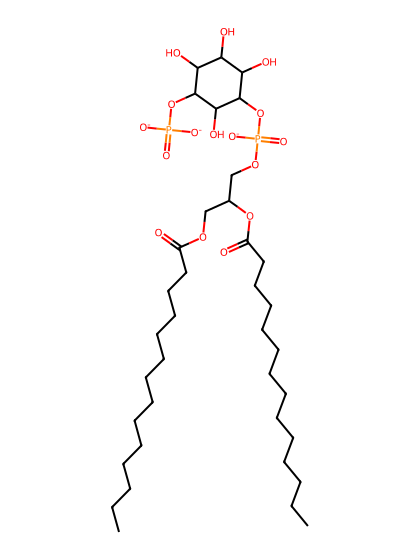
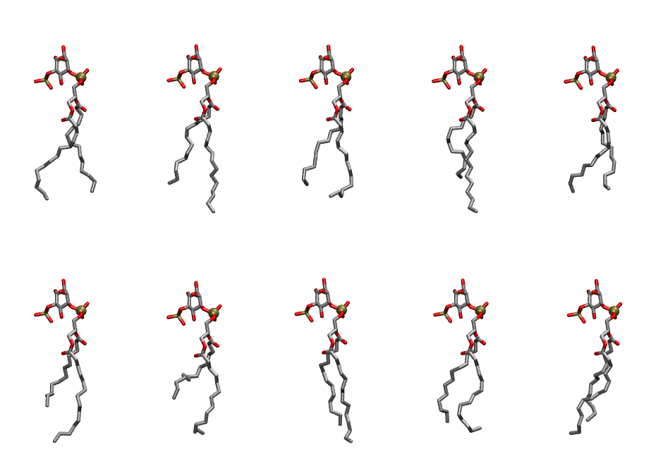
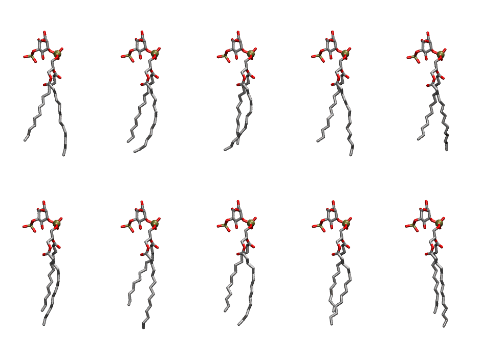

.. _lipid_gallery dmpi15:

DMPI15
======

**Di-myristoyl-inositol-(5)-phosphate (PIP1)**

==============  ============================================
CHARMM resname  ``DMPI15``
Net charge      -3.00
Atoms           124
Topology file   ``toppar_all36_lipid_inositol.str``
Conformers      10 fluid, 10 liquid-ordered (``DMPI15__Lo``)
==============  ============================================

Structure
---------

Conformers
----------

The grid packer draws a conformer per lipid from an ensemble, so what the ensemble contains is what a built bilayer is made of. DMPI15 ships two: a fluid one, used by default, and a liquid-ordered one, used for a leaflet declared ``phase: Lo``. All conformers on this page are rendered at one shared scale.

Fluid (``DMPI15``)
~~~~~~~~~~~~~~~~~~

=============  =============  ================  ================
Conformer      Head-tail (Å)  Max internal (Å)  Min chain extent
=============  =============  ================  ================
``DMPI15-00``  10.91          24.38             0.74
``DMPI15-01``  9.82           26.94             0.73
``DMPI15-02``  9.96           24.79             0.73
``DMPI15-03``  8.79           26.80             0.66
``DMPI15-04``  10.48          23.54             0.67
``DMPI15-05``  7.98           25.89             0.61
``DMPI15-06``  6.44           24.40             0.52
``DMPI15-07``  10.99          26.31             0.80
``DMPI15-08``  10.43          24.51             0.71
``DMPI15-09``  10.16          24.55             0.75
=============  =============  ================  ================

Liquid-ordered (``DMPI15__Lo``)
~~~~~~~~~~~~~~~~~~~~~~~~~~~~~~~

=============  =============  ================  ================
Conformer      Head-tail (Å)  Max internal (Å)  Min chain extent
=============  =============  ================  ================
``DMPI15-00``  11.75          27.36             0.84
``DMPI15-01``  12.09          26.66             0.86
``DMPI15-02``  12.45          25.90             0.85
``DMPI15-03``  11.95          27.40             0.85
``DMPI15-04``  11.36          26.23             0.82
``DMPI15-05``  11.85          26.81             0.85
``DMPI15-06``  10.60          27.81             0.77
``DMPI15-07``  12.04          27.20             0.86
``DMPI15-08``  12.06          27.00             0.86
``DMPI15-09``  12.37          27.85             0.88
=============  =============  ================  ================

*Min chain extent* is how far the least-extended acyl chain descends below its own attachment carbon, as a fraction of that chain's all-trans contour; an all-trans chain scores 1.0, and a conformer under 0.25 is rejected at generation as folded.

Provenance
----------

How each ensemble was generated, read from the entry's own ``info.yaml``:

===================  ============  ==============
Setting              ``DMPI15``    ``DMPI15__Lo``
===================  ============  ==============
Sampler              ``mc``        ``mc``
Phase                none (fluid)  Lo
Trans bias           0.0           10.0
Chain order          0.185         0.314
MC seed              0             0
Chains               2             2
Cylinder APL         60.0 Ų       60.0 Ų
Cylinder inflation   1.9           1.9
Equilibration steps  20000         20000
Decorrelation steps  3000          3000
Max MC angle         30°           30°
Radius scale         0.8           0.8
Axial bias           1.0           1.0
===================  ============  ==============
