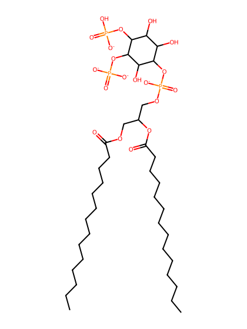
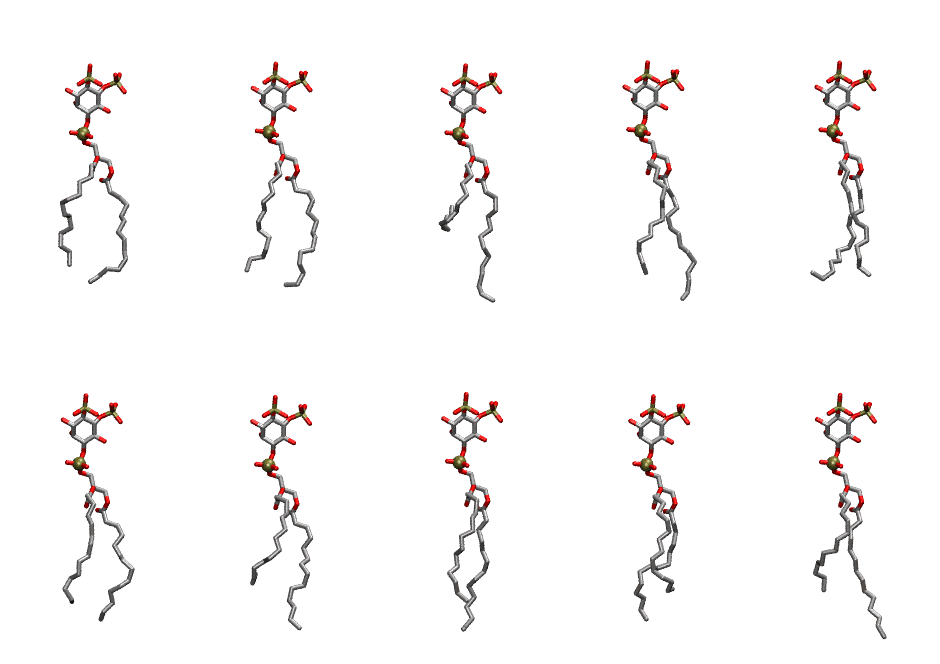
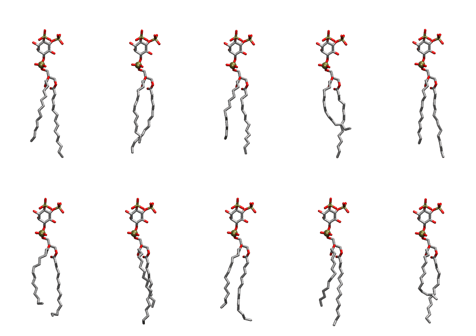

.. _lipid_gallery dmpi24:

DMPI24
======

**Di-myristoyl-inositol-(4,5)-bisphosphate (PIP2) with protonation on P4**

==============  ============================================
CHARMM resname  ``DMPI24``
Net charge      -4.00
Atoms           128
Topology file   ``toppar_all36_lipid_inositol.str``
Conformers      10 fluid, 10 liquid-ordered (``DMPI24__Lo``)
==============  ============================================

Structure
---------

Conformers
----------

The grid packer draws a conformer per lipid from an ensemble, so what the ensemble contains is what a built bilayer is made of. DMPI24 ships two: a fluid one, used by default, and a liquid-ordered one, used for a leaflet declared ``phase: Lo``. All conformers on this page are rendered at one shared scale.

Fluid (``DMPI24``)
~~~~~~~~~~~~~~~~~~

=============  =============  ================  ================
Conformer      Head-tail (Å)  Max internal (Å)  Min chain extent
=============  =============  ================  ================
``DMPI24-00``  10.11          26.56             0.70
``DMPI24-01``  11.00          27.60             0.76
``DMPI24-02``  3.23           29.41             0.29
``DMPI24-03``  11.46          29.72             0.79
``DMPI24-04``  11.43          26.77             0.69
``DMPI24-05``  10.95          27.83             0.76
``DMPI24-06``  8.55           28.82             0.61
``DMPI24-07``  10.99          29.71             0.76
``DMPI24-08``  9.32           28.18             0.66
``DMPI24-09``  9.63           30.10             0.68
=============  =============  ================  ================

Liquid-ordered (``DMPI24__Lo``)
~~~~~~~~~~~~~~~~~~~~~~~~~~~~~~~

=============  =============  ================  ================
Conformer      Head-tail (Å)  Max internal (Å)  Min chain extent
=============  =============  ================  ================
``DMPI24-00``  12.45          31.61             0.85
``DMPI24-01``  12.70          30.18             0.86
``DMPI24-02``  11.75          29.79             0.80
``DMPI24-03``  9.29           30.90             0.65
``DMPI24-04``  13.04          31.75             0.88
``DMPI24-05``  10.99          29.02             0.76
``DMPI24-06``  11.78          31.02             0.81
``DMPI24-07``  11.99          30.22             0.82
``DMPI24-08``  11.57          31.10             0.79
``DMPI24-09``  9.87           29.93             0.69
=============  =============  ================  ================

*Min chain extent* is how far the least-extended acyl chain descends below its own attachment carbon, as a fraction of that chain's all-trans contour; an all-trans chain scores 1.0, and a conformer under 0.25 is rejected at generation as folded.

Provenance
----------

How each ensemble was generated, read from the entry's own ``info.yaml``:

===================  ============  ==============
Setting              ``DMPI24``    ``DMPI24__Lo``
===================  ============  ==============
Sampler              ``mc``        ``mc``
Phase                none (fluid)  Lo
Trans bias           0.0           4.375
Chain order          0.210         0.314
MC seed              0             0
Chains               2             2
Cylinder APL         60.0 Ų       60.0 Ų
Cylinder inflation   1.9           1.9
Equilibration steps  20000         20000
Decorrelation steps  3000          3000
Max MC angle         30°           30°
Radius scale         0.8           0.8
Axial bias           1.0           1.0
===================  ============  ==============
