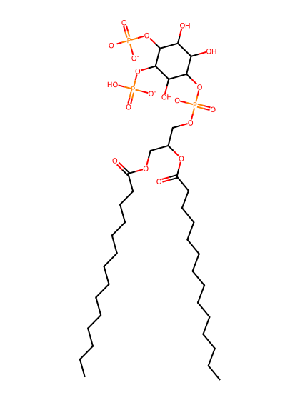
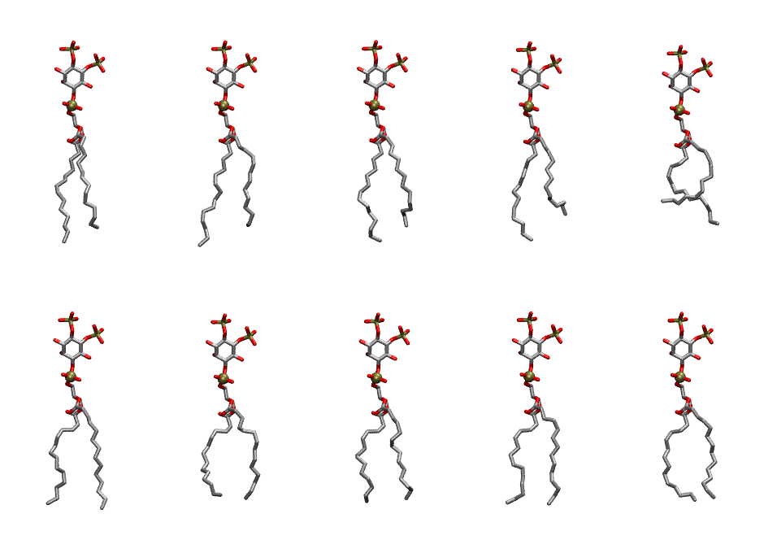
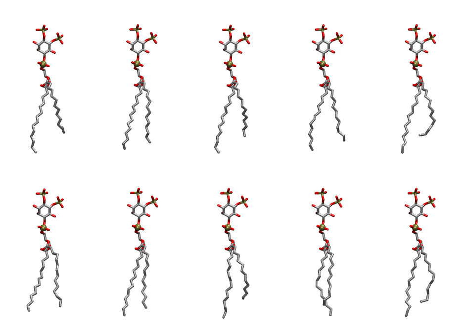

.. _lipid_gallery dmpi25:

DMPI25
======

**Di-myristoyl-inositol-(4,5)-bisphosphate (PIP2) with protonation on P5**

==============  ============================================
CHARMM resname  ``DMPI25``
Net charge      -4.00
Atoms           128
Topology file   ``toppar_all36_lipid_inositol.str``
Conformers      10 fluid, 10 liquid-ordered (``DMPI25__Lo``)
==============  ============================================

Structure
---------

Conformers
----------

The grid packer draws a conformer per lipid from an ensemble, so what the ensemble contains is what a built bilayer is made of. DMPI25 ships two: a fluid one, used by default, and a liquid-ordered one, used for a leaflet declared ``phase: Lo``. All conformers on this page are rendered at one shared scale.

Fluid (``DMPI25``)
~~~~~~~~~~~~~~~~~~

=============  =============  ================  ================
Conformer      Head-tail (Å)  Max internal (Å)  Min chain extent
=============  =============  ================  ================
``DMPI25-00``  12.50          29.51             0.80
``DMPI25-01``  12.17          30.73             0.78
``DMPI25-02``  12.27          30.19             0.79
``DMPI25-03``  10.44          29.56             0.68
``DMPI25-04``  8.05           27.30             0.53
``DMPI25-05``  13.18          29.46             0.78
``DMPI25-06``  11.68          27.48             0.69
``DMPI25-07``  12.30          28.10             0.75
``DMPI25-08``  13.11          28.48             0.77
``DMPI25-09``  12.26          28.35             0.75
=============  =============  ================  ================

Liquid-ordered (``DMPI25__Lo``)
~~~~~~~~~~~~~~~~~~~~~~~~~~~~~~~

=============  =============  ================  ================
Conformer      Head-tail (Å)  Max internal (Å)  Min chain extent
=============  =============  ================  ================
``DMPI25-00``  11.15          31.26             0.72
``DMPI25-01``  13.59          30.47             0.87
``DMPI25-02``  11.96          31.48             0.77
``DMPI25-03``  13.13          30.97             0.84
``DMPI25-04``  11.89          31.21             0.76
``DMPI25-05``  13.51          29.91             0.86
``DMPI25-06``  13.99          31.06             0.89
``DMPI25-07``  11.76          31.97             0.76
``DMPI25-08``  13.27          30.91             0.85
``DMPI25-09``  12.52          31.01             0.80
=============  =============  ================  ================

*Min chain extent* is how far the least-extended acyl chain descends below its own attachment carbon, as a fraction of that chain's all-trans contour; an all-trans chain scores 1.0, and a conformer under 0.25 is rejected at generation as folded.

Provenance
----------

How each ensemble was generated, read from the entry's own ``info.yaml``:

===================  ============  ==============
Setting              ``DMPI25``    ``DMPI25__Lo``
===================  ============  ==============
Sampler              ``mc``        ``mc``
Phase                none (fluid)  Lo
Trans bias           0.0           5.0
Chain order          0.205         0.303
MC seed              0             0
Chains               2             2
Cylinder APL         60.0 Ų       60.0 Ų
Cylinder inflation   1.9           1.9
Equilibration steps  20000         20000
Decorrelation steps  3000          3000
Max MC angle         30°           30°
Radius scale         0.8           0.8
Axial bias           1.0           1.0
===================  ============  ==============
