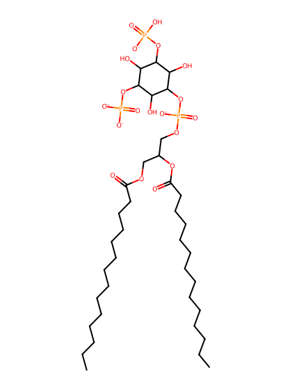
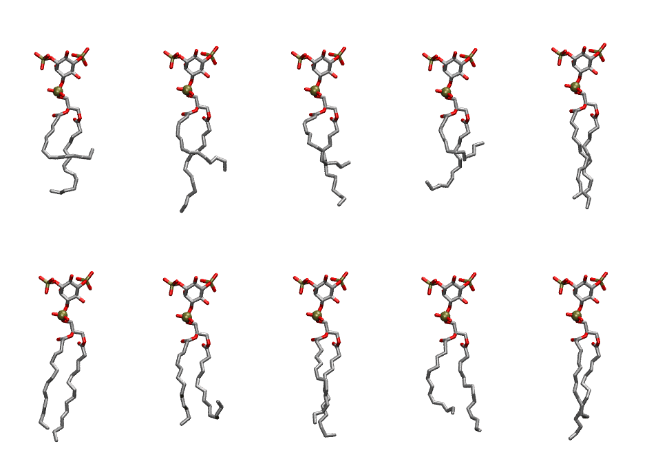
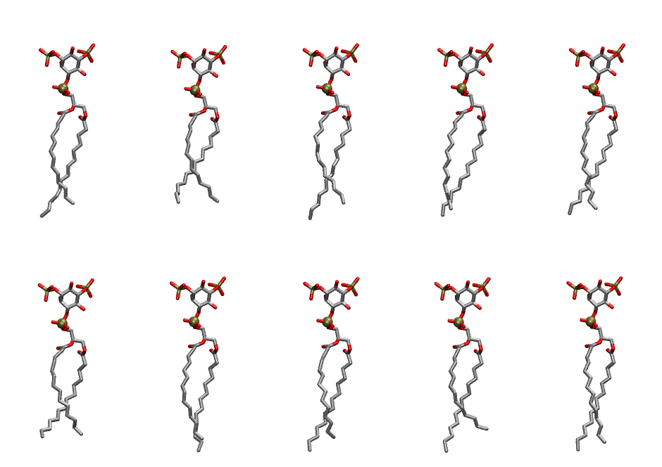

.. _lipid_gallery dmpi2a:

DMPI2A
======

**Di-myristoyl-inositol-(3,5)-trisphosphate (PIP2) with protonation on P3**

==============  ============================================
CHARMM resname  ``DMPI2A``
Net charge      -4.00
Atoms           128
Topology file   ``toppar_all36_lipid_inositol.str``
Conformers      10 fluid, 10 liquid-ordered (``DMPI2A__Lo``)
==============  ============================================

Structure
---------

Conformers
----------

The grid packer draws a conformer per lipid from an ensemble, so what the ensemble contains is what a built bilayer is made of. DMPI2A ships two: a fluid one, used by default, and a liquid-ordered one, used for a leaflet declared ``phase: Lo``. All conformers on this page are rendered at one shared scale.

Fluid (``DMPI2A``)
~~~~~~~~~~~~~~~~~~

=============  =============  ================  ================
Conformer      Head-tail (Å)  Max internal (Å)  Min chain extent
=============  =============  ================  ================
``DMPI2A-00``  4.80           24.76             0.33
``DMPI2A-01``  8.25           27.95             0.54
``DMPI2A-02``  6.98           26.53             0.46
``DMPI2A-03``  3.64           23.99             0.26
``DMPI2A-04``  13.15          27.15             0.84
``DMPI2A-05``  13.49          28.28             0.86
``DMPI2A-06``  8.98           25.43             0.52
``DMPI2A-07``  12.56          27.64             0.80
``DMPI2A-08``  10.90          26.80             0.70
``DMPI2A-09``  11.62          28.18             0.75
=============  =============  ================  ================

Liquid-ordered (``DMPI2A__Lo``)
~~~~~~~~~~~~~~~~~~~~~~~~~~~~~~~

=============  =============  ================  ================
Conformer      Head-tail (Å)  Max internal (Å)  Min chain extent
=============  =============  ================  ================
``DMPI2A-00``  13.41          28.61             0.85
``DMPI2A-01``  12.82          26.62             0.76
``DMPI2A-02``  13.35          28.67             0.85
``DMPI2A-03``  14.27          28.10             0.90
``DMPI2A-04``  14.18          28.06             0.88
``DMPI2A-05``  12.75          26.54             0.77
``DMPI2A-06``  13.74          28.00             0.87
``DMPI2A-07``  13.47          28.45             0.86
``DMPI2A-08``  12.14          28.32             0.78
``DMPI2A-09``  14.31          28.20             0.91
=============  =============  ================  ================

*Min chain extent* is how far the least-extended acyl chain descends below its own attachment carbon, as a fraction of that chain's all-trans contour; an all-trans chain scores 1.0, and a conformer under 0.25 is rejected at generation as folded.

Provenance
----------

How each ensemble was generated, read from the entry's own ``info.yaml``:

===================  ============  ==============
Setting              ``DMPI2A``    ``DMPI2A__Lo``
===================  ============  ==============
Sampler              ``mc``        ``mc``
Phase                none (fluid)  Lo
Trans bias           0.0           20.0
Chain order          0.183         0.306
MC seed              0             0
Chains               2             2
Cylinder APL         60.0 Ų       60.0 Ų
Cylinder inflation   1.9           1.9
Equilibration steps  20000         20000
Decorrelation steps  3000          3000
Max MC angle         30°           30°
Radius scale         0.8           0.8
Axial bias           1.0           1.0
===================  ============  ==============
