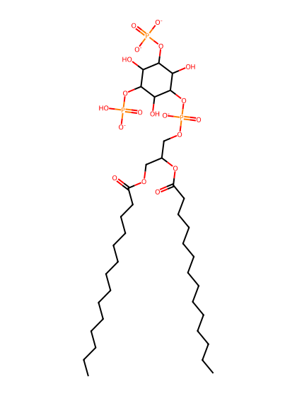
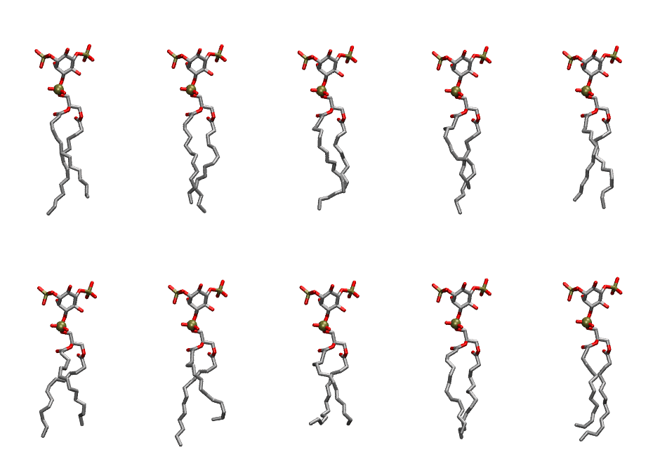
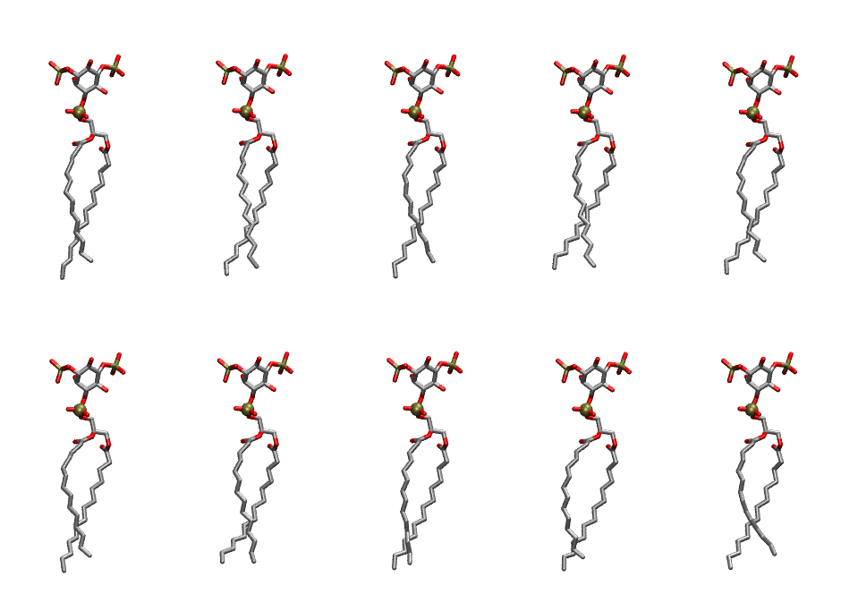

.. _lipid_gallery dmpi2b:

DMPI2B
======

**Di-myristoyl-inositol-(3,5)-bisphosphate (PIP2) with protonation on P5**

==============  ============================================
CHARMM resname  ``DMPI2B``
Net charge      -4.00
Atoms           128
Topology file   ``toppar_all36_lipid_inositol.str``
Conformers      10 fluid, 10 liquid-ordered (``DMPI2B__Lo``)
==============  ============================================

Structure
---------

Conformers
----------

The grid packer draws a conformer per lipid from an ensemble, so what the ensemble contains is what a built bilayer is made of. DMPI2B ships two: a fluid one, used by default, and a liquid-ordered one, used for a leaflet declared ``phase: Lo``. All conformers on this page are rendered at one shared scale.

Fluid (``DMPI2B``)
~~~~~~~~~~~~~~~~~~

=============  =============  ================  ================
Conformer      Head-tail (Å)  Max internal (Å)  Min chain extent
=============  =============  ================  ================
``DMPI2B-00``  12.22          27.70             0.78
``DMPI2B-01``  13.09          27.53             0.84
``DMPI2B-02``  11.19          26.59             0.72
``DMPI2B-03``  10.51          26.88             0.68
``DMPI2B-04``  12.49          25.86             0.80
``DMPI2B-05``  10.77          25.64             0.69
``DMPI2B-06``  10.21          27.22             0.66
``DMPI2B-07``  10.76          24.57             0.62
``DMPI2B-08``  12.54          26.43             0.78
``DMPI2B-09``  11.51          26.86             0.74
=============  =============  ================  ================

Liquid-ordered (``DMPI2B__Lo``)
~~~~~~~~~~~~~~~~~~~~~~~~~~~~~~~

=============  =============  ================  ================
Conformer      Head-tail (Å)  Max internal (Å)  Min chain extent
=============  =============  ================  ================
``DMPI2B-00``  13.67          28.50             0.87
``DMPI2B-01``  14.46          28.39             0.90
``DMPI2B-02``  13.75          28.56             0.87
``DMPI2B-03``  14.26          27.75             0.85
``DMPI2B-04``  13.53          28.14             0.86
``DMPI2B-05``  13.29          28.04             0.85
``DMPI2B-06``  14.09          27.35             0.83
``DMPI2B-07``  14.34          27.84             0.88
``DMPI2B-08``  13.51          27.96             0.86
``DMPI2B-09``  13.15          27.85             0.84
=============  =============  ================  ================

*Min chain extent* is how far the least-extended acyl chain descends below its own attachment carbon, as a fraction of that chain's all-trans contour; an all-trans chain scores 1.0, and a conformer under 0.25 is rejected at generation as folded.

Provenance
----------

How each ensemble was generated, read from the entry's own ``info.yaml``:

===================  ============  ==============
Setting              ``DMPI2B``    ``DMPI2B__Lo``
===================  ============  ==============
Sampler              ``mc``        ``mc``
Phase                none (fluid)  Lo
Trans bias           0.0           40.0
Chain order          0.195         0.320
MC seed              0             0
Chains               2             2
Cylinder APL         60.0 Ų       60.0 Ų
Cylinder inflation   1.9           1.9
Equilibration steps  20000         20000
Decorrelation steps  3000          3000
Max MC angle         30°           30°
Radius scale         0.8           0.8
Axial bias           1.0           1.0
===================  ============  ==============
