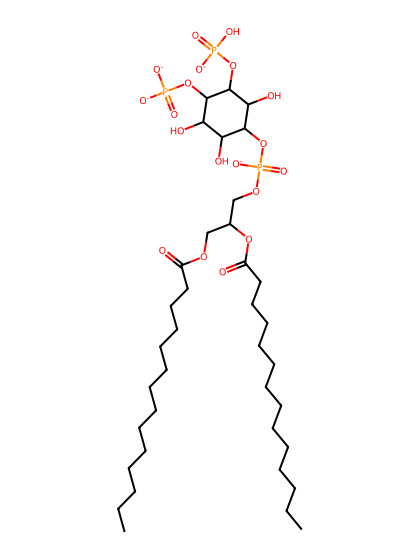
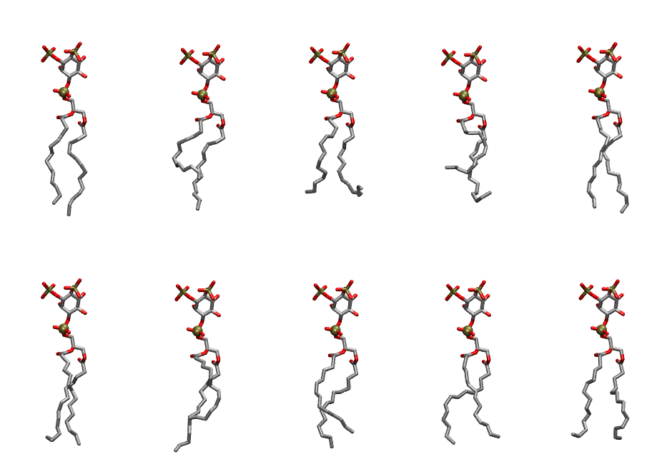
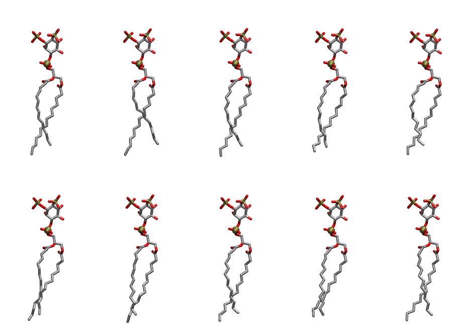

.. _lipid_gallery dmpi2c:

DMPI2C
======

**Di-myristoyl-inositol-(3,4)-bisphosphate (PIP2) with protonation on P3**

==============  ============================================
CHARMM resname  ``DMPI2C``
Net charge      -4.00
Atoms           128
Topology file   ``toppar_all36_lipid_inositol.str``
Conformers      10 fluid, 10 liquid-ordered (``DMPI2C__Lo``)
==============  ============================================

Structure
---------

Conformers
----------

The grid packer draws a conformer per lipid from an ensemble, so what the ensemble contains is what a built bilayer is made of. DMPI2C ships two: a fluid one, used by default, and a liquid-ordered one, used for a leaflet declared ``phase: Lo``. All conformers on this page are rendered at one shared scale.

Fluid (``DMPI2C``)
~~~~~~~~~~~~~~~~~~

=============  =============  ================  ================
Conformer      Head-tail (Å)  Max internal (Å)  Min chain extent
=============  =============  ================  ================
``DMPI2C-00``  12.39          27.53             0.81
``DMPI2C-01``  8.19           26.31             0.55
``DMPI2C-02``  9.96           25.19             0.58
``DMPI2C-03``  6.36           24.65             0.44
``DMPI2C-04``  12.94          27.30             0.80
``DMPI2C-05``  12.51          26.44             0.73
``DMPI2C-06``  8.71           27.84             0.59
``DMPI2C-07``  10.95          27.06             0.72
``DMPI2C-08``  11.65          26.81             0.74
``DMPI2C-09``  11.44          26.08             0.70
=============  =============  ================  ================

Liquid-ordered (``DMPI2C__Lo``)
~~~~~~~~~~~~~~~~~~~~~~~~~~~~~~~

=============  =============  ================  ================
Conformer      Head-tail (Å)  Max internal (Å)  Min chain extent
=============  =============  ================  ================
``DMPI2C-00``  13.05          28.84             0.85
``DMPI2C-01``  12.90          29.34             0.84
``DMPI2C-02``  13.33          29.75             0.87
``DMPI2C-03``  13.50          28.64             0.85
``DMPI2C-04``  13.02          29.18             0.85
``DMPI2C-05``  13.70          29.49             0.88
``DMPI2C-06``  13.89          29.48             0.90
``DMPI2C-07``  13.46          29.45             0.87
``DMPI2C-08``  13.77          28.10             0.83
``DMPI2C-09``  13.99          29.22             0.89
=============  =============  ================  ================

*Min chain extent* is how far the least-extended acyl chain descends below its own attachment carbon, as a fraction of that chain's all-trans contour; an all-trans chain scores 1.0, and a conformer under 0.25 is rejected at generation as folded.

Provenance
----------

How each ensemble was generated, read from the entry's own ``info.yaml``:

===================  ============  ==============
Setting              ``DMPI2C``    ``DMPI2C__Lo``
===================  ============  ==============
Sampler              ``mc``        ``mc``
Phase                none (fluid)  Lo
Trans bias           0.0           20.0
Chain order          0.164         0.315
MC seed              0             0
Chains               2             2
Cylinder APL         60.0 Ų       60.0 Ų
Cylinder inflation   1.9           1.9
Equilibration steps  20000         20000
Decorrelation steps  3000          3000
Max MC angle         30°           30°
Radius scale         0.8           0.8
Axial bias           1.0           1.0
===================  ============  ==============
