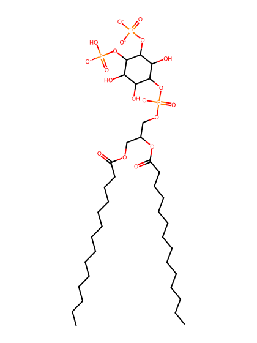
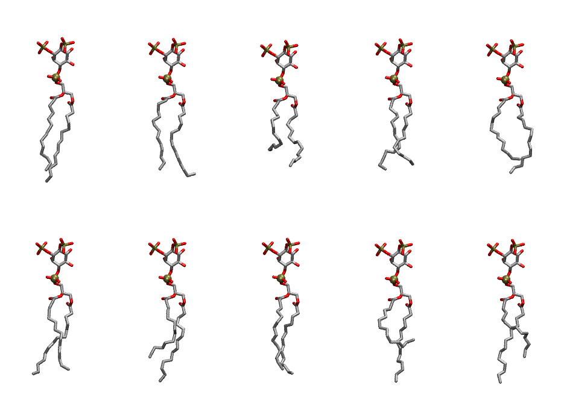
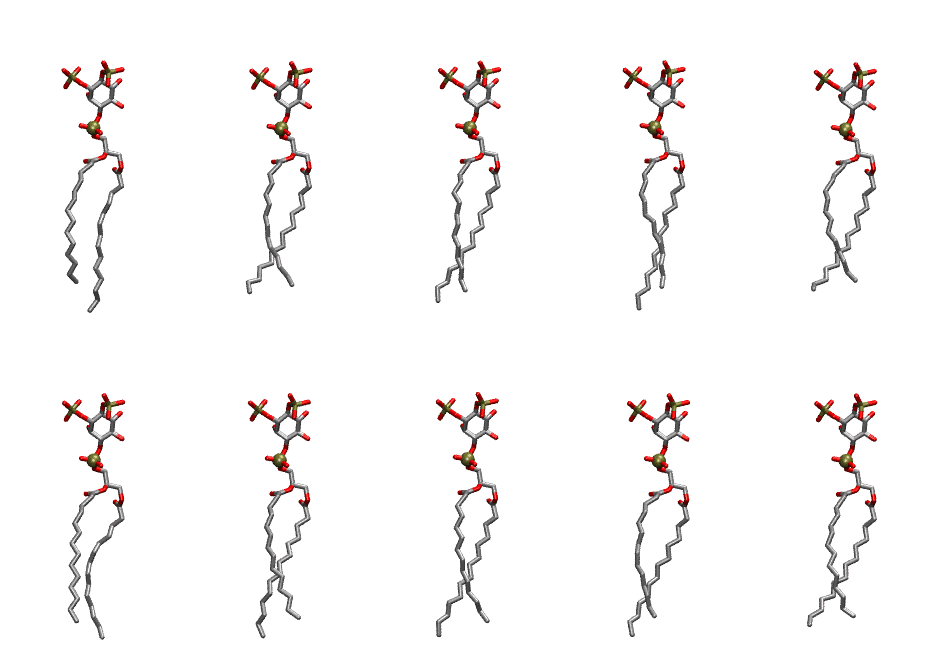

.. _lipid_gallery dmpi2d:

DMPI2D
======

**Di-myristoyl-inositol-(3,4)-bisphosphate (PIP2) with protonation on P4**

==============  ============================================
CHARMM resname  ``DMPI2D``
Net charge      -4.00
Atoms           128
Topology file   ``toppar_all36_lipid_inositol.str``
Conformers      10 fluid, 10 liquid-ordered (``DMPI2D__Lo``)
==============  ============================================

Structure
---------

Conformers
----------

The grid packer draws a conformer per lipid from an ensemble, so what the ensemble contains is what a built bilayer is made of. DMPI2D ships two: a fluid one, used by default, and a liquid-ordered one, used for a leaflet declared ``phase: Lo``. All conformers on this page are rendered at one shared scale.

Fluid (``DMPI2D``)
~~~~~~~~~~~~~~~~~~

=============  =============  ================  ================
Conformer      Head-tail (Å)  Max internal (Å)  Min chain extent
=============  =============  ================  ================
``DMPI2D-00``  12.94          29.10             0.84
``DMPI2D-01``  12.60          27.82             0.79
``DMPI2D-02``  8.49           25.22             0.57
``DMPI2D-03``  11.60          25.94             0.73
``DMPI2D-04``  10.45          26.64             0.69
``DMPI2D-05``  12.68          27.72             0.79
``DMPI2D-06``  10.25          29.16             0.68
``DMPI2D-07``  12.63          27.04             0.79
``DMPI2D-08``  6.77           28.09             0.47
``DMPI2D-09``  10.03          28.56             0.67
=============  =============  ================  ================

Liquid-ordered (``DMPI2D__Lo``)
~~~~~~~~~~~~~~~~~~~~~~~~~~~~~~~

=============  =============  ================  ================
Conformer      Head-tail (Å)  Max internal (Å)  Min chain extent
=============  =============  ================  ================
``DMPI2D-00``  13.02          30.76             0.85
``DMPI2D-01``  13.29          28.07             0.83
``DMPI2D-02``  14.00          29.12             0.90
``DMPI2D-03``  13.60          29.79             0.88
``DMPI2D-04``  12.66          27.37             0.80
``DMPI2D-05``  13.79          29.50             0.89
``DMPI2D-06``  13.41          29.43             0.87
``DMPI2D-07``  13.93          29.35             0.90
``DMPI2D-08``  13.18          29.31             0.86
``DMPI2D-09``  13.14          28.00             0.83
=============  =============  ================  ================

*Min chain extent* is how far the least-extended acyl chain descends below its own attachment carbon, as a fraction of that chain's all-trans contour; an all-trans chain scores 1.0, and a conformer under 0.25 is rejected at generation as folded.

Provenance
----------

How each ensemble was generated, read from the entry's own ``info.yaml``:

===================  ============  ==============
Setting              ``DMPI2D``    ``DMPI2D__Lo``
===================  ============  ==============
Sampler              ``mc``        ``mc``
Phase                none (fluid)  Lo
Trans bias           0.0           20.0
Chain order          0.194         0.313
MC seed              0             0
Chains               2             2
Cylinder APL         60.0 Ų       60.0 Ų
Cylinder inflation   1.9           1.9
Equilibration steps  20000         20000
Decorrelation steps  3000          3000
Max MC angle         30°           30°
Radius scale         0.8           0.8
Axial bias           1.0           1.0
===================  ============  ==============
