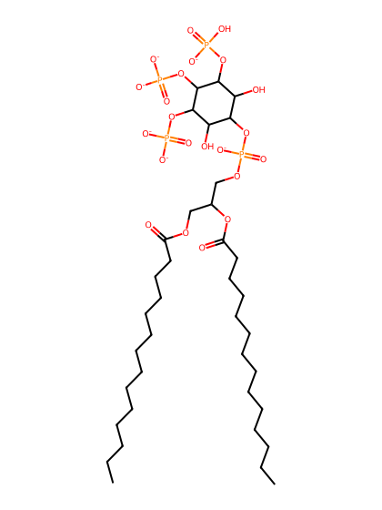
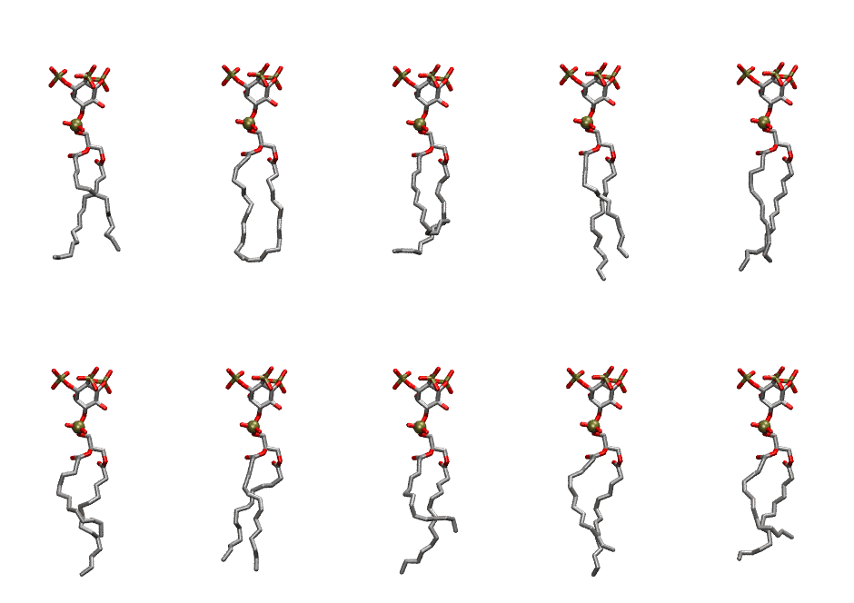
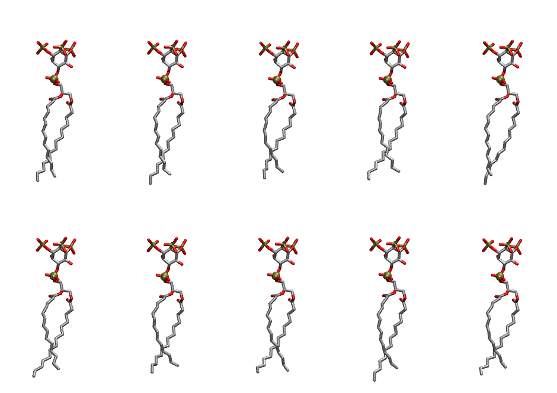

.. _lipid_gallery dmpi33:

DMPI33
======

**Di-myristoyl-inositol-(3,4,5)-trisphosphate (PIP3) with protonation on P3**

==============  ============================================
CHARMM resname  ``DMPI33``
Net charge      -6.00
Atoms           131
Topology file   ``toppar_all36_lipid_inositol.str``
Conformers      10 fluid, 10 liquid-ordered (``DMPI33__Lo``)
==============  ============================================

Structure
---------

Conformers
----------

The grid packer draws a conformer per lipid from an ensemble, so what the ensemble contains is what a built bilayer is made of. DMPI33 ships two: a fluid one, used by default, and a liquid-ordered one, used for a leaflet declared ``phase: Lo``. All conformers on this page are rendered at one shared scale.

Fluid (``DMPI33``)
~~~~~~~~~~~~~~~~~~

=============  =============  ================  ================
Conformer      Head-tail (Å)  Max internal (Å)  Min chain extent
=============  =============  ================  ================
``DMPI33-00``  11.08          25.83             0.70
``DMPI33-01``  12.18          26.52             0.71
``DMPI33-02``  7.59           25.55             0.50
``DMPI33-03``  12.23          28.30             0.79
``DMPI33-04``  12.84          27.71             0.82
``DMPI33-05``  9.05           27.85             0.59
``DMPI33-06``  12.16          26.26             0.71
``DMPI33-07``  8.48           27.42             0.56
``DMPI33-08``  10.99          27.39             0.71
``DMPI33-09``  9.36           25.88             0.61
=============  =============  ================  ================

Liquid-ordered (``DMPI33__Lo``)
~~~~~~~~~~~~~~~~~~~~~~~~~~~~~~~

=============  =============  ================  ================
Conformer      Head-tail (Å)  Max internal (Å)  Min chain extent
=============  =============  ================  ================
``DMPI33-00``  14.18          28.73             0.88
``DMPI33-01``  13.79          29.09             0.88
``DMPI33-02``  13.13          27.66             0.84
``DMPI33-03``  13.12          28.22             0.84
``DMPI33-04``  13.86          29.12             0.88
``DMPI33-05``  13.33          28.44             0.85
``DMPI33-06``  12.60          27.18             0.81
``DMPI33-07``  13.65          27.64             0.82
``DMPI33-08``  13.21          29.14             0.84
``DMPI33-09``  12.96          28.10             0.83
=============  =============  ================  ================

*Min chain extent* is how far the least-extended acyl chain descends below its own attachment carbon, as a fraction of that chain's all-trans contour; an all-trans chain scores 1.0, and a conformer under 0.25 is rejected at generation as folded.

Provenance
----------

How each ensemble was generated, read from the entry's own ``info.yaml``:

===================  ============  ==============
Setting              ``DMPI33``    ``DMPI33__Lo``
===================  ============  ==============
Sampler              ``mc``        ``mc``
Phase                none (fluid)  Lo
Trans bias           0.0           40.0
Chain order          0.176         0.293
MC seed              0             0
Chains               2             2
Cylinder APL         60.0 Ų       60.0 Ų
Cylinder inflation   1.9           1.9
Equilibration steps  20000         20000
Decorrelation steps  3000          3000
Max MC angle         30°           30°
Radius scale         0.8           0.8
Axial bias           1.0           1.0
===================  ============  ==============
