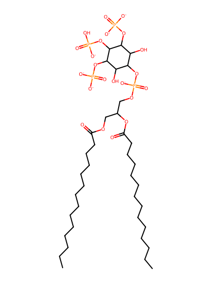
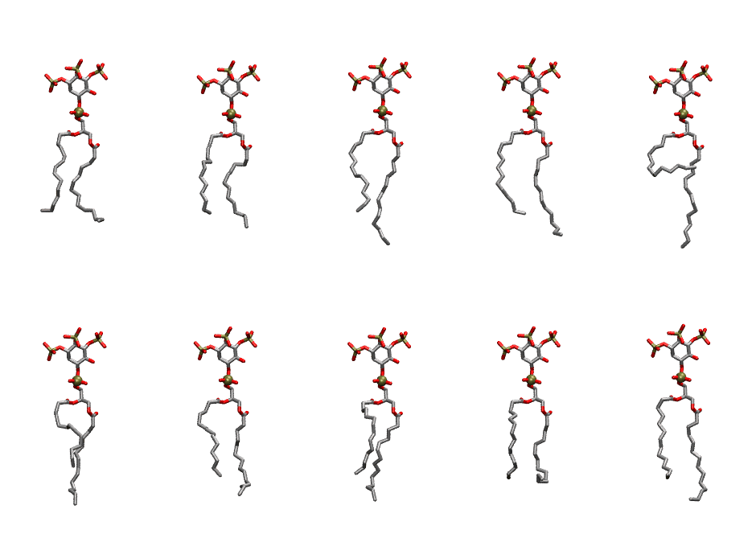
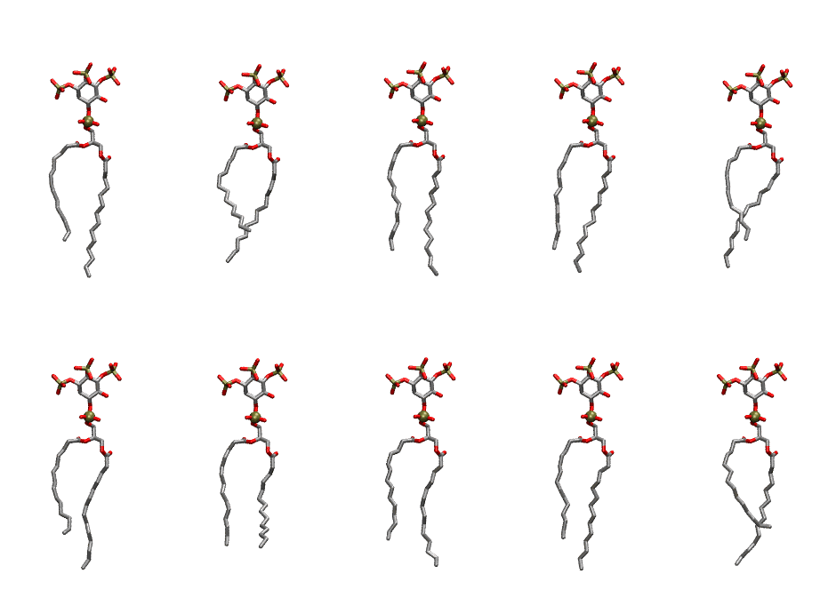

.. _lipid_gallery dmpi34:

DMPI34
======

**Di-myristoyl-inositol-(3,4,5)-trisphosphate (PIP3) with protonation on P4**

==============  ============================================
CHARMM resname  ``DMPI34``
Net charge      -6.00
Atoms           131
Topology file   ``toppar_all36_lipid_inositol.str``
Conformers      10 fluid, 10 liquid-ordered (``DMPI34__Lo``)
==============  ============================================

Structure
---------

Conformers
----------

The grid packer draws a conformer per lipid from an ensemble, so what the ensemble contains is what a built bilayer is made of. DMPI34 ships two: a fluid one, used by default, and a liquid-ordered one, used for a leaflet declared ``phase: Lo``. All conformers on this page are rendered at one shared scale.

Fluid (``DMPI34``)
~~~~~~~~~~~~~~~~~~

=============  =============  ================  ================
Conformer      Head-tail (Å)  Max internal (Å)  Min chain extent
=============  =============  ================  ================
``DMPI34-00``  10.18          26.25             0.68
``DMPI34-01``  10.30          26.20             0.73
``DMPI34-02``  10.40          30.25             0.74
``DMPI34-03``  10.85          28.52             0.76
``DMPI34-04``  3.21           30.55             0.30
``DMPI34-05``  8.16           27.68             0.60
``DMPI34-06``  9.74           26.83             0.70
``DMPI34-07``  9.27           27.56             0.67
``DMPI34-08``  10.12          25.32             0.60
``DMPI34-09``  10.06          28.05             0.72
=============  =============  ================  ================

Liquid-ordered (``DMPI34__Lo``)
~~~~~~~~~~~~~~~~~~~~~~~~~~~~~~~

=============  =============  ================  ================
Conformer      Head-tail (Å)  Max internal (Å)  Min chain extent
=============  =============  ================  ================
``DMPI34-00``  11.53          31.05             0.80
``DMPI34-01``  9.98           28.94             0.71
``DMPI34-02``  12.97          31.00             0.89
``DMPI34-03``  12.77          30.89             0.88
``DMPI34-04``  11.18          29.91             0.78
``DMPI34-05``  11.26          31.12             0.79
``DMPI34-06``  12.75          27.50             0.76
``DMPI34-07``  12.10          30.07             0.84
``DMPI34-08``  11.92          31.09             0.83
``DMPI34-09``  10.37          30.20             0.73
=============  =============  ================  ================

*Min chain extent* is how far the least-extended acyl chain descends below its own attachment carbon, as a fraction of that chain's all-trans contour; an all-trans chain scores 1.0, and a conformer under 0.25 is rejected at generation as folded.

Provenance
----------

How each ensemble was generated, read from the entry's own ``info.yaml``:

===================  ============  ==============
Setting              ``DMPI34``    ``DMPI34__Lo``
===================  ============  ==============
Sampler              ``mc``        ``mc``
Phase                none (fluid)  Lo
Trans bias           0.0           10.0
Chain order          0.180         0.296
MC seed              0             0
Chains               2             2
Cylinder APL         60.0 Ų       60.0 Ų
Cylinder inflation   1.9           1.9
Equilibration steps  20000         20000
Decorrelation steps  3000          3000
Max MC angle         30°           30°
Radius scale         0.8           0.8
Axial bias           1.0           1.0
===================  ============  ==============
