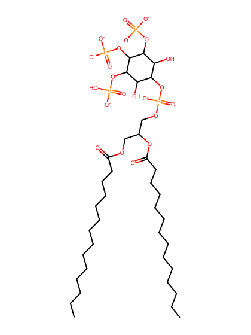
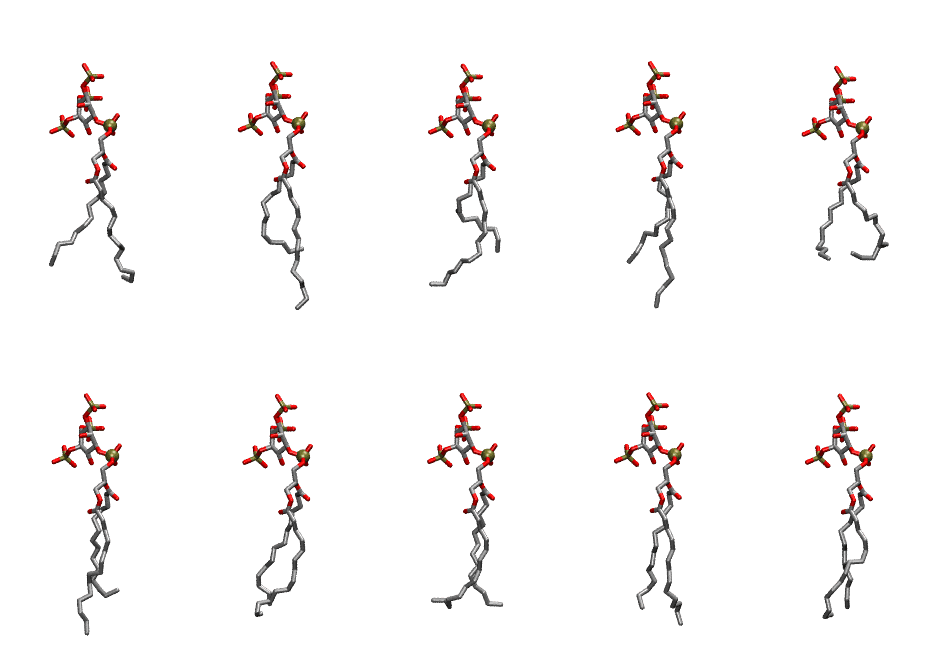
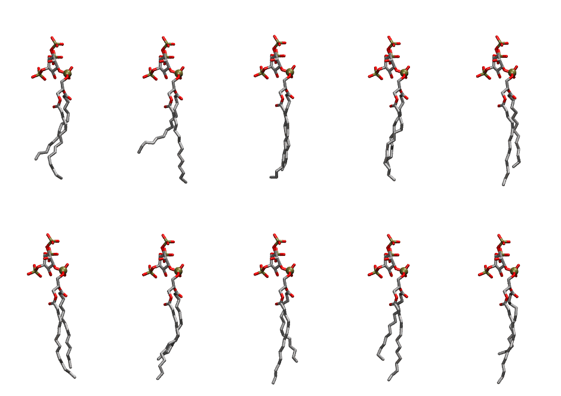

.. _lipid_gallery dmpi35:

DMPI35
======

**Di-myristoyl-inositol-(3,4,5)-trisphosphate (PIP3) with protonation on P5**

==============  ============================================
CHARMM resname  ``DMPI35``
Net charge      -6.00
Atoms           131
Topology file   ``toppar_all36_lipid_inositol.str``
Conformers      10 fluid, 10 liquid-ordered (``DMPI35__Lo``)
==============  ============================================

Structure
---------

Conformers
----------

The grid packer draws a conformer per lipid from an ensemble, so what the ensemble contains is what a built bilayer is made of. DMPI35 ships two: a fluid one, used by default, and a liquid-ordered one, used for a leaflet declared ``phase: Lo``. All conformers on this page are rendered at one shared scale.

Fluid (``DMPI35``)
~~~~~~~~~~~~~~~~~~

=============  =============  ================  ================
Conformer      Head-tail (Å)  Max internal (Å)  Min chain extent
=============  =============  ================  ================
``DMPI35-00``  9.82           27.08             0.70
``DMPI35-01``  8.24           30.25             0.64
``DMPI35-02``  8.14           27.24             0.63
``DMPI35-03``  9.72           29.57             0.73
``DMPI35-04``  8.23           24.03             0.51
``DMPI35-05``  9.33           28.89             0.70
``DMPI35-06``  10.87          27.20             0.74
``DMPI35-07``  10.55          26.42             0.65
``DMPI35-08``  11.47          28.12             0.82
``DMPI35-09``  11.26          27.41             0.75
=============  =============  ================  ================

Liquid-ordered (``DMPI35__Lo``)
~~~~~~~~~~~~~~~~~~~~~~~~~~~~~~~

=============  =============  ================  ================
Conformer      Head-tail (Å)  Max internal (Å)  Min chain extent
=============  =============  ================  ================
``DMPI35-00``  10.40          29.13             0.77
``DMPI35-01``  9.06           29.80             0.69
``DMPI35-02``  12.77          29.04             0.87
``DMPI35-03``  12.08          29.24             0.87
``DMPI35-04``  12.08          30.40             0.87
``DMPI35-05``  12.62          29.71             0.90
``DMPI35-06``  10.88          29.75             0.80
``DMPI35-07``  11.39          30.41             0.83
``DMPI35-08``  10.91          29.55             0.80
``DMPI35-09``  9.80           30.17             0.73
=============  =============  ================  ================

*Min chain extent* is how far the least-extended acyl chain descends below its own attachment carbon, as a fraction of that chain's all-trans contour; an all-trans chain scores 1.0, and a conformer under 0.25 is rejected at generation as folded.

Provenance
----------

How each ensemble was generated, read from the entry's own ``info.yaml``:

===================  ============  ==============
Setting              ``DMPI35``    ``DMPI35__Lo``
===================  ============  ==============
Sampler              ``mc``        ``mc``
Phase                none (fluid)  Lo
Trans bias           0.0           5.0
Chain order          0.203         0.296
MC seed              0             0
Chains               2             2
Cylinder APL         60.0 Ų       60.0 Ų
Cylinder inflation   1.9           1.9
Equilibration steps  20000         20000
Decorrelation steps  3000          3000
Max MC angle         30°           30°
Radius scale         0.8           0.8
Axial bias           1.0           1.0
===================  ============  ==============
