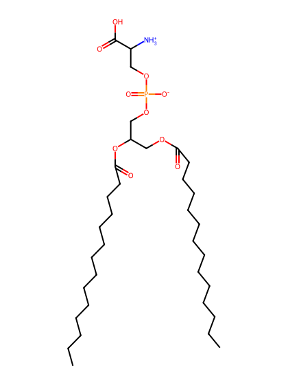
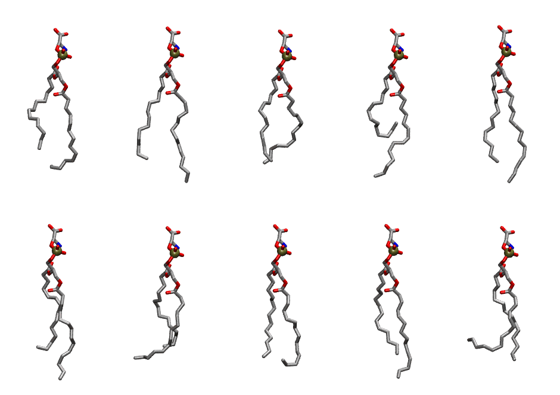
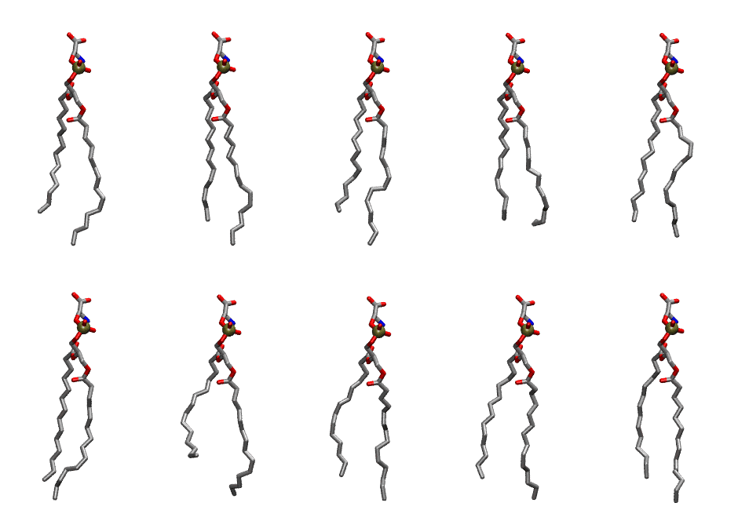

.. _lipid_gallery dmps:

DMPS
====

**2,3 dimyristoyl-D-glycero-1-Phosphatidylserine**

==============  ==========================================
CHARMM resname  ``DMPS``
Net charge      -1.00
Atoms           111
Topology file   ``top_all36_lipid.rtf``
Conformers      10 fluid, 10 liquid-ordered (``DMPS__Lo``)
==============  ==========================================

Structure
---------

Conformers
----------

The grid packer draws a conformer per lipid from an ensemble, so what the ensemble contains is what a built bilayer is made of. DMPS ships two: a fluid one, used by default, and a liquid-ordered one, used for a leaflet declared ``phase: Lo``. All conformers on this page are rendered at one shared scale.

Fluid (``DMPS``)
~~~~~~~~~~~~~~~~

===========  =============  ================  ================
Conformer    Head-tail (Å)  Max internal (Å)  Min chain extent
===========  =============  ================  ================
``DMPS-00``  8.70           23.44             0.72
``DMPS-01``  10.57          25.70             0.84
``DMPS-02``  10.43          22.81             0.66
``DMPS-03``  4.59           24.80             0.48
``DMPS-04``  11.29          26.04             0.89
``DMPS-05``  9.15           25.80             0.76
``DMPS-06``  8.65           22.82             0.65
``DMPS-07``  10.63          23.71             0.69
``DMPS-08``  10.17          25.84             0.82
``DMPS-09``  7.69           22.39             0.48
===========  =============  ================  ================

Liquid-ordered (``DMPS__Lo``)
~~~~~~~~~~~~~~~~~~~~~~~~~~~~~

===========  =============  ================  ================
Conformer    Head-tail (Å)  Max internal (Å)  Min chain extent
===========  =============  ================  ================
``DMPS-00``  11.21          26.32             0.88
``DMPS-01``  12.30          26.34             0.93
``DMPS-02``  11.10          26.70             0.88
``DMPS-03``  12.01          24.54             0.76
``DMPS-04``  12.19          25.22             0.86
``DMPS-05``  12.22          25.57             0.89
``DMPS-06``  8.96           25.47             0.75
``DMPS-07``  11.16          25.28             0.87
``DMPS-08``  11.57          25.70             0.87
``DMPS-09``  11.77          26.40             0.90
===========  =============  ================  ================

*Min chain extent* is how far the least-extended acyl chain descends below its own attachment carbon, as a fraction of that chain's all-trans contour; an all-trans chain scores 1.0, and a conformer under 0.25 is rejected at generation as folded.

Provenance
----------

How each ensemble was generated, read from the entry's own ``info.yaml``:

===================  ============  ============
Setting              ``DMPS``      ``DMPS__Lo``
===================  ============  ============
Sampler              ``mc``        ``mc``
Phase                none (fluid)  Lo
Trans bias           0.0           5.0
Chain order          0.220         0.320
MC seed              0             0
Chains               2             2
Cylinder APL         60.0 Ų       60.0 Ų
Cylinder inflation   1.9           1.9
Equilibration steps  20000         20000
Decorrelation steps  3000          3000
Max MC angle         30°           30°
Radius scale         0.8           0.8
Axial bias           1.0           1.0
===================  ============  ============
