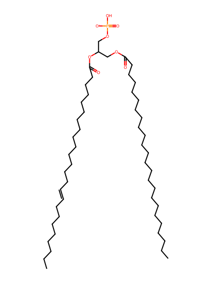
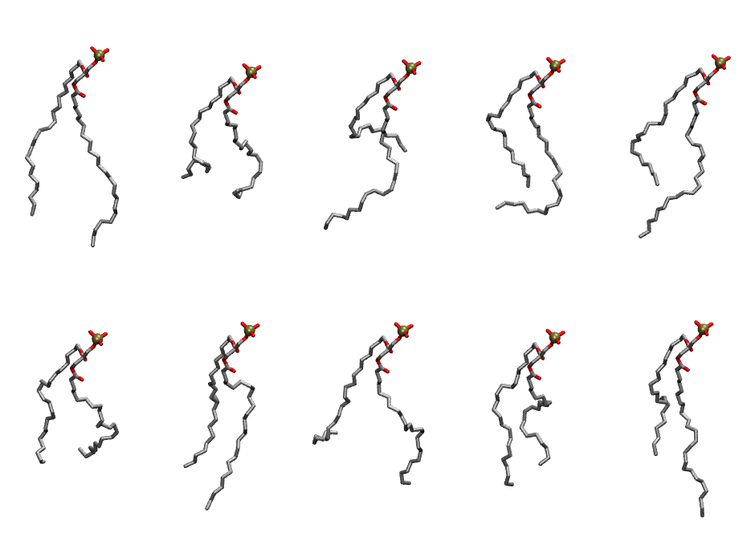

.. _lipid_gallery dnpa:

DNPA
====

**di-nervonic-phosphatidic acid (diC24:1)**

==============  ========================================
CHARMM resname  ``DNPA``
Net charge      -1.00
Atoms           156
Topology file   ``toppar_all36_lipid_miscellaneous.str``
Conformers      10 fluid
==============  ========================================

Structure
---------

Conformers
----------

The grid packer draws a conformer per lipid from this ensemble, so what the ensemble contains is what a built bilayer is made of. A leaflet declared ``phase: Lo`` generates an ordered ensemble when a build first needs it. All conformers are rendered at one shared scale.

===========  =============  ================  ================
Conformer    Head-tail (Å)  Max internal (Å)  Min chain extent
===========  =============  ================  ================
``DNPA-00``  17.45          33.73             0.73
``DNPA-01``  9.49           28.27             0.41
``DNPA-02``  6.14           32.30             0.35
``DNPA-03``  11.72          27.61             0.53
``DNPA-04``  11.89          32.91             0.54
``DNPA-05``  10.28          30.23             0.37
``DNPA-06``  13.99          31.34             0.61
``DNPA-07``  9.01           31.51             0.44
``DNPA-08``  12.63          29.89             0.45
``DNPA-09``  12.43          31.91             0.56
===========  =============  ================  ================

*Min chain extent* is how far the least-extended acyl chain descends below its own attachment carbon, as a fraction of that chain's all-trans contour; an all-trans chain scores 1.0, and a conformer under 0.25 is rejected at generation as folded.

Provenance
----------

How the ensemble was generated, read from the entry's own ``info.yaml``:

===================  ============
Setting              ``DNPA``
===================  ============
Sampler              ``mc``
Phase                none (fluid)
Trans bias           0.0
Chain order          0.073
MC seed              0
Chains               2
Cylinder APL         60.0 Ų
Cylinder inflation   1.9
Equilibration steps  20000
Decorrelation steps  3000
Max MC angle         30°
Radius scale         0.8
Axial bias           1.0
===================  ============
