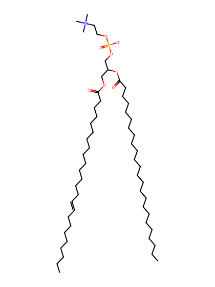
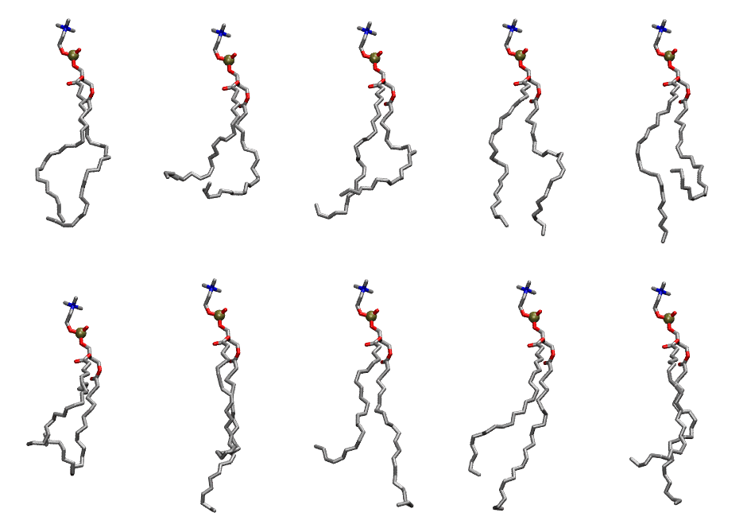

.. _lipid_gallery dnpc:

DNPC
====

**di-nervonic-phosphatidylcholine (diC24:1)**

==============  ========================================
CHARMM resname  ``DNPC``
Net charge      0.00
Atoms           174
Topology file   ``toppar_all36_lipid_miscellaneous.str``
Conformers      10 fluid
==============  ========================================

Structure
---------

Conformers
----------

The grid packer draws a conformer per lipid from this ensemble, so what the ensemble contains is what a built bilayer is made of. A leaflet declared ``phase: Lo`` generates an ordered ensemble when a build first needs it. All conformers are rendered at one shared scale.

===========  =============  ================  ================
Conformer    Head-tail (Å)  Max internal (Å)  Min chain extent
===========  =============  ================  ================
``DNPC-00``  17.14          34.08             0.59
``DNPC-01``  10.38          31.43             0.39
``DNPC-02``  13.29          31.74             0.46
``DNPC-03``  18.13          34.23             0.67
``DNPC-04``  10.10          33.97             0.35
``DNPC-05``  9.53           28.92             0.33
``DNPC-06``  13.36          36.33             0.55
``DNPC-07``  12.32          37.12             0.52
``DNPC-08``  16.34          35.62             0.65
``DNPC-09``  13.84          34.95             0.57
===========  =============  ================  ================

*Min chain extent* is how far the least-extended acyl chain descends below its own attachment carbon, as a fraction of that chain's all-trans contour; an all-trans chain scores 1.0, and a conformer under 0.25 is rejected at generation as folded.

Provenance
----------

How the ensemble was generated, read from the entry's own ``info.yaml``:

===================  ============
Setting              ``DNPC``
===================  ============
Sampler              ``mc``
Phase                none (fluid)
Trans bias           0.0
Chain order          0.084
MC seed              0
Chains               2
Cylinder APL         60.0 Ų
Cylinder inflation   1.9
Equilibration steps  20000
Decorrelation steps  3000
Max MC angle         30°
Radius scale         0.8
Axial bias           1.0
===================  ============
