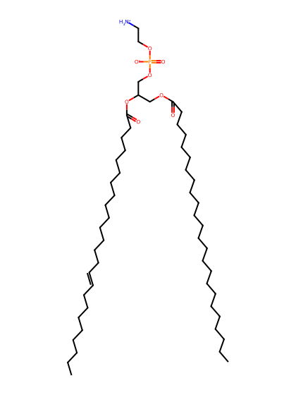
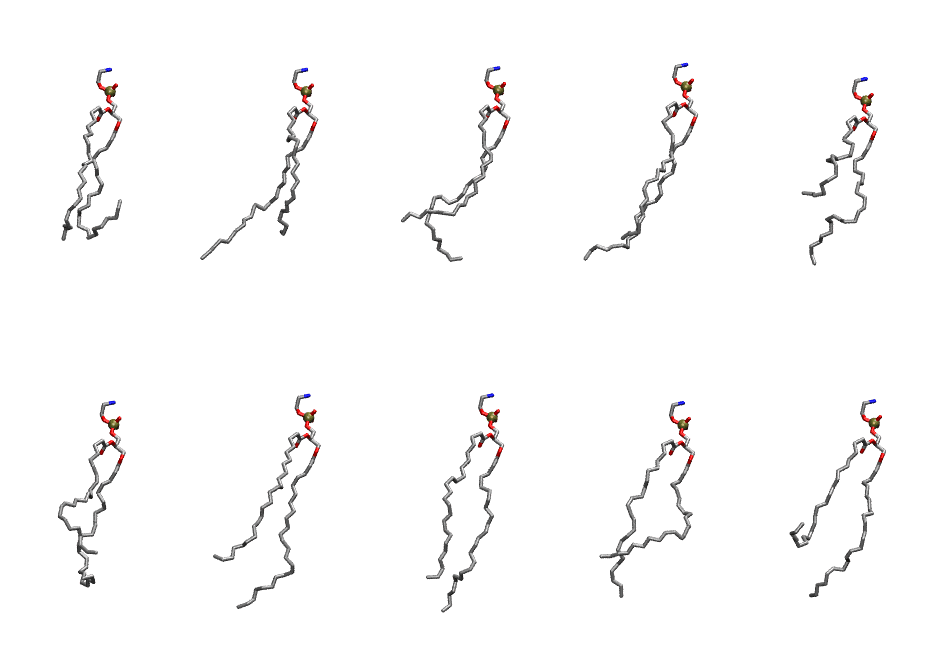

.. _lipid_gallery dnpe:

DNPE
====

**di-nervonic-phosphatidylethanolamine (diC24:1)**

==============  ========================================
CHARMM resname  ``DNPE``
Net charge      0.00
Atoms           165
Topology file   ``toppar_all36_lipid_miscellaneous.str``
Conformers      10 fluid
==============  ========================================

Structure
---------

Conformers
----------

The grid packer draws a conformer per lipid from this ensemble, so what the ensemble contains is what a built bilayer is made of. A leaflet declared ``phase: Lo`` generates an ordered ensemble when a build first needs it. All conformers are rendered at one shared scale.

===========  =============  ================  ================
Conformer    Head-tail (Å)  Max internal (Å)  Min chain extent
===========  =============  ================  ================
``DNPE-00``  9.58           29.85             0.34
``DNPE-01``  14.06          35.60             0.60
``DNPE-02``  12.63          31.72             0.55
``DNPE-03``  15.73          34.89             0.65
``DNPE-04``  6.98           30.37             0.36
``DNPE-05``  12.28          32.17             0.54
``DNPE-06``  13.85          35.18             0.59
``DNPE-07``  16.99          34.78             0.70
``DNPE-08``  12.79          32.96             0.45
``DNPE-09``  8.27           33.01             0.40
===========  =============  ================  ================

*Min chain extent* is how far the least-extended acyl chain descends below its own attachment carbon, as a fraction of that chain's all-trans contour; an all-trans chain scores 1.0, and a conformer under 0.25 is rejected at generation as folded.

Provenance
----------

How the ensemble was generated, read from the entry's own ``info.yaml``:

===================  ============
Setting              ``DNPE``
===================  ============
Sampler              ``mc``
Phase                none (fluid)
Trans bias           0.0
Chain order          0.089
MC seed              0
Chains               2
Cylinder APL         60.0 Ų
Cylinder inflation   1.9
Equilibration steps  20000
Decorrelation steps  3000
Max MC angle         30°
Radius scale         0.8
Axial bias           1.0
===================  ============
