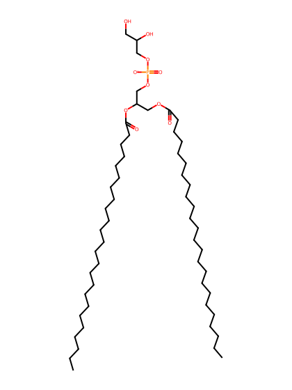
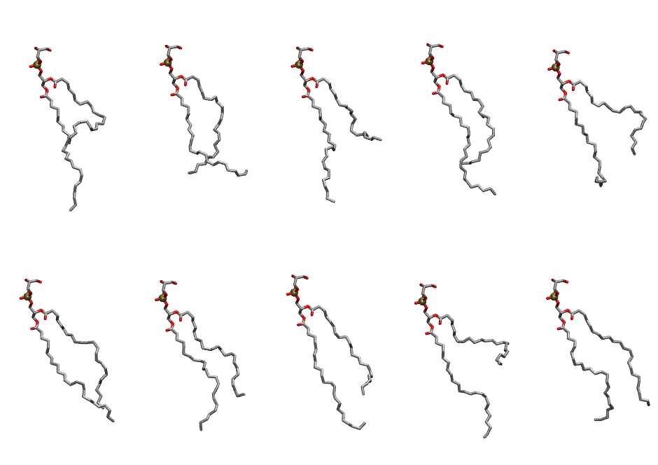

.. _lipid_gallery dnpg:

DNPG
====

**di-nervonic-phosphatidylglycerol (diC24:1)**

==============  ========================================
CHARMM resname  ``DNPG``
Net charge      -1.00
Atoms           167
Topology file   ``toppar_all36_lipid_miscellaneous.str``
Conformers      10 fluid
==============  ========================================

Structure
---------

Conformers
----------

The grid packer draws a conformer per lipid from this ensemble, so what the ensemble contains is what a built bilayer is made of. A leaflet declared ``phase: Lo`` generates an ordered ensemble when a build first needs it. All conformers are rendered at one shared scale.

===========  =============  ================  ================
Conformer    Head-tail (Å)  Max internal (Å)  Min chain extent
===========  =============  ================  ================
``DNPG-00``  9.40           35.83             0.43
``DNPG-01``  15.60          32.25             0.54
``DNPG-02``  8.80           34.25             0.41
``DNPG-03``  14.34          34.80             0.60
``DNPG-04``  11.12          30.48             0.49
``DNPG-05``  16.26          34.91             0.66
``DNPG-06``  13.11          33.17             0.55
``DNPG-07``  14.20          35.18             0.59
``DNPG-08``  6.12           35.38             0.32
``DNPG-09``  15.62          33.59             0.64
===========  =============  ================  ================

*Min chain extent* is how far the least-extended acyl chain descends below its own attachment carbon, as a fraction of that chain's all-trans contour; an all-trans chain scores 1.0, and a conformer under 0.25 is rejected at generation as folded.

Provenance
----------

How the ensemble was generated, read from the entry's own ``info.yaml``:

===================  ============
Setting              ``DNPG``
===================  ============
Sampler              ``mc``
Phase                none (fluid)
Trans bias           0.0
Chain order          0.107
MC seed              0
Chains               2
Cylinder APL         60.0 Ų
Cylinder inflation   1.9
Equilibration steps  20000
Decorrelation steps  3000
Max MC angle         30°
Radius scale         0.8
Axial bias           1.0
===================  ============
