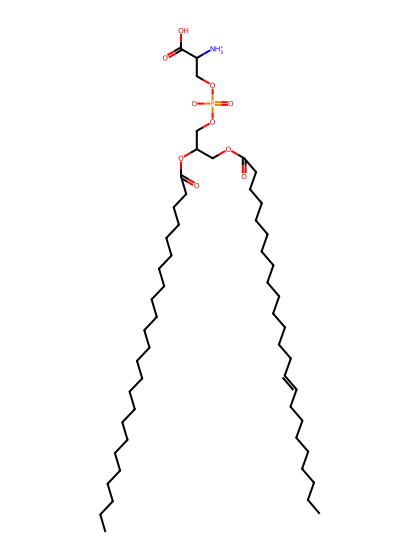
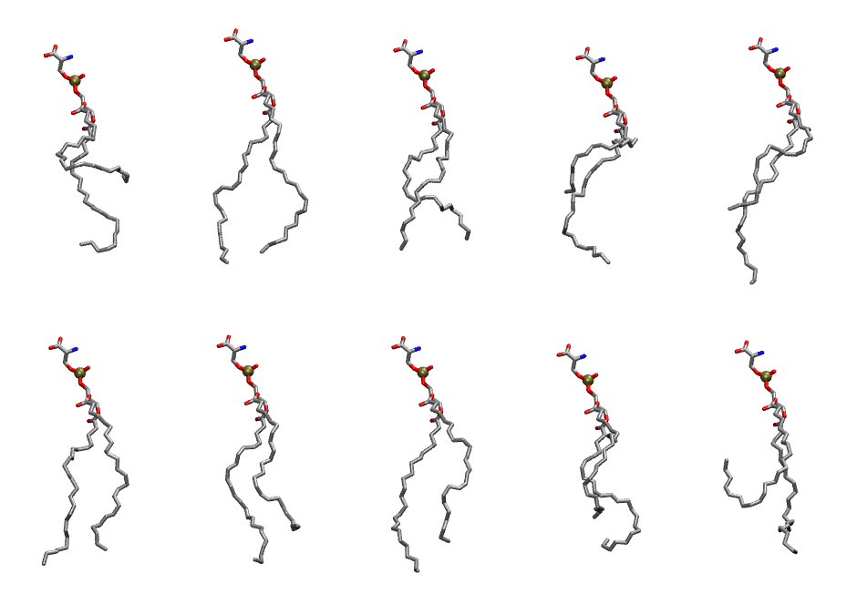

.. _lipid_gallery dnps:

DNPS
====

**di-nervonic-phosphatidylserine (diC24:1)**

==============  ========================================
CHARMM resname  ``DNPS``
Net charge      -1.00
Atoms           167
Topology file   ``toppar_all36_lipid_miscellaneous.str``
Conformers      10 fluid
==============  ========================================

Structure
---------

Conformers
----------

The grid packer draws a conformer per lipid from this ensemble, so what the ensemble contains is what a built bilayer is made of. A leaflet declared ``phase: Lo`` generates an ordered ensemble when a build first needs it. All conformers are rendered at one shared scale.

===========  =============  ================  ================
Conformer    Head-tail (Å)  Max internal (Å)  Min chain extent
===========  =============  ================  ================
``DNPS-00``  6.69           33.72             0.32
``DNPS-01``  19.76          36.31             0.73
``DNPS-02``  16.36          34.03             0.56
``DNPS-03``  8.62           33.12             0.39
``DNPS-04``  12.42          36.30             0.52
``DNPS-05``  18.22          34.77             0.70
``DNPS-06``  15.16          35.74             0.61
``DNPS-07``  17.16          36.55             0.68
``DNPS-08``  12.64          31.29             0.53
``DNPS-09``  5.09           33.91             0.27
===========  =============  ================  ================

*Min chain extent* is how far the least-extended acyl chain descends below its own attachment carbon, as a fraction of that chain's all-trans contour; an all-trans chain scores 1.0, and a conformer under 0.25 is rejected at generation as folded.

Provenance
----------

How the ensemble was generated, read from the entry's own ``info.yaml``:

===================  ============
Setting              ``DNPS``
===================  ============
Sampler              ``mc``
Phase                none (fluid)
Trans bias           0.0
Chain order          0.094
MC seed              0
Chains               2
Cylinder APL         60.0 Ų
Cylinder inflation   1.9
Equilibration steps  20000
Decorrelation steps  3000
Max MC angle         30°
Radius scale         0.8
Axial bias           1.0
===================  ============
