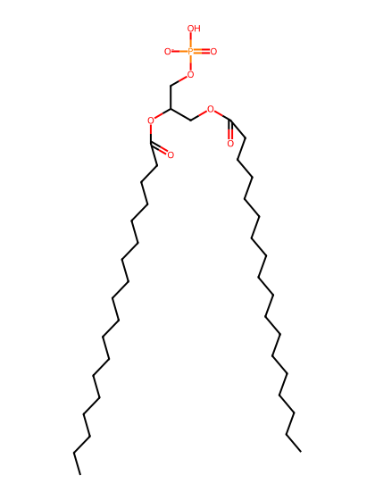
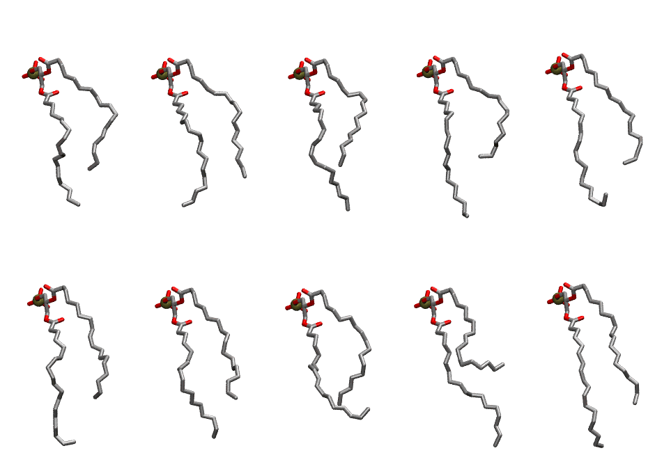

.. _lipid_gallery dopa:

DOPA
====

**2,3-dioleoyl-D-glycero-1-phosphatidic acid**

==============  =======================
CHARMM resname  ``DOPA``
Net charge      -1.00
Atoms           120
Topology file   ``top_all36_lipid.rtf``
Conformers      10 fluid
==============  =======================

Structure
---------

Conformers
----------

The grid packer draws a conformer per lipid from this ensemble, so what the ensemble contains is what a built bilayer is made of. A leaflet declared ``phase: Lo`` generates an ordered ensemble when a build first needs it. All conformers are rendered at one shared scale.

===========  =============  ================  ================
Conformer    Head-tail (Å)  Max internal (Å)  Min chain extent
===========  =============  ================  ================
``DOPA-00``  10.25          22.54             0.65
``DOPA-01``  11.15          24.54             0.68
``DOPA-02``  9.65           23.41             0.62
``DOPA-03``  8.76           25.92             0.58
``DOPA-04``  10.07          26.45             0.64
``DOPA-05``  10.40          23.32             0.66
``DOPA-06``  10.17          23.66             0.65
``DOPA-07``  10.75          24.79             0.51
``DOPA-08``  5.71           25.30             0.44
``DOPA-09``  11.41          25.50             0.71
===========  =============  ================  ================

*Min chain extent* is how far the least-extended acyl chain descends below its own attachment carbon, as a fraction of that chain's all-trans contour; an all-trans chain scores 1.0, and a conformer under 0.25 is rejected at generation as folded.

Provenance
----------

How the ensemble was generated, read from the entry's own ``info.yaml``:

===================  ============
Setting              ``DOPA``
===================  ============
Sampler              ``mc``
Phase                none (fluid)
Trans bias           0.0
Chain order          0.131
MC seed              0
Chains               2
Cylinder APL         60.0 Ų
Cylinder inflation   1.9
Equilibration steps  20000
Decorrelation steps  3000
Max MC angle         30°
Radius scale         0.8
Axial bias           1.0
===================  ============
