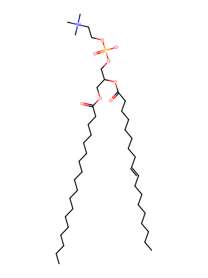
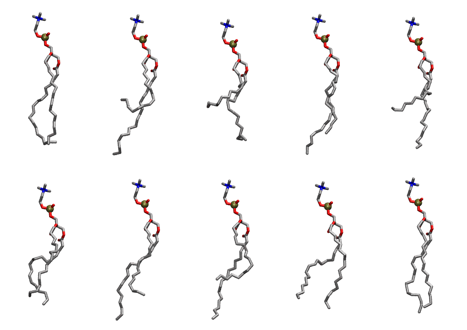

.. _lipid_gallery dopc:

DOPC
====

**2,3-dioleoyl-D-glycero-1-phosphatidylcholine**

==============  =======================
CHARMM resname  ``DOPC``
Net charge      0.00
Atoms           138
Topology file   ``top_all36_lipid.rtf``
Conformers      10 fluid
==============  =======================

Structure
---------

Conformers
----------

The grid packer draws a conformer per lipid from this ensemble, so what the ensemble contains is what a built bilayer is made of. A leaflet declared ``phase: Lo`` generates an ordered ensemble when a build first needs it. All conformers are rendered at one shared scale.

===========  =============  ================  ================
Conformer    Head-tail (Å)  Max internal (Å)  Min chain extent
===========  =============  ================  ================
``DOPC-00``  15.44          29.72             0.72
``DOPC-01``  6.08           31.34             0.39
``DOPC-02``  5.72           28.78             0.37
``DOPC-03``  13.18          30.86             0.72
``DOPC-04``  7.31           31.38             0.44
``DOPC-05``  11.73          27.74             0.62
``DOPC-06``  12.44          31.59             0.68
``DOPC-07``  9.06           31.19             0.52
``DOPC-08``  12.65          28.39             0.59
``DOPC-09``  15.34          31.07             0.76
===========  =============  ================  ================

*Min chain extent* is how far the least-extended acyl chain descends below its own attachment carbon, as a fraction of that chain's all-trans contour; an all-trans chain scores 1.0, and a conformer under 0.25 is rejected at generation as folded.

Provenance
----------

How the ensemble was generated, read from the entry's own ``info.yaml``:

===================  ============
Setting              ``DOPC``
===================  ============
Sampler              ``mc``
Phase                none (fluid)
Trans bias           0.0
Chain order          0.146
MC seed              0
Chains               2
Cylinder APL         60.0 Ų
Cylinder inflation   1.9
Equilibration steps  20000
Decorrelation steps  3000
Max MC angle         30°
Radius scale         0.8
Axial bias           1.0
===================  ============
