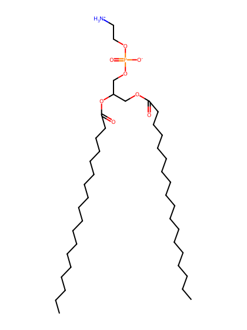
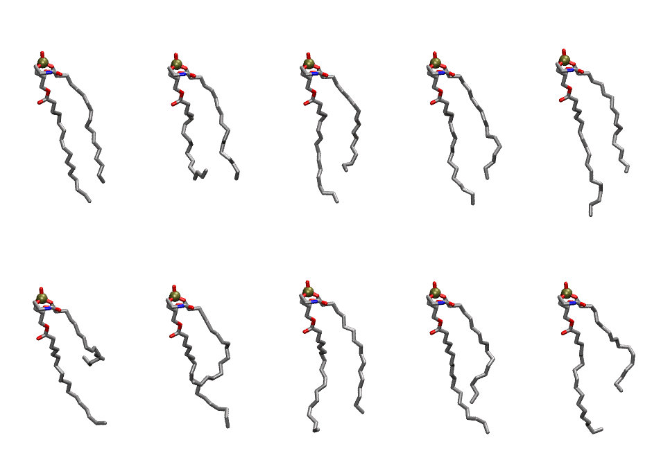

.. _lipid_gallery dope:

DOPE
====

**2,3-dioleoyl-D-glycero-1-phosphatidylethanolamine**

==============  =======================
CHARMM resname  ``DOPE``
Net charge      0.00
Atoms           129
Topology file   ``top_all36_lipid.rtf``
Conformers      10 fluid
==============  =======================

Structure
---------

Conformers
----------

The grid packer draws a conformer per lipid from this ensemble, so what the ensemble contains is what a built bilayer is made of. A leaflet declared ``phase: Lo`` generates an ordered ensemble when a build first needs it. All conformers are rendered at one shared scale.

===========  =============  ================  ================
Conformer    Head-tail (Å)  Max internal (Å)  Min chain extent
===========  =============  ================  ================
``DOPE-00``  11.73          27.82             0.70
``DOPE-01``  9.84           24.84             0.48
``DOPE-02``  9.87           25.35             0.67
``DOPE-03``  11.12          27.04             0.72
``DOPE-04``  10.58          27.70             0.70
``DOPE-05``  2.81           27.07             0.34
``DOPE-06``  6.82           27.13             0.53
``DOPE-07``  11.92          24.89             0.70
``DOPE-08``  10.24          28.20             0.69
``DOPE-09``  8.51           28.81             0.61
===========  =============  ================  ================

*Min chain extent* is how far the least-extended acyl chain descends below its own attachment carbon, as a fraction of that chain's all-trans contour; an all-trans chain scores 1.0, and a conformer under 0.25 is rejected at generation as folded.

Provenance
----------

How the ensemble was generated, read from the entry's own ``info.yaml``:

===================  ============
Setting              ``DOPE``
===================  ============
Sampler              ``mc``
Phase                none (fluid)
Trans bias           0.0
Chain order          0.127
MC seed              0
Chains               2
Cylinder APL         60.0 Ų
Cylinder inflation   1.9
Equilibration steps  20000
Decorrelation steps  3000
Max MC angle         30°
Radius scale         0.8
Axial bias           1.0
===================  ============
