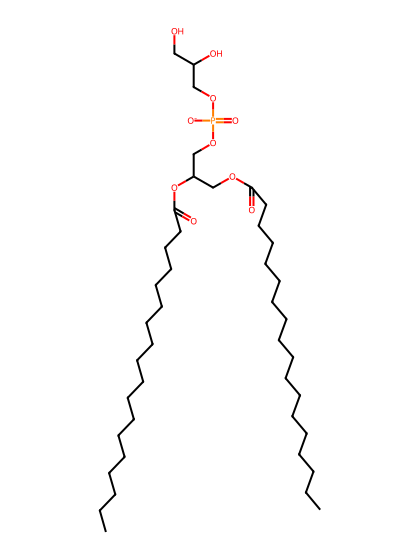
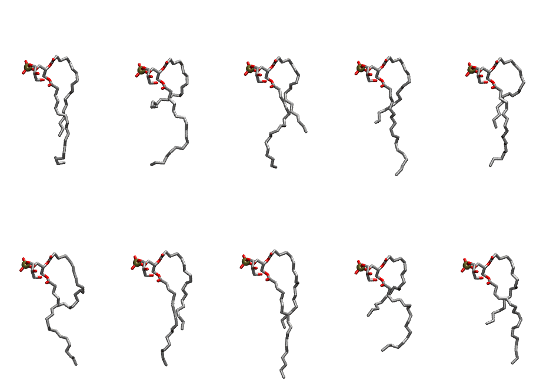

.. _lipid_gallery dopg:

DOPG
====

**2,3-dioleoyl-D-glycero-1-phosphatidylglycerol**

==============  =======================
CHARMM resname  ``DOPG``
Net charge      -1.00
Atoms           131
Topology file   ``top_all36_lipid.rtf``
Conformers      10 fluid
==============  =======================

Structure
---------

Conformers
----------

The grid packer draws a conformer per lipid from this ensemble, so what the ensemble contains is what a built bilayer is made of. A leaflet declared ``phase: Lo`` generates an ordered ensemble when a build first needs it. All conformers are rendered at one shared scale.

===========  =============  ================  ================
Conformer    Head-tail (Å)  Max internal (Å)  Min chain extent
===========  =============  ================  ================
``DOPG-00``  9.91           24.33             0.69
``DOPG-01``  3.60           23.29             0.40
``DOPG-02``  8.90           23.47             0.64
``DOPG-03``  7.17           25.23             0.56
``DOPG-04``  7.78           24.01             0.59
``DOPG-05``  4.58           24.60             0.44
``DOPG-06``  9.51           24.43             0.67
``DOPG-07``  9.42           26.68             0.67
``DOPG-08``  5.93           21.20             0.50
``DOPG-09``  7.92           24.59             0.60
===========  =============  ================  ================

*Min chain extent* is how far the least-extended acyl chain descends below its own attachment carbon, as a fraction of that chain's all-trans contour; an all-trans chain scores 1.0, and a conformer under 0.25 is rejected at generation as folded.

Provenance
----------

How the ensemble was generated, read from the entry's own ``info.yaml``:

===================  ============
Setting              ``DOPG``
===================  ============
Sampler              ``mc``
Phase                none (fluid)
Trans bias           0.0
Chain order          0.164
MC seed              0
Chains               2
Cylinder APL         60.0 Ų
Cylinder inflation   1.9
Equilibration steps  20000
Decorrelation steps  3000
Max MC angle         30°
Radius scale         0.8
Axial bias           1.0
===================  ============
