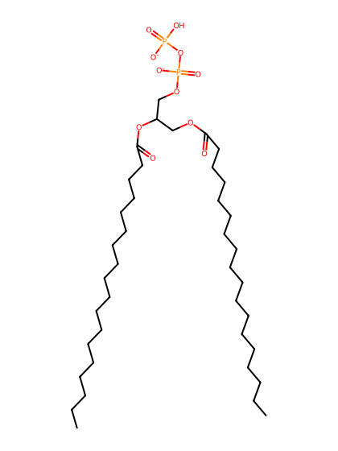
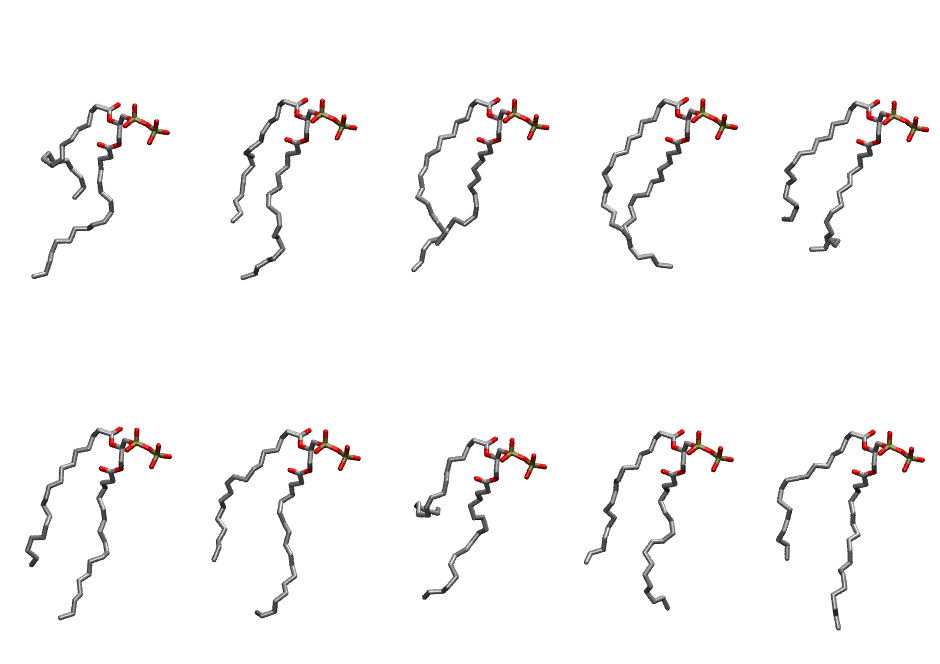

.. _lipid_gallery dopp1:

DOPP1
=====

**2,3-dioleoyl-D-glycero-1-pyrophosphate**

==============  ========================================
CHARMM resname  ``DOPP1``
Net charge      -2.00
Atoms           124
Topology file   ``toppar_all36_lipid_miscellaneous.str``
Conformers      10 fluid
==============  ========================================

Structure
---------

Conformers
----------

The grid packer draws a conformer per lipid from this ensemble, so what the ensemble contains is what a built bilayer is made of. A leaflet declared ``phase: Lo`` generates an ordered ensemble when a build first needs it. All conformers are rendered at one shared scale.

============  =============  ================  ================
Conformer     Head-tail (Å)  Max internal (Å)  Min chain extent
============  =============  ================  ================
``DOPP1-00``  6.01           25.94             0.46
``DOPP1-01``  9.25           27.39             0.61
``DOPP1-02``  11.82          27.36             0.67
``DOPP1-03``  11.28          23.97             0.65
``DOPP1-04``  8.83           26.04             0.55
``DOPP1-05``  10.96          24.90             0.69
``DOPP1-06``  10.19          24.26             0.65
``DOPP1-07``  3.48           26.34             0.34
``DOPP1-08``  10.32          24.72             0.66
``DOPP1-09``  9.83           24.36             0.64
============  =============  ================  ================

*Min chain extent* is how far the least-extended acyl chain descends below its own attachment carbon, as a fraction of that chain's all-trans contour; an all-trans chain scores 1.0, and a conformer under 0.25 is rejected at generation as folded.

Provenance
----------

How the ensemble was generated, read from the entry's own ``info.yaml``:

===================  ============
Setting              ``DOPP1``
===================  ============
Sampler              ``mc``
Phase                none (fluid)
Trans bias           0.0
Chain order          0.116
MC seed              0
Chains               2
Cylinder APL         60.0 Ų
Cylinder inflation   1.9
Equilibration steps  20000
Decorrelation steps  3000
Max MC angle         30°
Radius scale         0.8
Axial bias           1.0
===================  ============
