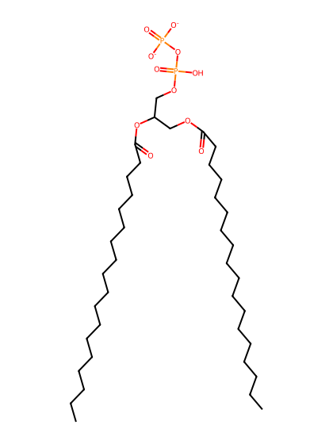
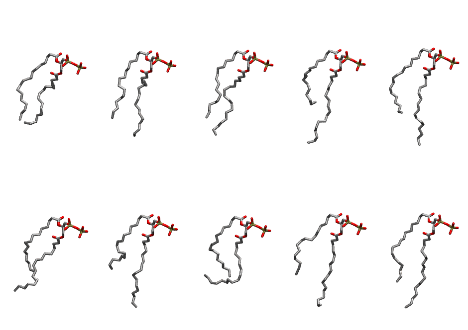

.. _lipid_gallery dopp2:

DOPP2
=====

**2,3-dioleoyl-D-glycero-1-pyrophosphate**

==============  ========================================
CHARMM resname  ``DOPP2``
Net charge      -2.00
Atoms           124
Topology file   ``toppar_all36_lipid_miscellaneous.str``
Conformers      10 fluid
==============  ========================================

Structure
---------

Conformers
----------

The grid packer draws a conformer per lipid from this ensemble, so what the ensemble contains is what a built bilayer is made of. A leaflet declared ``phase: Lo`` generates an ordered ensemble when a build first needs it. All conformers are rendered at one shared scale.

============  =============  ================  ================
Conformer     Head-tail (Å)  Max internal (Å)  Min chain extent
============  =============  ================  ================
``DOPP2-00``  10.76          25.79             0.51
``DOPP2-01``  10.82          25.15             0.67
``DOPP2-02``  10.88          25.64             0.67
``DOPP2-03``  7.49           27.56             0.53
``DOPP2-04``  10.29          27.29             0.66
``DOPP2-05``  7.83           23.61             0.54
``DOPP2-06``  7.87           25.45             0.54
``DOPP2-07``  9.14           23.93             0.40
``DOPP2-08``  9.40           26.64             0.61
``DOPP2-09``  11.18          27.71             0.70
============  =============  ================  ================

*Min chain extent* is how far the least-extended acyl chain descends below its own attachment carbon, as a fraction of that chain's all-trans contour; an all-trans chain scores 1.0, and a conformer under 0.25 is rejected at generation as folded.

Provenance
----------

How the ensemble was generated, read from the entry's own ``info.yaml``:

===================  ============
Setting              ``DOPP2``
===================  ============
Sampler              ``mc``
Phase                none (fluid)
Trans bias           0.0
Chain order          0.116
MC seed              0
Chains               2
Cylinder APL         60.0 Ų
Cylinder inflation   1.9
Equilibration steps  20000
Decorrelation steps  3000
Max MC angle         30°
Radius scale         0.8
Axial bias           1.0
===================  ============
