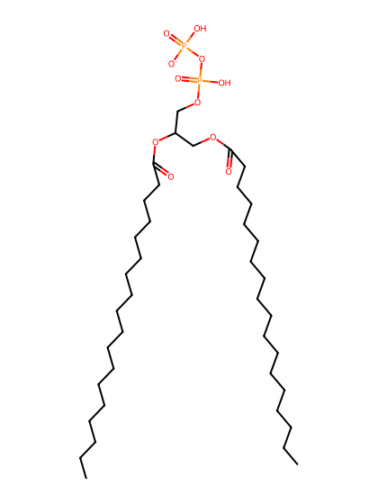
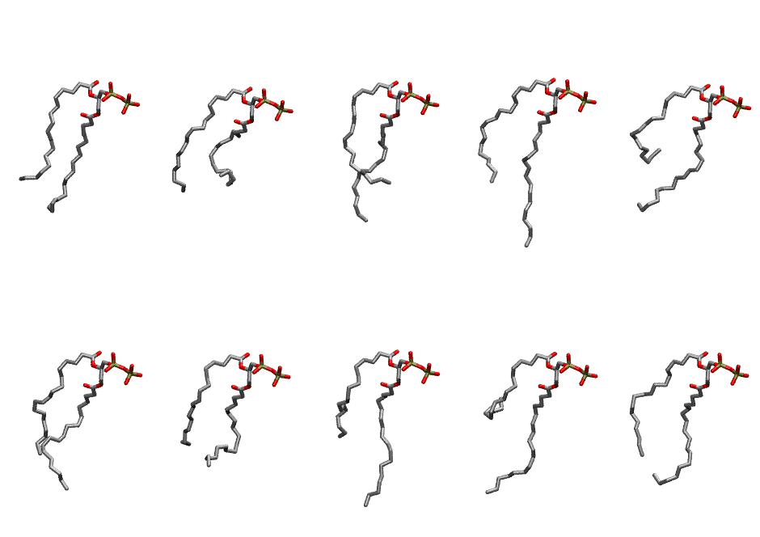

.. _lipid_gallery dopp3:

DOPP3
=====

**2,3-dioleoyl-D-glycero-1-pyrophosphate**

==============  ========================================
CHARMM resname  ``DOPP3``
Net charge      -1.00
Atoms           125
Topology file   ``toppar_all36_lipid_miscellaneous.str``
Conformers      10 fluid
==============  ========================================

Structure
---------

Conformers
----------

The grid packer draws a conformer per lipid from this ensemble, so what the ensemble contains is what a built bilayer is made of. A leaflet declared ``phase: Lo`` generates an ordered ensemble when a build first needs it. All conformers are rendered at one shared scale.

============  =============  ================  ================
Conformer     Head-tail (Å)  Max internal (Å)  Min chain extent
============  =============  ================  ================
``DOPP3-00``  9.06           24.32             0.56
``DOPP3-01``  7.62           24.06             0.34
``DOPP3-02``  9.54           26.31             0.62
``DOPP3-03``  9.73           26.91             0.63
``DOPP3-04``  4.49           26.23             0.39
``DOPP3-05``  9.63           24.00             0.63
``DOPP3-06``  7.75           24.03             0.49
``DOPP3-07``  7.34           24.84             0.52
``DOPP3-08``  1.79           27.68             0.26
``DOPP3-09``  9.76           24.75             0.57
============  =============  ================  ================

*Min chain extent* is how far the least-extended acyl chain descends below its own attachment carbon, as a fraction of that chain's all-trans contour; an all-trans chain scores 1.0, and a conformer under 0.25 is rejected at generation as folded.

Provenance
----------

How the ensemble was generated, read from the entry's own ``info.yaml``:

===================  ============
Setting              ``DOPP3``
===================  ============
Sampler              ``mc``
Phase                none (fluid)
Trans bias           0.0
Chain order          0.097
MC seed              0
Chains               2
Cylinder APL         60.0 Ų
Cylinder inflation   1.9
Equilibration steps  20000
Decorrelation steps  3000
Max MC angle         30°
Radius scale         0.8
Axial bias           1.0
===================  ============
