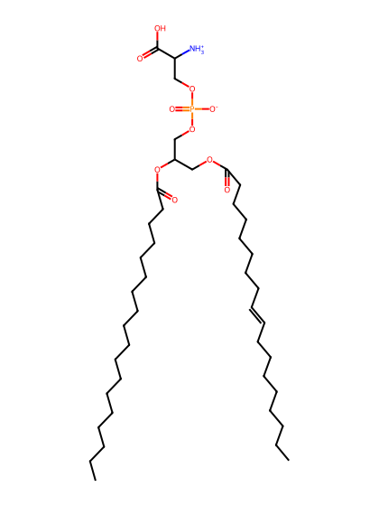
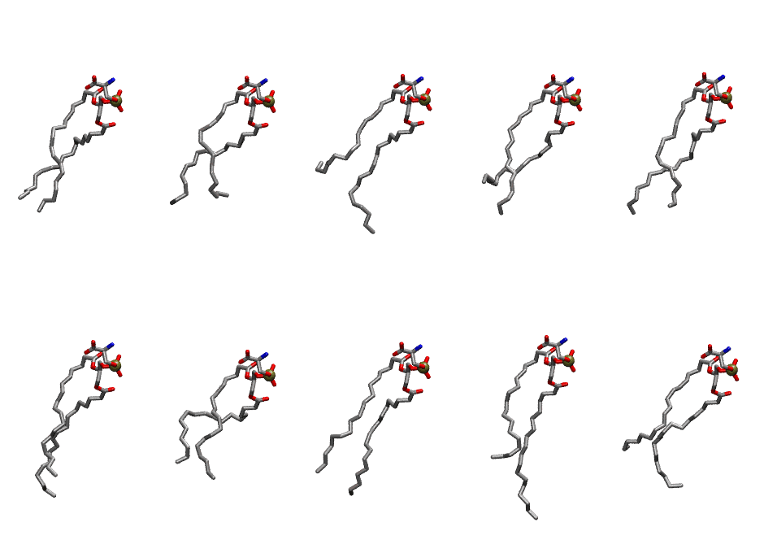

.. _lipid_gallery dops:

DOPS
====

**2,3-dioleoyl-D-glycero-1-phosphatidylserine**

==============  =======================
CHARMM resname  ``DOPS``
Net charge      -1.00
Atoms           131
Topology file   ``top_all36_lipid.rtf``
Conformers      10 fluid
==============  =======================

Structure
---------

Conformers
----------

The grid packer draws a conformer per lipid from this ensemble, so what the ensemble contains is what a built bilayer is made of. A leaflet declared ``phase: Lo`` generates an ordered ensemble when a build first needs it. All conformers are rendered at one shared scale.

===========  =============  ================  ================
Conformer    Head-tail (Å)  Max internal (Å)  Min chain extent
===========  =============  ================  ================
``DOPS-00``  9.90           23.63             0.45
``DOPS-01``  9.48           26.10             0.47
``DOPS-02``  5.39           26.99             0.44
``DOPS-03``  7.87           22.71             0.35
``DOPS-04``  11.40          26.65             0.56
``DOPS-05``  11.58          27.28             0.65
``DOPS-06``  8.51           22.86             0.38
``DOPS-07``  10.83          27.39             0.63
``DOPS-08``  9.81           29.28             0.64
``DOPS-09``  7.20           26.56             0.52
===========  =============  ================  ================

*Min chain extent* is how far the least-extended acyl chain descends below its own attachment carbon, as a fraction of that chain's all-trans contour; an all-trans chain scores 1.0, and a conformer under 0.25 is rejected at generation as folded.

Provenance
----------

How the ensemble was generated, read from the entry's own ``info.yaml``:

===================  ============
Setting              ``DOPS``
===================  ============
Sampler              ``mc``
Phase                none (fluid)
Trans bias           0.0
Chain order          0.056
MC seed              0
Chains               2
Cylinder APL         60.0 Ų
Cylinder inflation   1.9
Equilibration steps  20000
Decorrelation steps  3000
Max MC angle         30°
Radius scale         0.8
Axial bias           1.0
===================  ============
