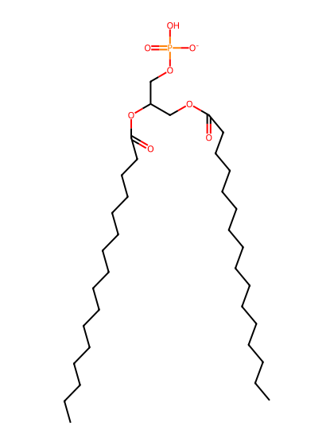
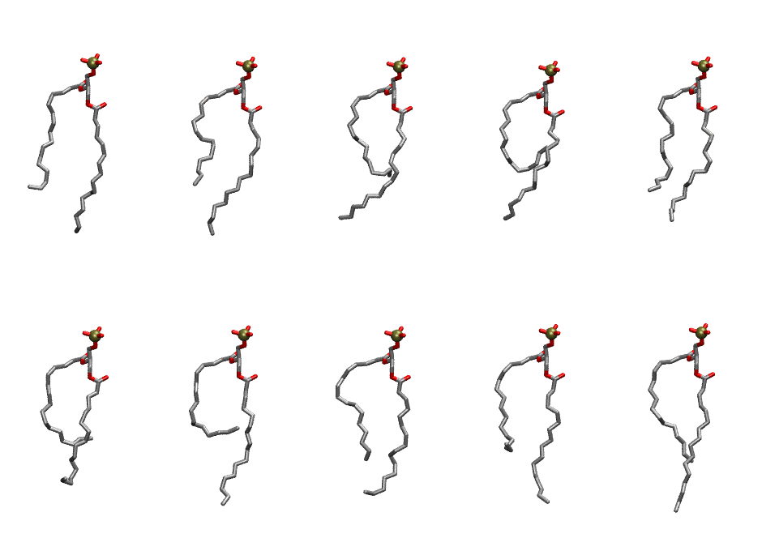
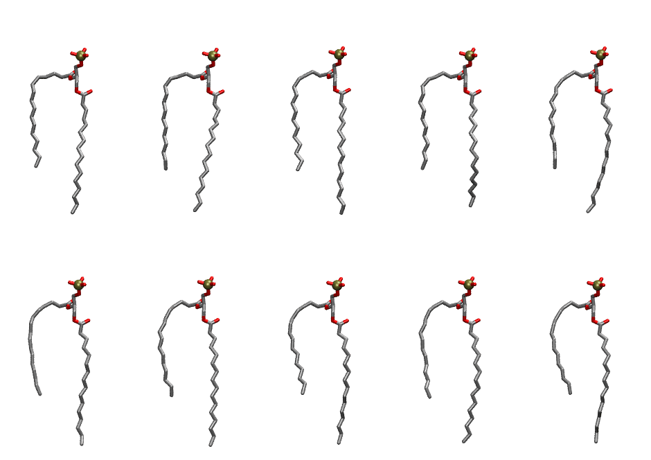

.. _lipid_gallery dppa:

DPPA
====

**2,3 dipalmitoyl--D-glycero-1-Phosphatidic acid**

==============  ==========================================
CHARMM resname  ``DPPA``
Net charge      -1.00
Atoms           112
Topology file   ``top_all36_lipid.rtf``
Conformers      10 fluid, 10 liquid-ordered (``DPPA__Lo``)
==============  ==========================================

Structure
---------

Conformers
----------

The grid packer draws a conformer per lipid from an ensemble, so what the ensemble contains is what a built bilayer is made of. DPPA ships two: a fluid one, used by default, and a liquid-ordered one, used for a leaflet declared ``phase: Lo``. All conformers on this page are rendered at one shared scale.

Fluid (``DPPA``)
~~~~~~~~~~~~~~~~

===========  =============  ================  ================
Conformer    Head-tail (Å)  Max internal (Å)  Min chain extent
===========  =============  ================  ================
``DPPA-00``  11.00          25.97             0.71
``DPPA-01``  10.22          25.69             0.67
``DPPA-02``  8.97           24.70             0.60
``DPPA-03``  4.80           23.75             0.38
``DPPA-04``  11.08          24.12             0.71
``DPPA-05``  8.15           23.11             0.56
``DPPA-06``  6.94           25.55             0.50
``DPPA-07``  10.96          24.53             0.71
``DPPA-08``  9.25           25.29             0.62
``DPPA-09``  11.59          27.06             0.74
===========  =============  ================  ================

Liquid-ordered (``DPPA__Lo``)
~~~~~~~~~~~~~~~~~~~~~~~~~~~~~

===========  =============  ================  ================
Conformer    Head-tail (Å)  Max internal (Å)  Min chain extent
===========  =============  ================  ================
``DPPA-00``  11.71          27.27             0.75
``DPPA-01``  12.10          27.44             0.77
``DPPA-02``  12.46          27.63             0.79
``DPPA-03``  12.06          26.29             0.77
``DPPA-04``  12.10          27.64             0.77
``DPPA-05``  11.53          27.77             0.74
``DPPA-06``  11.80          27.93             0.75
``DPPA-07``  11.34          27.76             0.73
``DPPA-08``  12.00          27.63             0.76
``DPPA-09``  11.29          27.45             0.72
===========  =============  ================  ================

*Min chain extent* is how far the least-extended acyl chain descends below its own attachment carbon, as a fraction of that chain's all-trans contour; an all-trans chain scores 1.0, and a conformer under 0.25 is rejected at generation as folded.

Provenance
----------

How each ensemble was generated, read from the entry's own ``info.yaml``:

===================  ============  ============
Setting              ``DPPA``      ``DPPA__Lo``
===================  ============  ============
Sampler              ``mc``        ``mc``
Phase                none (fluid)  Lo
Trans bias           0.0           40.0
Chain order          0.162         0.317
MC seed              0             0
Chains               2             2
Cylinder APL         60.0 Ų       60.0 Ų
Cylinder inflation   1.9           1.9
Equilibration steps  20000         20000
Decorrelation steps  3000          3000
Max MC angle         30°           30°
Radius scale         0.8           0.8
Axial bias           1.0           1.0
===================  ============  ============
