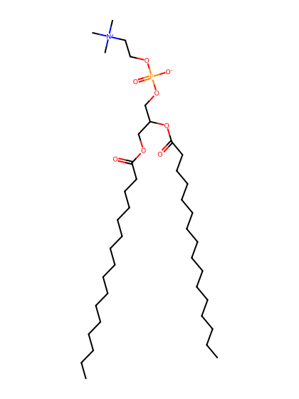
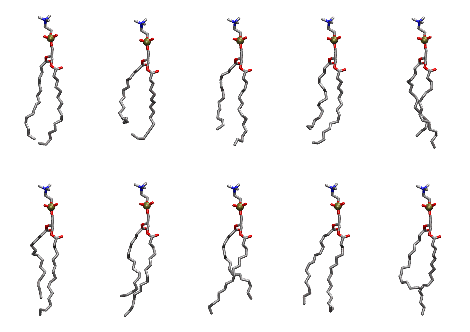
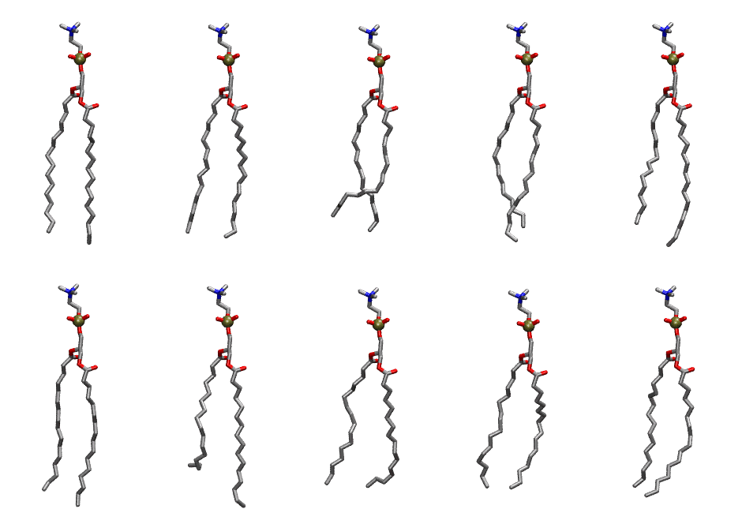

.. _lipid_gallery dppc:

DPPC
====

**2,3 dipalmitoyl-D-glycero-1-Phosphatidylcholine**

==============  ==========================================
CHARMM resname  ``DPPC``
Net charge      0.00
Atoms           130
Topology file   ``top_all36_lipid.rtf``
Conformers      10 fluid, 10 liquid-ordered (``DPPC__Lo``)
==============  ==========================================

Structure
---------

Conformers
----------

The grid packer draws a conformer per lipid from an ensemble, so what the ensemble contains is what a built bilayer is made of. DPPC ships two: a fluid one, used by default, and a liquid-ordered one, used for a leaflet declared ``phase: Lo``. All conformers on this page are rendered at one shared scale.

Fluid (``DPPC``)
~~~~~~~~~~~~~~~~

===========  =============  ================  ================
Conformer    Head-tail (Å)  Max internal (Å)  Min chain extent
===========  =============  ================  ================
``DPPC-00``  15.00          29.11             0.82
``DPPC-01``  10.00          27.13             0.59
``DPPC-02``  12.45          28.53             0.72
``DPPC-03``  12.49          28.74             0.72
``DPPC-04``  13.95          29.23             0.80
``DPPC-05``  12.87          29.51             0.74
``DPPC-06``  12.85          29.95             0.74
``DPPC-07``  13.08          29.49             0.76
``DPPC-08``  14.31          28.97             0.77
``DPPC-09``  10.94          29.36             0.64
===========  =============  ================  ================

Liquid-ordered (``DPPC__Lo``)
~~~~~~~~~~~~~~~~~~~~~~~~~~~~~

===========  =============  ================  ================
Conformer    Head-tail (Å)  Max internal (Å)  Min chain extent
===========  =============  ================  ================
``DPPC-00``  16.83          31.29             0.94
``DPPC-01``  16.73          30.26             0.89
``DPPC-02``  14.36          29.12             0.73
``DPPC-03``  16.09          31.15             0.91
``DPPC-04``  15.66          31.47             0.89
``DPPC-05``  16.30          30.88             0.92
``DPPC-06``  13.01          31.49             0.75
``DPPC-07``  15.00          28.65             0.79
``DPPC-08``  15.22          28.70             0.79
``DPPC-09``  15.58          30.31             0.87
===========  =============  ================  ================

*Min chain extent* is how far the least-extended acyl chain descends below its own attachment carbon, as a fraction of that chain's all-trans contour; an all-trans chain scores 1.0, and a conformer under 0.25 is rejected at generation as folded.

Provenance
----------

How each ensemble was generated, read from the entry's own ``info.yaml``:

===================  ============  ============
Setting              ``DPPC``      ``DPPC__Lo``
===================  ============  ============
Sampler              ``mc``        ``mc``
Phase                none (fluid)  Lo
Trans bias           0.0           5.0
Chain order          0.200         0.304
MC seed              0             0
Chains               2             2
Cylinder APL         60.0 Ų       60.0 Ų
Cylinder inflation   1.9           1.9
Equilibration steps  20000         20000
Decorrelation steps  3000          3000
Max MC angle         30°           30°
Radius scale         0.8           0.8
Axial bias           1.0           1.0
===================  ============  ============
