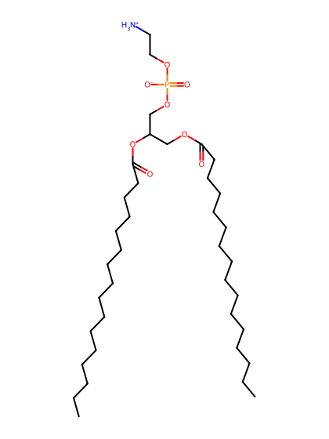
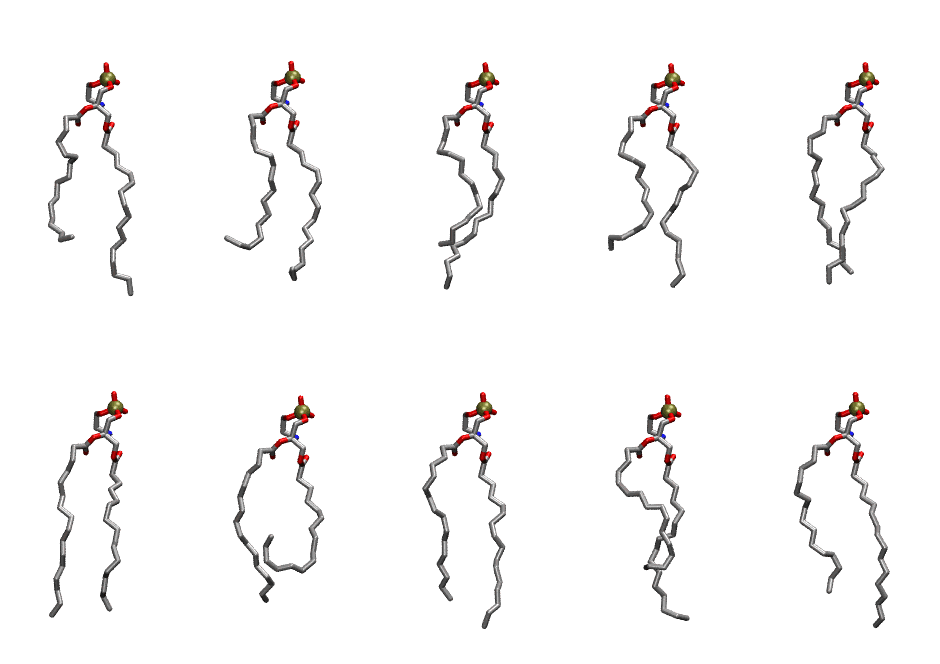
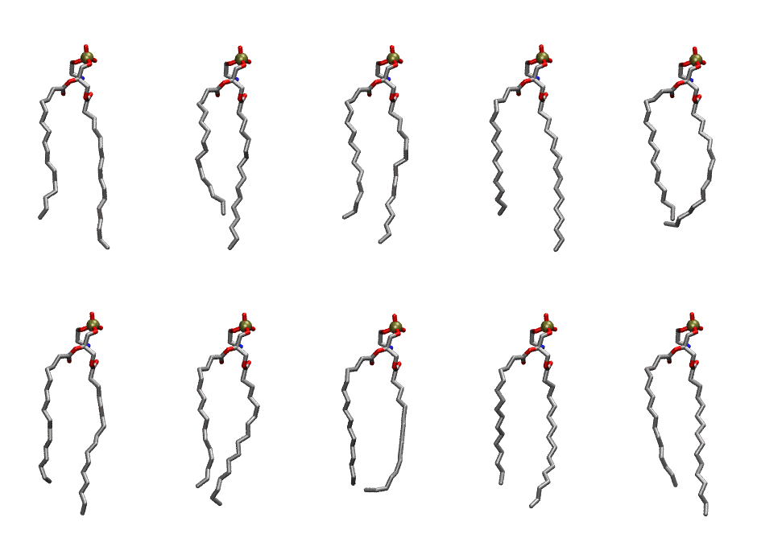

.. _lipid_gallery dppe:

DPPE
====

**2,3 dipalmitoyl-D-glycero-1-Phosphatidylethanolamine**

==============  ==========================================
CHARMM resname  ``DPPE``
Net charge      0.00
Atoms           121
Topology file   ``top_all36_lipid.rtf``
Conformers      10 fluid, 10 liquid-ordered (``DPPE__Lo``)
==============  ==========================================

Structure
---------

Conformers
----------

The grid packer draws a conformer per lipid from an ensemble, so what the ensemble contains is what a built bilayer is made of. DPPE ships two: a fluid one, used by default, and a liquid-ordered one, used for a leaflet declared ``phase: Lo``. All conformers on this page are rendered at one shared scale.

Fluid (``DPPE``)
~~~~~~~~~~~~~~~~

===========  =============  ================  ================
Conformer    Head-tail (Å)  Max internal (Å)  Min chain extent
===========  =============  ================  ================
``DPPE-00``  11.44          23.97             0.64
``DPPE-01``  11.73          23.36             0.65
``DPPE-02``  12.18          23.91             0.68
``DPPE-03``  12.50          23.37             0.69
``DPPE-04``  15.03          23.75             0.80
``DPPE-05``  15.83          24.43             0.79
``DPPE-06``  8.08           21.80             0.39
``DPPE-07``  14.69          24.85             0.81
``DPPE-08``  11.28          23.27             0.63
``DPPE-09``  13.94          24.64             0.77
===========  =============  ================  ================

Liquid-ordered (``DPPE__Lo``)
~~~~~~~~~~~~~~~~~~~~~~~~~~~~~

===========  =============  ================  ================
Conformer    Head-tail (Å)  Max internal (Å)  Min chain extent
===========  =============  ================  ================
``DPPE-00``  15.59          26.52             0.86
``DPPE-01``  14.91          26.29             0.82
``DPPE-02``  15.44          25.50             0.85
``DPPE-03``  15.08          26.72             0.83
``DPPE-04``  15.50          23.55             0.81
``DPPE-05``  15.15          26.28             0.83
``DPPE-06``  15.61          25.10             0.86
``DPPE-07``  15.13          24.33             0.80
``DPPE-08``  15.20          25.42             0.84
``DPPE-09``  15.53          26.24             0.85
===========  =============  ================  ================

*Min chain extent* is how far the least-extended acyl chain descends below its own attachment carbon, as a fraction of that chain's all-trans contour; an all-trans chain scores 1.0, and a conformer under 0.25 is rejected at generation as folded.

Provenance
----------

How each ensemble was generated, read from the entry's own ``info.yaml``:

===================  ============  ============
Setting              ``DPPE``      ``DPPE__Lo``
===================  ============  ============
Sampler              ``mc``        ``mc``
Phase                none (fluid)  Lo
Trans bias           0.0           7.5
Chain order          0.204         0.319
MC seed              0             0
Chains               2             2
Cylinder APL         60.0 Ų       60.0 Ų
Cylinder inflation   1.9           1.9
Equilibration steps  20000         20000
Decorrelation steps  3000          3000
Max MC angle         30°           30°
Radius scale         0.8           0.8
Axial bias           1.0           1.0
===================  ============  ============
