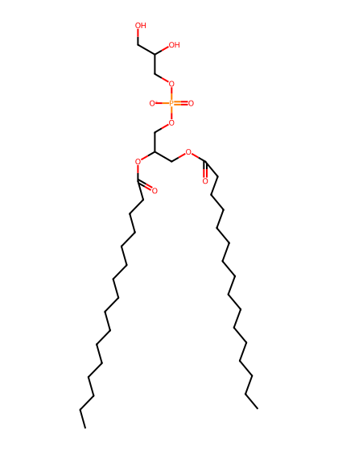
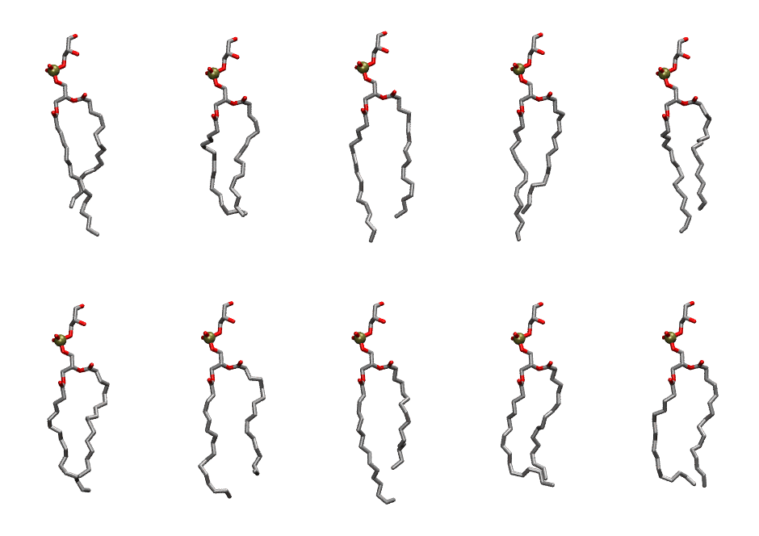
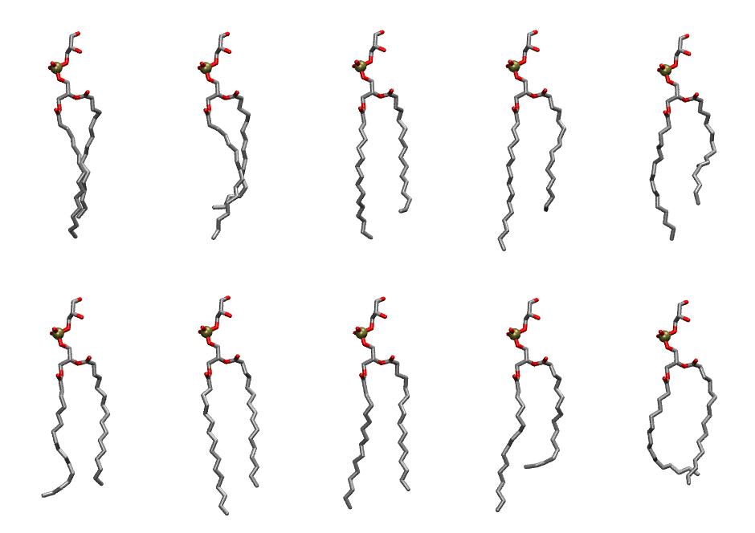

.. _lipid_gallery dppg:

DPPG
====

**2,3 dipalmitoyl-D-glycero-1-Phosphatidylglycerol**

==============  ==========================================
CHARMM resname  ``DPPG``
Net charge      -1.00
Atoms           123
Topology file   ``top_all36_lipid.rtf``
Conformers      10 fluid, 10 liquid-ordered (``DPPG__Lo``)
==============  ==========================================

Structure
---------

Conformers
----------

The grid packer draws a conformer per lipid from an ensemble, so what the ensemble contains is what a built bilayer is made of. DPPG ships two: a fluid one, used by default, and a liquid-ordered one, used for a leaflet declared ``phase: Lo``. All conformers on this page are rendered at one shared scale.

Fluid (``DPPG``)
~~~~~~~~~~~~~~~~

===========  =============  ================  ================
Conformer    Head-tail (Å)  Max internal (Å)  Min chain extent
===========  =============  ================  ================
``DPPG-00``  12.71          28.47             0.77
``DPPG-01``  13.24          25.74             0.67
``DPPG-02``  14.45          29.03             0.86
``DPPG-03``  13.65          29.00             0.82
``DPPG-04``  12.58          27.40             0.76
``DPPG-05``  12.66          27.40             0.74
``DPPG-06``  12.38          27.44             0.75
``DPPG-07``  11.87          28.27             0.72
``DPPG-08``  13.23          25.97             0.71
``DPPG-09``  14.14          26.22             0.71
===========  =============  ================  ================

Liquid-ordered (``DPPG__Lo``)
~~~~~~~~~~~~~~~~~~~~~~~~~~~~~

===========  =============  ================  ================
Conformer    Head-tail (Å)  Max internal (Å)  Min chain extent
===========  =============  ================  ================
``DPPG-00``  14.58          28.79             0.87
``DPPG-01``  13.28          29.00             0.80
``DPPG-02``  14.02          29.82             0.84
``DPPG-03``  13.84          30.90             0.83
``DPPG-04``  12.40          29.48             0.75
``DPPG-05``  14.80          28.04             0.83
``DPPG-06``  15.23          30.53             0.90
``DPPG-07``  15.58          30.16             0.92
``DPPG-08``  12.35          30.05             0.75
``DPPG-09``  13.07          25.80             0.66
===========  =============  ================  ================

*Min chain extent* is how far the least-extended acyl chain descends below its own attachment carbon, as a fraction of that chain's all-trans contour; an all-trans chain scores 1.0, and a conformer under 0.25 is rejected at generation as folded.

Provenance
----------

How each ensemble was generated, read from the entry's own ``info.yaml``:

===================  ============  ============
Setting              ``DPPG``      ``DPPG__Lo``
===================  ============  ============
Sampler              ``mc``        ``mc``
Phase                none (fluid)  Lo
Trans bias           0.0           5.0
Chain order          0.213         0.288
MC seed              0             0
Chains               2             2
Cylinder APL         60.0 Ų       60.0 Ų
Cylinder inflation   1.9           1.9
Equilibration steps  20000         20000
Decorrelation steps  3000          3000
Max MC angle         30°           30°
Radius scale         0.8           0.8
Axial bias           1.0           1.0
===================  ============  ============
