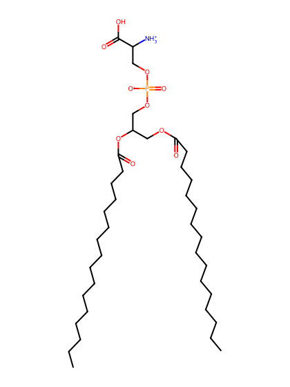
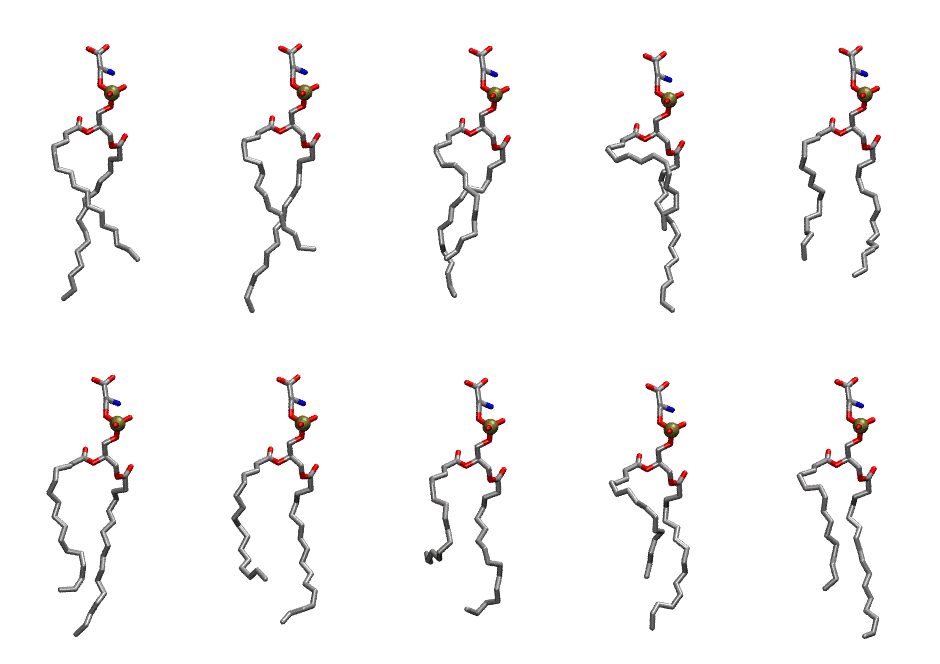
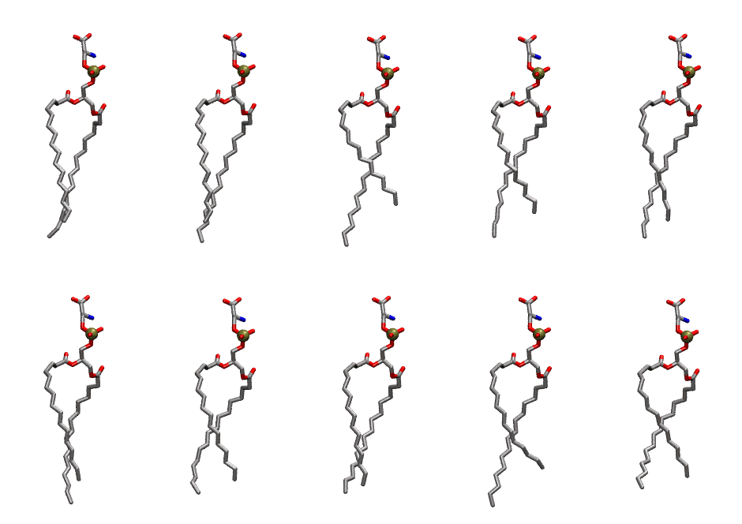

.. _lipid_gallery dpps:

DPPS
====

**2,3 dipalmitoyl-D-glycero-1-Phosphatidylserine**

==============  ==========================================
CHARMM resname  ``DPPS``
Net charge      -1.00
Atoms           123
Topology file   ``top_all36_lipid.rtf``
Conformers      10 fluid, 10 liquid-ordered (``DPPS__Lo``)
==============  ==========================================

Structure
---------

Conformers
----------

The grid packer draws a conformer per lipid from an ensemble, so what the ensemble contains is what a built bilayer is made of. DPPS ships two: a fluid one, used by default, and a liquid-ordered one, used for a leaflet declared ``phase: Lo``. All conformers on this page are rendered at one shared scale.

Fluid (``DPPS``)
~~~~~~~~~~~~~~~~

===========  =============  ================  ================
Conformer    Head-tail (Å)  Max internal (Å)  Min chain extent
===========  =============  ================  ================
``DPPS-00``  12.79          27.52             0.72
``DPPS-01``  11.80          28.83             0.67
``DPPS-02``  12.53          26.91             0.71
``DPPS-03``  8.86           27.86             0.51
``DPPS-04``  12.53          25.29             0.70
``DPPS-05``  12.79          27.76             0.72
``DPPS-06``  11.68          26.51             0.66
``DPPS-07``  9.56           25.11             0.55
``DPPS-08``  10.71          26.07             0.61
``DPPS-09``  12.43          27.95             0.70
===========  =============  ================  ================

Liquid-ordered (``DPPS__Lo``)
~~~~~~~~~~~~~~~~~~~~~~~~~~~~~

===========  =============  ================  ================
Conformer    Head-tail (Å)  Max internal (Å)  Min chain extent
===========  =============  ================  ================
``DPPS-00``  15.13          27.68             0.84
``DPPS-01``  15.30          28.35             0.85
``DPPS-02``  12.66          28.53             0.71
``DPPS-03``  13.76          27.31             0.77
``DPPS-04``  14.90          27.54             0.83
``DPPS-05``  14.64          27.71             0.82
``DPPS-06``  14.41          26.73             0.80
``DPPS-07``  15.26          26.88             0.80
``DPPS-08``  13.02          28.67             0.73
``DPPS-09``  13.84          26.26             0.75
===========  =============  ================  ================

*Min chain extent* is how far the least-extended acyl chain descends below its own attachment carbon, as a fraction of that chain's all-trans contour; an all-trans chain scores 1.0, and a conformer under 0.25 is rejected at generation as folded.

Provenance
----------

How each ensemble was generated, read from the entry's own ``info.yaml``:

===================  ============  ============
Setting              ``DPPS``      ``DPPS__Lo``
===================  ============  ============
Sampler              ``mc``        ``mc``
Phase                none (fluid)  Lo
Trans bias           0.0           40.0
Chain order          0.157         0.271
MC seed              0             0
Chains               2             2
Cylinder APL         60.0 Ų       60.0 Ų
Cylinder inflation   1.9           1.9
Equilibration steps  20000         20000
Decorrelation steps  3000          3000
Max MC angle         30°           30°
Radius scale         0.8           0.8
Axial bias           1.0           1.0
===================  ============  ============
