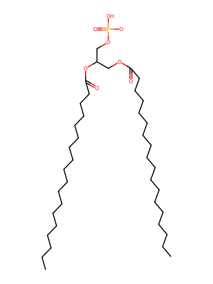
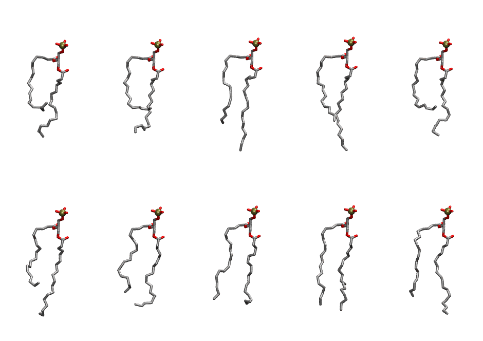
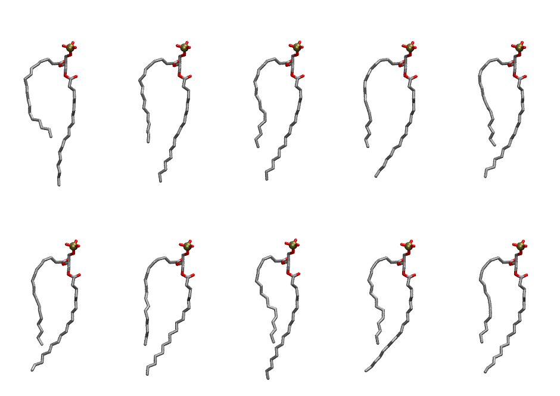

.. _lipid_gallery dspa:

DSPA
====

**2,3-distearoyl--D-glycero-1-Phosphatidic acid**

==============  ==========================================
CHARMM resname  ``DSPA``
Net charge      -1.00
Atoms           124
Topology file   ``top_all36_lipid.rtf``
Conformers      10 fluid, 10 liquid-ordered (``DSPA__Lo``)
==============  ==========================================

Structure
---------

Conformers
----------

The grid packer draws a conformer per lipid from an ensemble, so what the ensemble contains is what a built bilayer is made of. DSPA ships two: a fluid one, used by default, and a liquid-ordered one, used for a leaflet declared ``phase: Lo``. All conformers on this page are rendered at one shared scale.

Fluid (``DSPA``)
~~~~~~~~~~~~~~~~

===========  =============  ================  ================
Conformer    Head-tail (Å)  Max internal (Å)  Min chain extent
===========  =============  ================  ================
``DSPA-00``  7.46           24.90             0.46
``DSPA-01``  8.77           23.45             0.52
``DSPA-02``  12.41          27.39             0.69
``DSPA-03``  12.14          27.57             0.68
``DSPA-04``  8.56           23.87             0.51
``DSPA-05``  10.31          27.08             0.59
``DSPA-06``  12.46          24.71             0.68
``DSPA-07``  14.26          24.69             0.67
``DSPA-08``  15.60          25.25             0.75
``DSPA-09``  13.58          25.88             0.75
===========  =============  ================  ================

Liquid-ordered (``DSPA__Lo``)
~~~~~~~~~~~~~~~~~~~~~~~~~~~~~

===========  =============  ================  ================
Conformer    Head-tail (Å)  Max internal (Å)  Min chain extent
===========  =============  ================  ================
``DSPA-00``  11.80          30.27             0.66
``DSPA-01``  12.85          29.98             0.71
``DSPA-02``  13.87          29.82             0.76
``DSPA-03``  13.74          29.44             0.75
``DSPA-04``  13.47          29.20             0.74
``DSPA-05``  13.60          28.60             0.75
``DSPA-06``  13.58          29.22             0.75
``DSPA-07``  13.36          29.80             0.74
``DSPA-08``  13.39          29.06             0.74
``DSPA-09``  13.11          28.47             0.72
===========  =============  ================  ================

*Min chain extent* is how far the least-extended acyl chain descends below its own attachment carbon, as a fraction of that chain's all-trans contour; an all-trans chain scores 1.0, and a conformer under 0.25 is rejected at generation as folded.

Provenance
----------

How each ensemble was generated, read from the entry's own ``info.yaml``:

===================  ============  ============
Setting              ``DSPA``      ``DSPA__Lo``
===================  ============  ============
Sampler              ``mc``        ``mc``
Phase                none (fluid)  Lo
Trans bias           0.0           40.0
Chain order          0.147         0.282
MC seed              0             0
Chains               2             2
Cylinder APL         60.0 Ų       60.0 Ų
Cylinder inflation   1.9           1.9
Equilibration steps  20000         20000
Decorrelation steps  3000          3000
Max MC angle         30°           30°
Radius scale         0.8           0.8
Axial bias           1.0           1.0
===================  ============  ============
