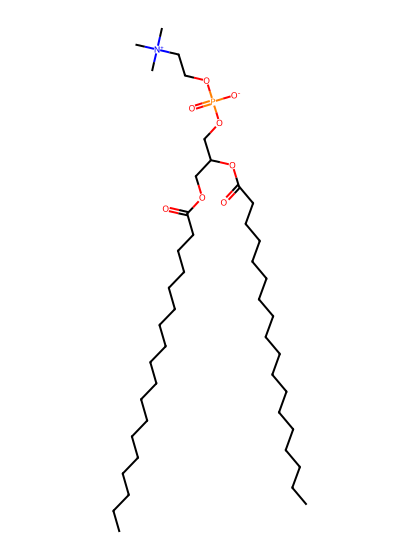
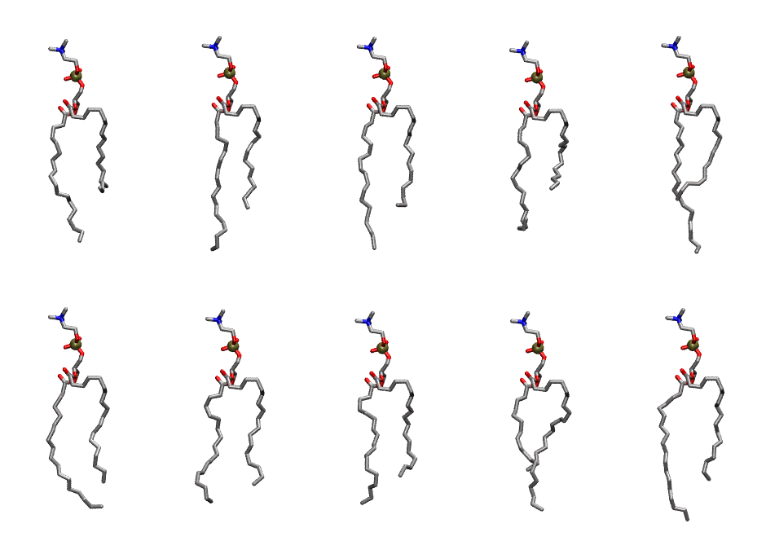
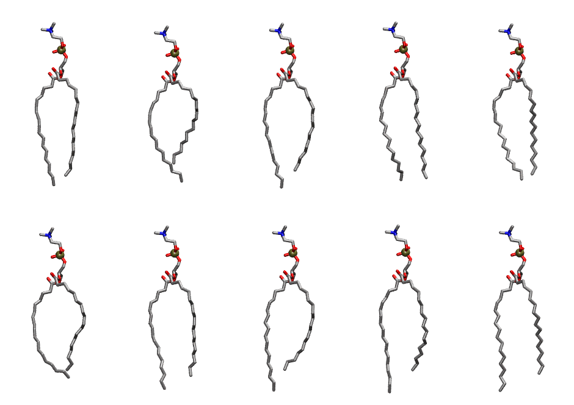

.. _lipid_gallery dspc:

DSPC
====

**2,3 distearoyl-D-glycero-1-Phosphatidylcholine**

==============  ==========================================
CHARMM resname  ``DSPC``
Net charge      0.00
Atoms           142
Topology file   ``top_all36_lipid.rtf``
Conformers      10 fluid, 10 liquid-ordered (``DSPC__Lo``)
==============  ==========================================

Structure
---------

Conformers
----------

The grid packer draws a conformer per lipid from an ensemble, so what the ensemble contains is what a built bilayer is made of. DSPC ships two: a fluid one, used by default, and a liquid-ordered one, used for a leaflet declared ``phase: Lo``. All conformers on this page are rendered at one shared scale.

Fluid (``DSPC``)
~~~~~~~~~~~~~~~~

===========  =============  ================  ================
Conformer    Head-tail (Å)  Max internal (Å)  Min chain extent
===========  =============  ================  ================
``DSPC-00``  11.13          29.55             0.52
``DSPC-01``  14.28          31.45             0.66
``DSPC-02``  13.83          30.68             0.64
``DSPC-03``  11.00          27.67             0.51
``DSPC-04``  13.13          31.48             0.61
``DSPC-05``  14.66          29.60             0.68
``DSPC-06``  14.73          28.47             0.68
``DSPC-07``  13.28          28.31             0.62
``DSPC-08``  12.46          29.46             0.58
``DSPC-09``  14.19          30.81             0.66
===========  =============  ================  ================

Liquid-ordered (``DSPC__Lo``)
~~~~~~~~~~~~~~~~~~~~~~~~~~~~~

===========  =============  ================  ================
Conformer    Head-tail (Å)  Max internal (Å)  Min chain extent
===========  =============  ================  ================
``DSPC-00``  18.86          31.63             0.87
``DSPC-01``  15.96          30.46             0.74
``DSPC-02``  17.79          31.80             0.82
``DSPC-03``  19.41          30.88             0.87
``DSPC-04``  18.39          30.47             0.85
``DSPC-05``  16.89          29.68             0.78
``DSPC-06``  18.26          31.92             0.85
``DSPC-07``  17.17          32.05             0.80
``DSPC-08``  17.39          32.47             0.81
``DSPC-09``  17.91          32.22             0.83
===========  =============  ================  ================

*Min chain extent* is how far the least-extended acyl chain descends below its own attachment carbon, as a fraction of that chain's all-trans contour; an all-trans chain scores 1.0, and a conformer under 0.25 is rejected at generation as folded.

Provenance
----------

How each ensemble was generated, read from the entry's own ``info.yaml``:

===================  ============  ============
Setting              ``DSPC``      ``DSPC__Lo``
===================  ============  ============
Sampler              ``mc``        ``mc``
Phase                none (fluid)  Lo
Trans bias           0.0           20.0
Chain order          0.191         0.301
MC seed              0             0
Chains               2             2
Cylinder APL         60.0 Ų       60.0 Ų
Cylinder inflation   1.9           1.9
Equilibration steps  20000         20000
Decorrelation steps  3000          3000
Max MC angle         30°           30°
Radius scale         0.8           0.8
Axial bias           1.0           1.0
===================  ============  ============
