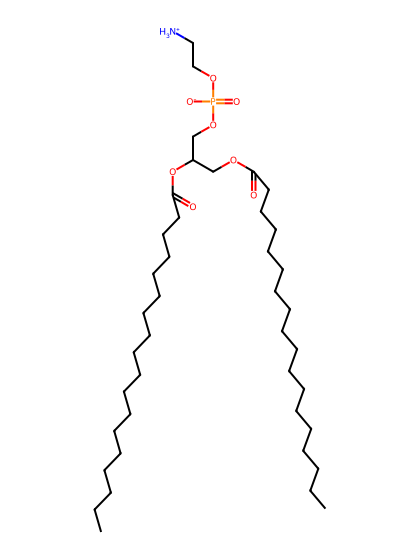
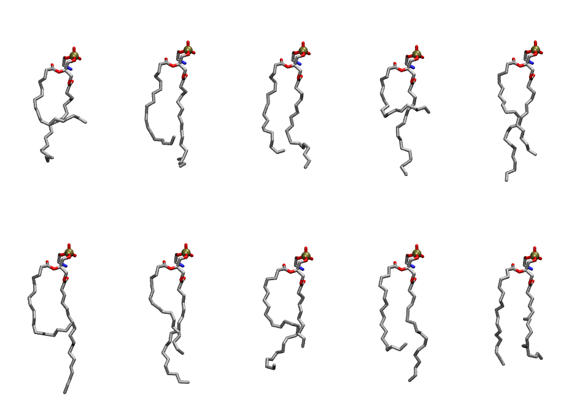
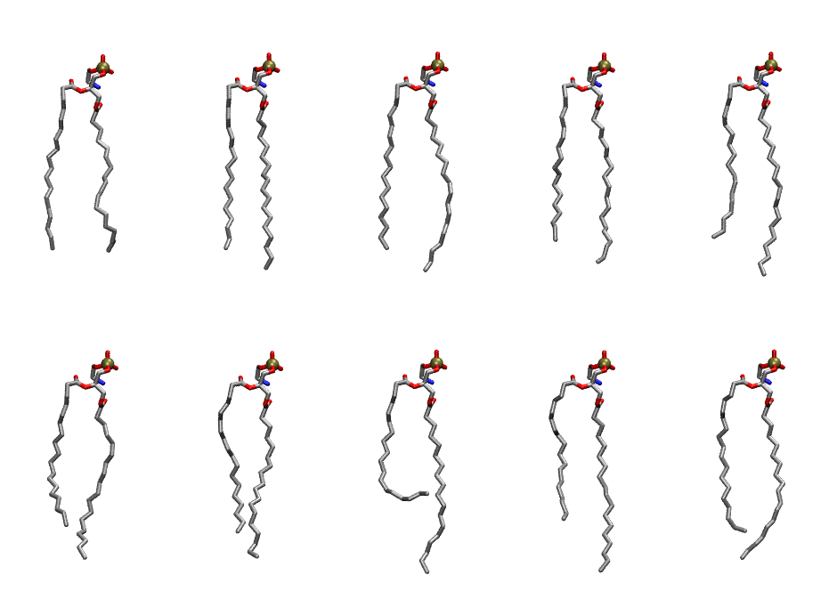

.. _lipid_gallery dspe:

DSPE
====

**2,3-distearoyl-D-glycero-1-Phosphatidylethanolamine**

==============  ==========================================
CHARMM resname  ``DSPE``
Net charge      0.00
Atoms           133
Topology file   ``top_all36_lipid.rtf``
Conformers      10 fluid, 10 liquid-ordered (``DSPE__Lo``)
==============  ==========================================

Structure
---------

Conformers
----------

The grid packer draws a conformer per lipid from an ensemble, so what the ensemble contains is what a built bilayer is made of. DSPE ships two: a fluid one, used by default, and a liquid-ordered one, used for a leaflet declared ``phase: Lo``. All conformers on this page are rendered at one shared scale.

Fluid (``DSPE``)
~~~~~~~~~~~~~~~~

===========  =============  ================  ================
Conformer    Head-tail (Å)  Max internal (Å)  Min chain extent
===========  =============  ================  ================
``DSPE-00``  7.44           22.28             0.45
``DSPE-01``  11.18          24.21             0.62
``DSPE-02``  13.49          23.88             0.73
``DSPE-03``  5.90           24.55             0.38
``DSPE-04``  14.36          26.32             0.77
``DSPE-05``  8.39           27.42             0.49
``DSPE-06``  13.66          26.05             0.74
``DSPE-07``  11.80          23.80             0.65
``DSPE-08``  11.83          25.50             0.65
``DSPE-09``  14.03          22.69             0.62
===========  =============  ================  ================

Liquid-ordered (``DSPE__Lo``)
~~~~~~~~~~~~~~~~~~~~~~~~~~~~~

===========  =============  ================  ================
Conformer    Head-tail (Å)  Max internal (Å)  Min chain extent
===========  =============  ================  ================
``DSPE-00``  17.95          25.70             0.81
``DSPE-01``  18.10          27.87             0.92
``DSPE-02``  18.22          28.17             0.94
``DSPE-03``  17.10          27.38             0.89
``DSPE-04``  16.83          28.24             0.89
``DSPE-05``  15.52          26.60             0.82
``DSPE-06``  16.26          27.41             0.86
``DSPE-07``  11.71          28.29             0.65
``DSPE-08``  14.75          28.30             0.79
``DSPE-09``  16.35          27.46             0.86
===========  =============  ================  ================

*Min chain extent* is how far the least-extended acyl chain descends below its own attachment carbon, as a fraction of that chain's all-trans contour; an all-trans chain scores 1.0, and a conformer under 0.25 is rejected at generation as folded.

Provenance
----------

How each ensemble was generated, read from the entry's own ``info.yaml``:

===================  ============  ============
Setting              ``DSPE``      ``DSPE__Lo``
===================  ============  ============
Sampler              ``mc``        ``mc``
Phase                none (fluid)  Lo
Trans bias           0.0           5.0
Chain order          0.175         0.320
MC seed              0             0
Chains               2             2
Cylinder APL         60.0 Ų       60.0 Ų
Cylinder inflation   1.9           1.9
Equilibration steps  20000         20000
Decorrelation steps  3000          3000
Max MC angle         30°           30°
Radius scale         0.8           0.8
Axial bias           1.0           1.0
===================  ============  ============
