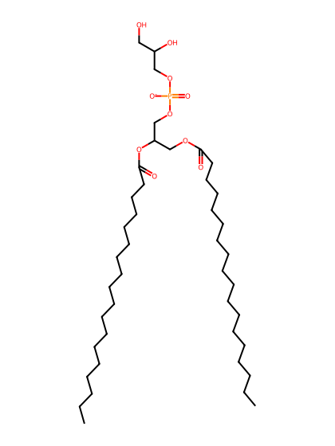
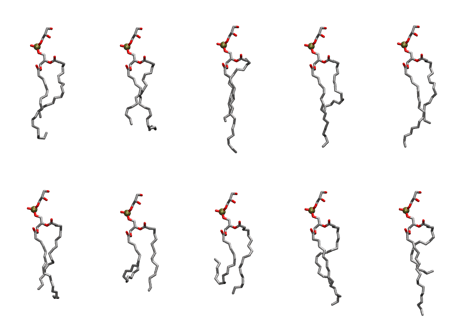
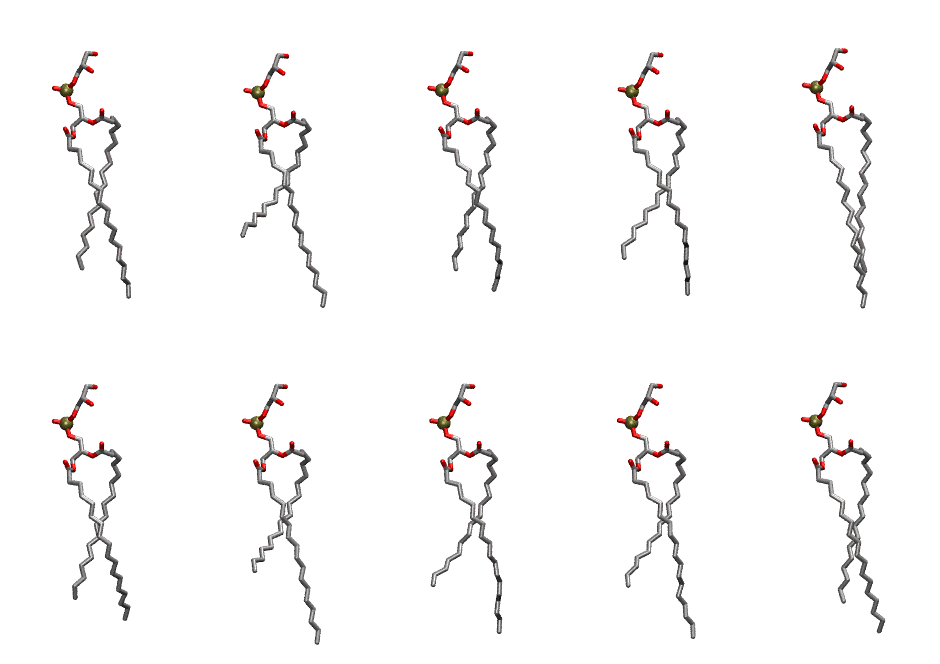

.. _lipid_gallery dspg:

DSPG
====

**2,3-distearoyl-D-glycero-1-Phosphatidylglycerol**

==============  ==========================================
CHARMM resname  ``DSPG``
Net charge      -1.00
Atoms           135
Topology file   ``top_all36_lipid.rtf``
Conformers      10 fluid, 10 liquid-ordered (``DSPG__Lo``)
==============  ==========================================

Structure
---------

Conformers
----------

The grid packer draws a conformer per lipid from an ensemble, so what the ensemble contains is what a built bilayer is made of. DSPG ships two: a fluid one, used by default, and a liquid-ordered one, used for a leaflet declared ``phase: Lo``. All conformers on this page are rendered at one shared scale.

Fluid (``DSPG``)
~~~~~~~~~~~~~~~~

===========  =============  ================  ================
Conformer    Head-tail (Å)  Max internal (Å)  Min chain extent
===========  =============  ================  ================
``DSPG-00``  12.29          28.08             0.63
``DSPG-01``  13.96          26.60             0.67
``DSPG-02``  13.66          31.62             0.69
``DSPG-03``  10.85          30.33             0.56
``DSPG-04``  14.17          30.50             0.72
``DSPG-05``  14.52          27.73             0.73
``DSPG-06``  7.50           25.12             0.30
``DSPG-07``  6.83           25.91             0.27
``DSPG-08``  12.84          28.89             0.66
``DSPG-09``  9.99           30.90             0.52
===========  =============  ================  ================

Liquid-ordered (``DSPG__Lo``)
~~~~~~~~~~~~~~~~~~~~~~~~~~~~~

===========  =============  ================  ================
Conformer    Head-tail (Å)  Max internal (Å)  Min chain extent
===========  =============  ================  ================
``DSPG-00``  16.50          30.50             0.83
``DSPG-01``  12.38          31.52             0.63
``DSPG-02``  16.60          29.91             0.83
``DSPG-03``  15.13          30.02             0.76
``DSPG-04``  17.14          31.77             0.86
``DSPG-05``  16.08          29.53             0.81
``DSPG-06``  12.93          32.25             0.66
``DSPG-07``  14.62          30.97             0.74
``DSPG-08``  14.71          31.57             0.74
``DSPG-09``  16.75          31.22             0.84
===========  =============  ================  ================

*Min chain extent* is how far the least-extended acyl chain descends below its own attachment carbon, as a fraction of that chain's all-trans contour; an all-trans chain scores 1.0, and a conformer under 0.25 is rejected at generation as folded.

Provenance
----------

How each ensemble was generated, read from the entry's own ``info.yaml``:

===================  ============  ============
Setting              ``DSPG``      ``DSPG__Lo``
===================  ============  ============
Sampler              ``mc``        ``mc``
Phase                none (fluid)  Lo
Trans bias           0.0           40.0
Chain order          0.167         0.275
MC seed              0             0
Chains               2             2
Cylinder APL         60.0 Ų       60.0 Ų
Cylinder inflation   1.9           1.9
Equilibration steps  20000         20000
Decorrelation steps  3000          3000
Max MC angle         30°           30°
Radius scale         0.8           0.8
Axial bias           1.0           1.0
===================  ============  ============
