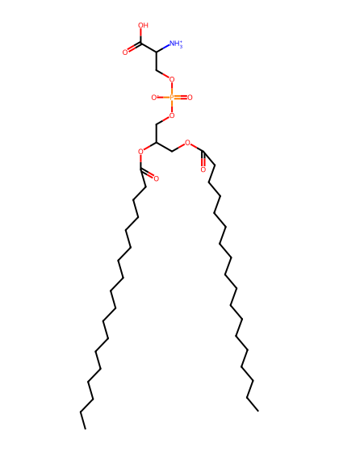
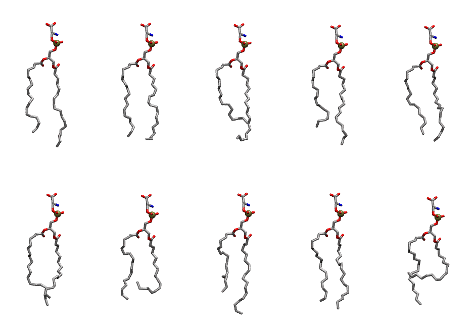
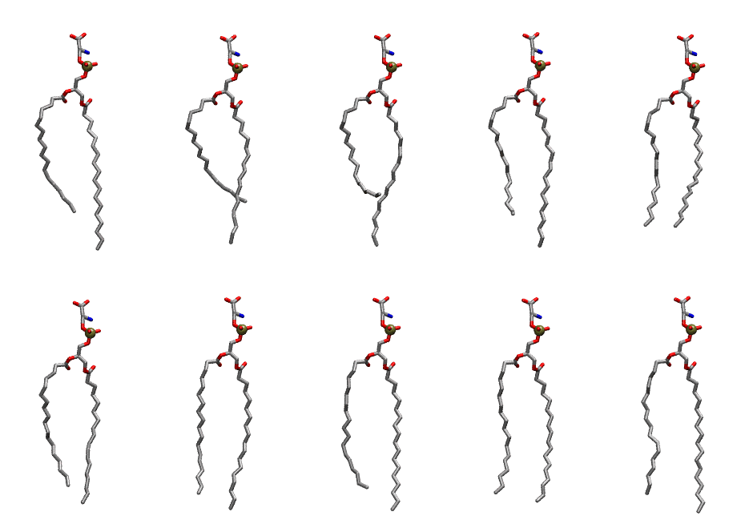

.. _lipid_gallery dsps:

DSPS
====

**2,3-distearoyl-D-glycero-1-Phosphatidylserine**

==============  ==========================================
CHARMM resname  ``DSPS``
Net charge      -1.00
Atoms           135
Topology file   ``top_all36_lipid.rtf``
Conformers      10 fluid, 10 liquid-ordered (``DSPS__Lo``)
==============  ==========================================

Structure
---------

Conformers
----------

The grid packer draws a conformer per lipid from an ensemble, so what the ensemble contains is what a built bilayer is made of. DSPS ships two: a fluid one, used by default, and a liquid-ordered one, used for a leaflet declared ``phase: Lo``. All conformers on this page are rendered at one shared scale.

Fluid (``DSPS``)
~~~~~~~~~~~~~~~~

===========  =============  ================  ================
Conformer    Head-tail (Å)  Max internal (Å)  Min chain extent
===========  =============  ================  ================
``DSPS-00``  15.87          30.86             0.76
``DSPS-01``  16.75          29.21             0.78
``DSPS-02``  13.42          29.22             0.65
``DSPS-03``  13.94          29.39             0.67
``DSPS-04``  15.58          28.46             0.75
``DSPS-05``  14.60          27.89             0.70
``DSPS-06``  10.78          26.20             0.47
``DSPS-07``  13.21          29.61             0.64
``DSPS-08``  15.46          28.70             0.74
``DSPS-09``  7.97           26.71             0.34
===========  =============  ================  ================

Liquid-ordered (``DSPS__Lo``)
~~~~~~~~~~~~~~~~~~~~~~~~~~~~~

===========  =============  ================  ================
Conformer    Head-tail (Å)  Max internal (Å)  Min chain extent
===========  =============  ================  ================
``DSPS-00``  16.48          33.19             0.79
``DSPS-01``  14.68          32.32             0.71
``DSPS-02``  13.79          32.30             0.67
``DSPS-03``  16.97          32.80             0.81
``DSPS-04``  18.31          30.23             0.83
``DSPS-05``  17.53          31.55             0.84
``DSPS-06``  19.23          32.50             0.92
``DSPS-07``  18.35          32.89             0.88
``DSPS-08``  19.02          32.09             0.91
``DSPS-09``  19.27          32.99             0.92
===========  =============  ================  ================

*Min chain extent* is how far the least-extended acyl chain descends below its own attachment carbon, as a fraction of that chain's all-trans contour; an all-trans chain scores 1.0, and a conformer under 0.25 is rejected at generation as folded.

Provenance
----------

How each ensemble was generated, read from the entry's own ``info.yaml``:

===================  ============  ============
Setting              ``DSPS``      ``DSPS__Lo``
===================  ============  ============
Sampler              ``mc``        ``mc``
Phase                none (fluid)  Lo
Trans bias           0.0           20.0
Chain order          0.171         0.308
MC seed              0             0
Chains               2             2
Cylinder APL         60.0 Ų       60.0 Ų
Cylinder inflation   1.9           1.9
Equilibration steps  20000         20000
Decorrelation steps  3000          3000
Max MC angle         30°           30°
Radius scale         0.8           0.8
Axial bias           1.0           1.0
===================  ============  ============
