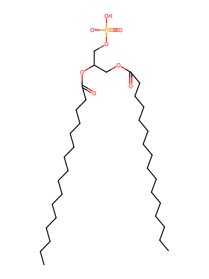
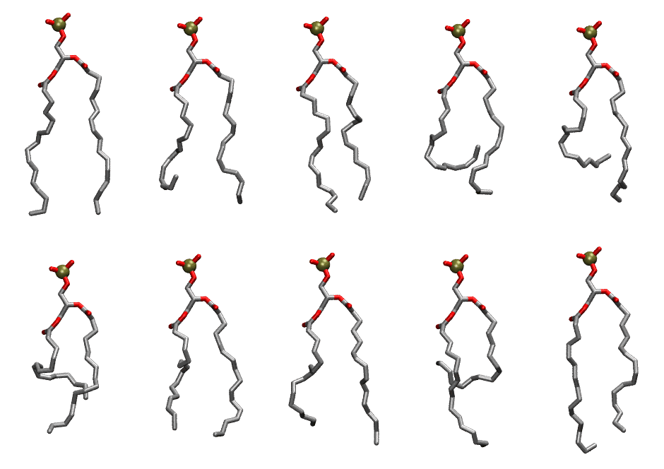

.. _lipid_gallery dtpa:

DTPA
====

==============  ========================================
CHARMM resname  ``DTPA``
Net charge      -1.00
Atoms           100
Topology file   ``toppar_all36_lipid_miscellaneous.str``
Conformers      10 fluid
==============  ========================================

Structure
---------

Conformers
----------

The grid packer draws a conformer per lipid from this ensemble, so what the ensemble contains is what a built bilayer is made of. A leaflet declared ``phase: Lo`` generates an ordered ensemble when a build first needs it. All conformers are rendered at one shared scale.

===========  =============  ================  ================
Conformer    Head-tail (Å)  Max internal (Å)  Min chain extent
===========  =============  ================  ================
``DTPA-00``  14.60          25.18             0.78
``DTPA-01``  10.05          23.36             0.54
``DTPA-02``  12.52          24.15             0.74
``DTPA-03``  6.37           21.61             0.34
``DTPA-04``  7.18           22.23             0.39
``DTPA-05``  7.48           21.79             0.40
``DTPA-06``  11.65          22.79             0.62
``DTPA-07``  11.35          23.99             0.61
``DTPA-08``  4.19           23.50             0.34
``DTPA-09``  12.75          25.16             0.77
===========  =============  ================  ================

*Min chain extent* is how far the least-extended acyl chain descends below its own attachment carbon, as a fraction of that chain's all-trans contour; an all-trans chain scores 1.0, and a conformer under 0.25 is rejected at generation as folded.

Provenance
----------

How the ensemble was generated, read from the entry's own ``info.yaml``:

===================  ============
Setting              ``DTPA``
===================  ============
Sampler              ``mc``
Phase                none (fluid)
Trans bias           0.0
Chain order          0.166
MC seed              0
Chains               2
Cylinder APL         60.0 Ų
Cylinder inflation   1.9
Equilibration steps  20000
Decorrelation steps  3000
Max MC angle         30°
Radius scale         0.8
Axial bias           1.0
===================  ============
