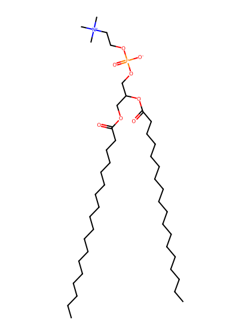
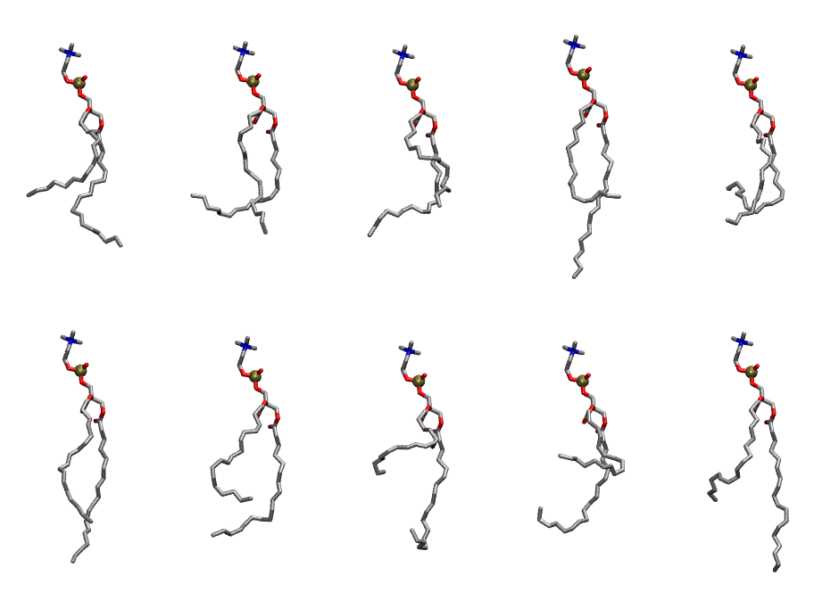

.. _lipid_gallery dupc:

DUPC
====

**2,3-dilinoleoyl-D-glycero-1-phosphatidylcholine**

==============  ========================================
CHARMM resname  ``DUPC``
Net charge      0.00
Atoms           134
Topology file   ``toppar_all36_lipid_miscellaneous.str``
Conformers      10 fluid
==============  ========================================

Structure
---------

Conformers
----------

The grid packer draws a conformer per lipid from this ensemble, so what the ensemble contains is what a built bilayer is made of. A leaflet declared ``phase: Lo`` generates an ordered ensemble when a build first needs it. All conformers are rendered at one shared scale.

===========  =============  ================  ================
Conformer    Head-tail (Å)  Max internal (Å)  Min chain extent
===========  =============  ================  ================
``DUPC-00``  8.07           29.59             0.48
``DUPC-01``  8.35           28.61             0.39
``DUPC-02``  9.21           27.46             0.53
``DUPC-03``  9.35           33.58             0.54
``DUPC-04``  7.01           28.47             0.33
``DUPC-05``  13.19          32.25             0.72
``DUPC-06``  9.40           28.48             0.54
``DUPC-07``  5.27           29.00             0.35
``DUPC-08``  3.20           26.93             0.25
``DUPC-09``  10.16          33.24             0.57
===========  =============  ================  ================

*Min chain extent* is how far the least-extended acyl chain descends below its own attachment carbon, as a fraction of that chain's all-trans contour; an all-trans chain scores 1.0, and a conformer under 0.25 is rejected at generation as folded.

Provenance
----------

How the ensemble was generated, read from the entry's own ``info.yaml``:

===================  ============
Setting              ``DUPC``
===================  ============
Sampler              ``mc``
Phase                none (fluid)
Trans bias           0.0
Chain order          0.128
MC seed              0
Chains               2
Cylinder APL         60.0 Ų
Cylinder inflation   1.9
Equilibration steps  20000
Decorrelation steps  3000
Max MC angle         30°
Radius scale         0.8
Axial bias           1.0
===================  ============
