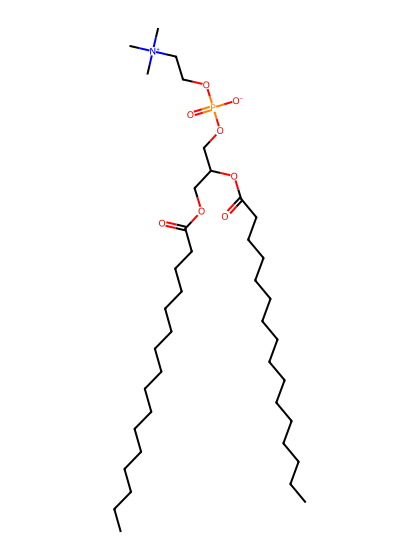
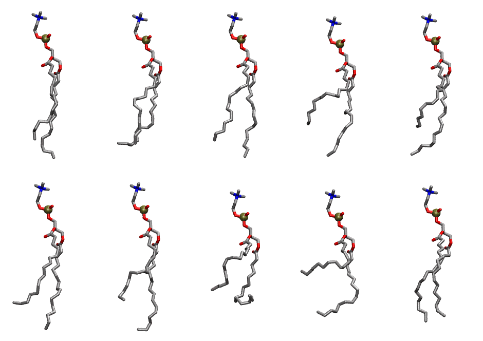

.. _lipid_gallery dxpc:

DXPC
====

**di-palmitoleic-phosphatidylcholine (diC16:1)**

==============  ========================================
CHARMM resname  ``DXPC``
Net charge      0.00
Atoms           126
Topology file   ``toppar_all36_lipid_miscellaneous.str``
Conformers      10 fluid
==============  ========================================

Structure
---------

Conformers
----------

The grid packer draws a conformer per lipid from this ensemble, so what the ensemble contains is what a built bilayer is made of. A leaflet declared ``phase: Lo`` generates an ordered ensemble when a build first needs it. All conformers are rendered at one shared scale.

===========  =============  ================  ================
Conformer    Head-tail (Å)  Max internal (Å)  Min chain extent
===========  =============  ================  ================
``DXPC-00``  12.33          29.45             0.75
``DXPC-01``  12.86          27.64             0.67
``DXPC-02``  12.38          29.00             0.75
``DXPC-03``  8.48           28.32             0.55
``DXPC-04``  9.49           28.25             0.60
``DXPC-05``  10.93          29.68             0.68
``DXPC-06``  10.34          29.40             0.64
``DXPC-07``  7.12           23.52             0.43
``DXPC-08``  3.69           25.71             0.29
``DXPC-09``  12.74          27.50             0.72
===========  =============  ================  ================

*Min chain extent* is how far the least-extended acyl chain descends below its own attachment carbon, as a fraction of that chain's all-trans contour; an all-trans chain scores 1.0, and a conformer under 0.25 is rejected at generation as folded.

Provenance
----------

How the ensemble was generated, read from the entry's own ``info.yaml``:

===================  ============
Setting              ``DXPC``
===================  ============
Sampler              ``mc``
Phase                none (fluid)
Trans bias           0.0
Chain order          0.140
MC seed              0
Chains               2
Cylinder APL         60.0 Ų
Cylinder inflation   1.9
Equilibration steps  20000
Decorrelation steps  3000
Max MC angle         30°
Radius scale         0.8
Axial bias           1.0
===================  ============
