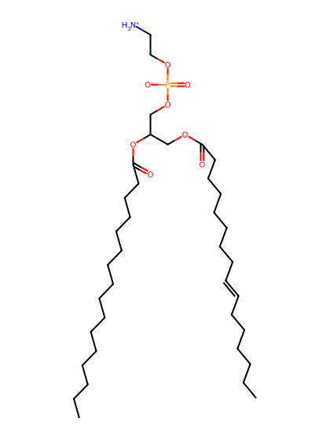
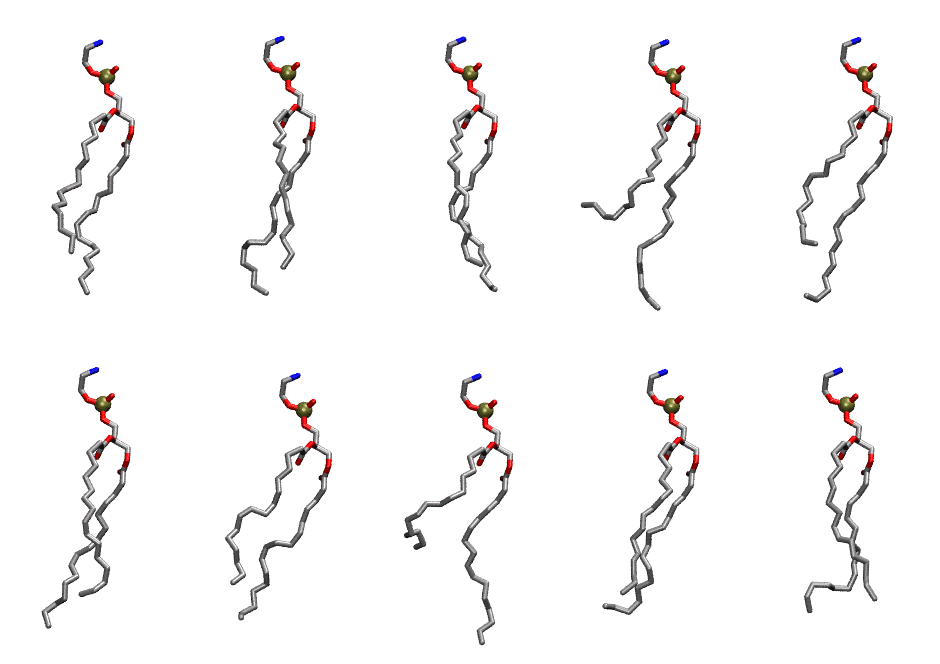

.. _lipid_gallery dxpe:

DXPE
====

**di-palmitoleic-phosphatidylethanolamine (diC16:1)**

==============  ========================================
CHARMM resname  ``DXPE``
Net charge      0.00
Atoms           117
Topology file   ``toppar_all36_lipid_miscellaneous.str``
Conformers      10 fluid
==============  ========================================

Structure
---------

Conformers
----------

The grid packer draws a conformer per lipid from this ensemble, so what the ensemble contains is what a built bilayer is made of. A leaflet declared ``phase: Lo`` generates an ordered ensemble when a build first needs it. All conformers are rendered at one shared scale.

===========  =============  ================  ================
Conformer    Head-tail (Å)  Max internal (Å)  Min chain extent
===========  =============  ================  ================
``DXPE-00``  10.53          27.31             0.68
``DXPE-01``  12.44          27.18             0.78
``DXPE-02``  12.10          27.48             0.77
``DXPE-03``  5.99           27.86             0.44
``DXPE-04``  10.03          28.16             0.66
``DXPE-05``  12.05          27.60             0.76
``DXPE-06``  10.31          26.36             0.67
``DXPE-07``  6.75           28.01             0.48
``DXPE-08``  11.70          26.52             0.69
``DXPE-09``  12.43          26.04             0.72
===========  =============  ================  ================

*Min chain extent* is how far the least-extended acyl chain descends below its own attachment carbon, as a fraction of that chain's all-trans contour; an all-trans chain scores 1.0, and a conformer under 0.25 is rejected at generation as folded.

Provenance
----------

How the ensemble was generated, read from the entry's own ``info.yaml``:

===================  ============
Setting              ``DXPE``
===================  ============
Sampler              ``mc``
Phase                none (fluid)
Trans bias           0.0
Chain order          0.151
MC seed              0
Chains               2
Cylinder APL         60.0 Ų
Cylinder inflation   1.9
Equilibration steps  20000
Decorrelation steps  3000
Max MC angle         30°
Radius scale         0.8
Axial bias           1.0
===================  ============
