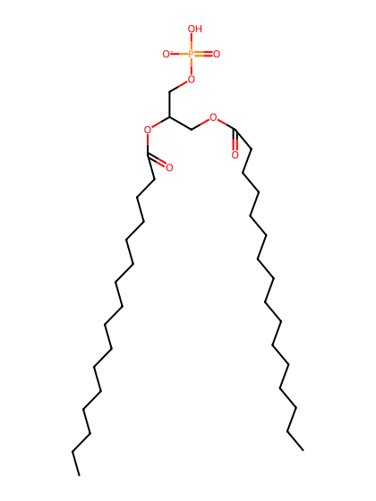
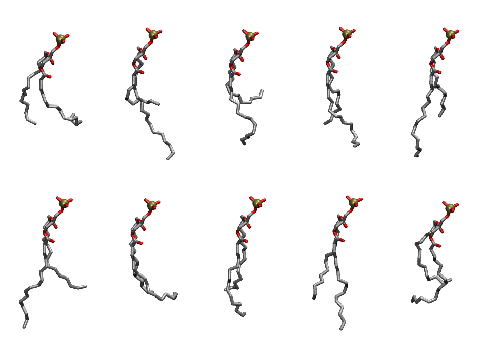

.. _lipid_gallery dypa:

DYPA
====

**di-palmitoleic-phosphatidic acid (diC16:1)**

==============  ========================================
CHARMM resname  ``DYPA``
Net charge      -1.00
Atoms           108
Topology file   ``toppar_all36_lipid_miscellaneous.str``
Conformers      10 fluid
==============  ========================================

Structure
---------

Conformers
----------

The grid packer draws a conformer per lipid from this ensemble, so what the ensemble contains is what a built bilayer is made of. A leaflet declared ``phase: Lo`` generates an ordered ensemble when a build first needs it. All conformers are rendered at one shared scale.

===========  =============  ================  ================
Conformer    Head-tail (Å)  Max internal (Å)  Min chain extent
===========  =============  ================  ================
``DYPA-00``  6.49           21.33             0.36
``DYPA-01``  5.50           24.56             0.47
``DYPA-02``  2.78           22.77             0.33
``DYPA-03``  8.99           22.78             0.65
``DYPA-04``  7.50           26.27             0.58
``DYPA-05``  7.79           26.75             0.59
``DYPA-06``  8.48           22.75             0.47
``DYPA-07``  8.42           23.82             0.62
``DYPA-08``  9.98           24.62             0.70
``DYPA-09``  5.82           23.18             0.49
===========  =============  ================  ================

*Min chain extent* is how far the least-extended acyl chain descends below its own attachment carbon, as a fraction of that chain's all-trans contour; an all-trans chain scores 1.0, and a conformer under 0.25 is rejected at generation as folded.

Provenance
----------

How the ensemble was generated, read from the entry's own ``info.yaml``:

===================  ============
Setting              ``DYPA``
===================  ============
Sampler              ``mc``
Phase                none (fluid)
Trans bias           0.0
Chain order          0.132
MC seed              0
Chains               2
Cylinder APL         60.0 Ų
Cylinder inflation   1.9
Equilibration steps  20000
Decorrelation steps  3000
Max MC angle         30°
Radius scale         0.8
Axial bias           1.0
===================  ============
