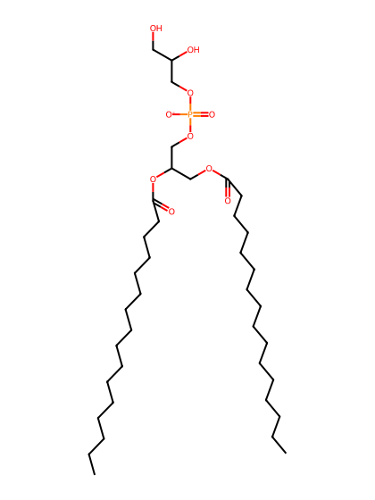
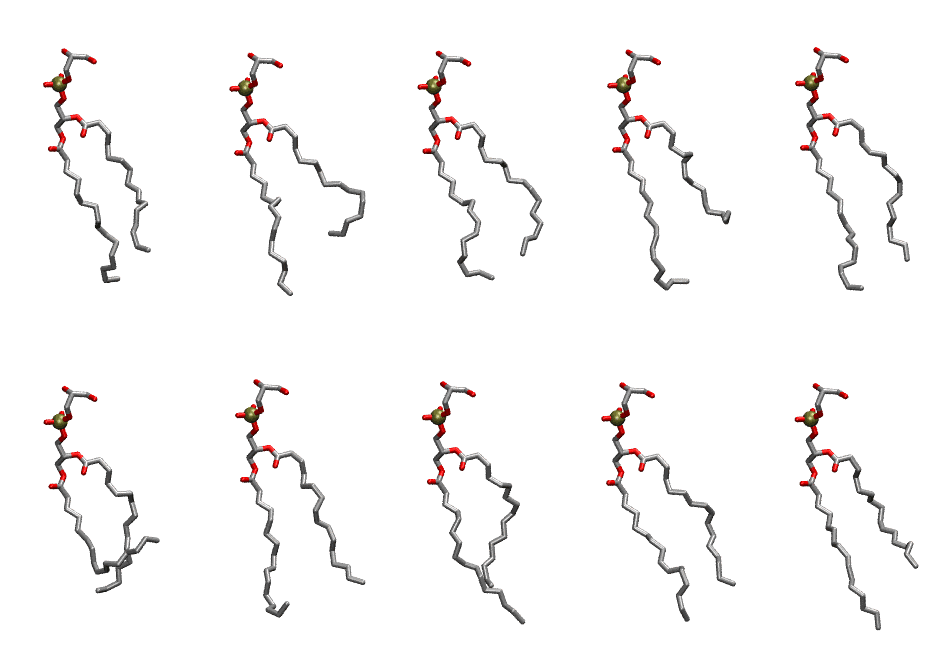

.. _lipid_gallery dypg:

DYPG
====

**di-palmitoleic-phosphatidylglycerol (diC16:1)**

==============  ========================================
CHARMM resname  ``DYPG``
Net charge      -1.00
Atoms           119
Topology file   ``toppar_all36_lipid_miscellaneous.str``
Conformers      10 fluid
==============  ========================================

Structure
---------

Conformers
----------

The grid packer draws a conformer per lipid from this ensemble, so what the ensemble contains is what a built bilayer is made of. A leaflet declared ``phase: Lo`` generates an ordered ensemble when a build first needs it. All conformers are rendered at one shared scale.

===========  =============  ================  ================
Conformer    Head-tail (Å)  Max internal (Å)  Min chain extent
===========  =============  ================  ================
``DYPG-00``  10.40          26.81             0.67
``DYPG-01``  8.27           26.03             0.56
``DYPG-02``  10.54          24.89             0.68
``DYPG-03``  7.16           25.76             0.50
``DYPG-04``  11.45          26.30             0.73
``DYPG-05``  5.55           23.57             0.29
``DYPG-06``  10.55          25.24             0.67
``DYPG-07``  10.66          26.47             0.68
``DYPG-08``  10.36          26.12             0.67
``DYPG-09``  8.47           26.49             0.57
===========  =============  ================  ================

*Min chain extent* is how far the least-extended acyl chain descends below its own attachment carbon, as a fraction of that chain's all-trans contour; an all-trans chain scores 1.0, and a conformer under 0.25 is rejected at generation as folded.

Provenance
----------

How the ensemble was generated, read from the entry's own ``info.yaml``:

===================  ============
Setting              ``DYPG``
===================  ============
Sampler              ``mc``
Phase                none (fluid)
Trans bias           0.0
Chain order          0.150
MC seed              0
Chains               2
Cylinder APL         60.0 Ų
Cylinder inflation   1.9
Equilibration steps  20000
Decorrelation steps  3000
Max MC angle         30°
Radius scale         0.8
Axial bias           1.0
===================  ============
