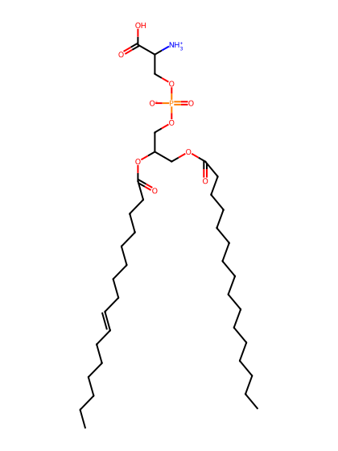
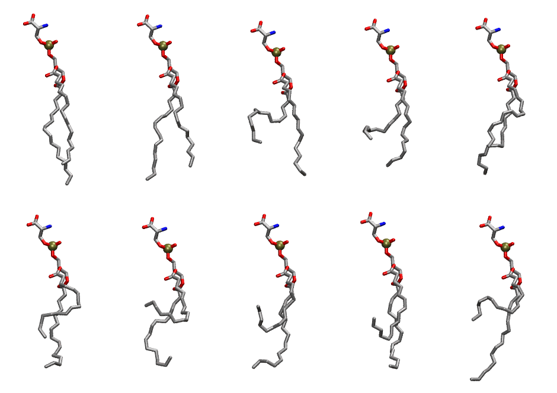

.. _lipid_gallery dyps:

DYPS
====

**di-palmitoleic-phosphatidylserine (diC16:1)**

==============  ========================================
CHARMM resname  ``DYPS``
Net charge      -1.00
Atoms           119
Topology file   ``toppar_all36_lipid_miscellaneous.str``
Conformers      10 fluid
==============  ========================================

Structure
---------

Conformers
----------

The grid packer draws a conformer per lipid from this ensemble, so what the ensemble contains is what a built bilayer is made of. A leaflet declared ``phase: Lo`` generates an ordered ensemble when a build first needs it. All conformers are rendered at one shared scale.

===========  =============  ================  ================
Conformer    Head-tail (Å)  Max internal (Å)  Min chain extent
===========  =============  ================  ================
``DYPS-00``  13.03          29.65             0.79
``DYPS-01``  13.23          28.80             0.80
``DYPS-02``  8.23           27.68             0.43
``DYPS-03``  7.97           25.98             0.41
``DYPS-04``  9.39           26.46             0.60
``DYPS-05``  8.38           27.10             0.55
``DYPS-06``  2.75           25.85             0.25
``DYPS-07``  3.44           26.45             0.29
``DYPS-08``  5.81           27.47             0.41
``DYPS-09``  5.30           28.25             0.39
===========  =============  ================  ================

*Min chain extent* is how far the least-extended acyl chain descends below its own attachment carbon, as a fraction of that chain's all-trans contour; an all-trans chain scores 1.0, and a conformer under 0.25 is rejected at generation as folded.

Provenance
----------

How the ensemble was generated, read from the entry's own ``info.yaml``:

===================  ============
Setting              ``DYPS``
===================  ============
Sampler              ``mc``
Phase                none (fluid)
Trans bias           0.0
Chain order          0.142
MC seed              0
Chains               2
Cylinder APL         60.0 Ų
Cylinder inflation   1.9
Equilibration steps  20000
Decorrelation steps  3000
Max MC angle         30°
Radius scale         0.8
Axial bias           1.0
===================  ============
