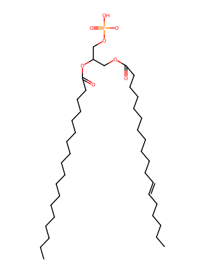
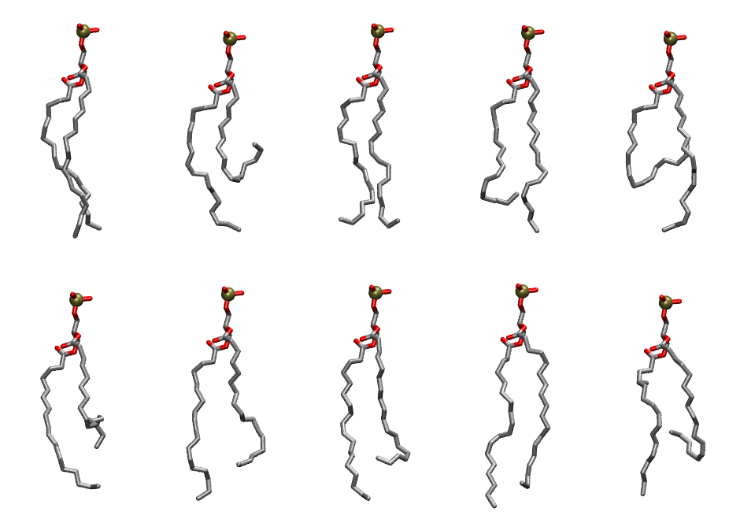

.. _lipid_gallery llpa:

LLPA
====

**1-Linoleoyl-2-Linolenoyl-sn-glycero-3-Phosphotidic acid**

==============  ========================================
CHARMM resname  ``LLPA``
Net charge      -1.00
Atoms           114
Topology file   ``toppar_all36_lipid_miscellaneous.str``
Conformers      10 fluid
==============  ========================================

Structure
---------

Conformers
----------

The grid packer draws a conformer per lipid from this ensemble, so what the ensemble contains is what a built bilayer is made of. A leaflet declared ``phase: Lo`` generates an ordered ensemble when a build first needs it. All conformers are rendered at one shared scale.

===========  =============  ================  ================
Conformer    Head-tail (Å)  Max internal (Å)  Min chain extent
===========  =============  ================  ================
``LLPA-00``  17.41          25.95             0.77
``LLPA-01``  6.75           24.57             0.34
``LLPA-02``  16.38          24.82             0.72
``LLPA-03``  13.22          24.56             0.58
``LLPA-04``  6.72           23.96             0.27
``LLPA-05``  11.54          24.26             0.56
``LLPA-06``  14.29          25.74             0.69
``LLPA-07``  13.72          25.50             0.66
``LLPA-08``  16.82          26.86             0.81
``LLPA-09``  9.52           23.78             0.47
===========  =============  ================  ================

*Min chain extent* is how far the least-extended acyl chain descends below its own attachment carbon, as a fraction of that chain's all-trans contour; an all-trans chain scores 1.0, and a conformer under 0.25 is rejected at generation as folded.

Provenance
----------

How the ensemble was generated, read from the entry's own ``info.yaml``:

===================  ============
Setting              ``LLPA``
===================  ============
Sampler              ``mc``
Phase                none (fluid)
Trans bias           0.0
Chain order          0.206
MC seed              0
Chains               2
Cylinder APL         60.0 Ų
Cylinder inflation   1.9
Equilibration steps  20000
Decorrelation steps  3000
Max MC angle         30°
Radius scale         0.8
Axial bias           1.0
===================  ============
