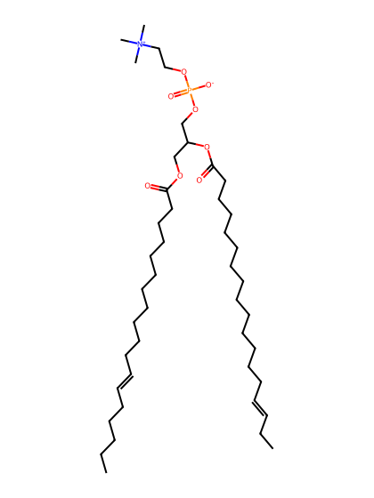
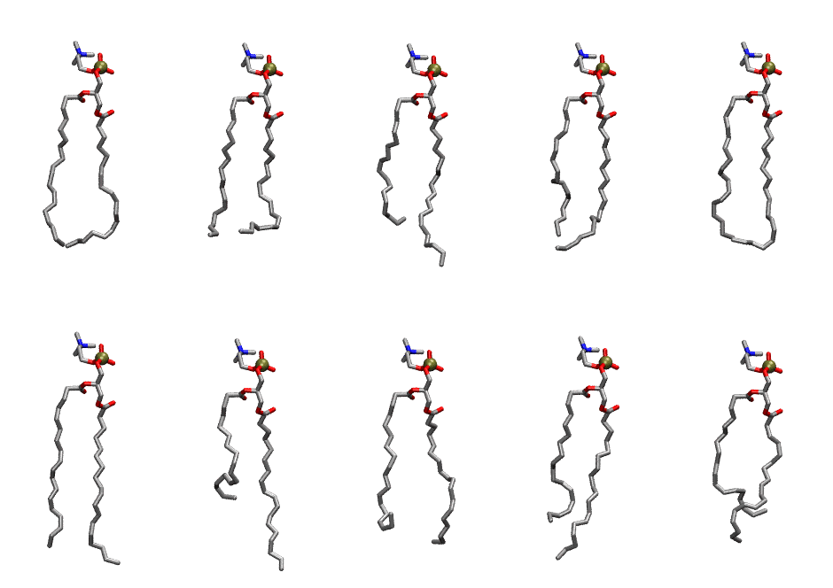

.. _lipid_gallery llpc:

LLPC
====

**1-Linoleoyl-2-Linolenoyl-sn-glycero-3--Phosphatidylcholine**

==============  ========================================
CHARMM resname  ``LLPC``
Net charge      0.00
Atoms           132
Topology file   ``toppar_all36_lipid_miscellaneous.str``
Conformers      10 fluid
==============  ========================================

Structure
---------

Conformers
----------

The grid packer draws a conformer per lipid from this ensemble, so what the ensemble contains is what a built bilayer is made of. A leaflet declared ``phase: Lo`` generates an ordered ensemble when a build first needs it. All conformers are rendered at one shared scale.

===========  =============  ================  ================
Conformer    Head-tail (Å)  Max internal (Å)  Min chain extent
===========  =============  ================  ================
``LLPC-00``  15.89          26.52             0.72
``LLPC-01``  14.09          24.93             0.63
``LLPC-02``  12.50          28.37             0.66
``LLPC-03``  14.51          26.70             0.72
``LLPC-04``  14.98          26.48             0.68
``LLPC-05``  17.12          29.75             0.86
``LLPC-06``  10.59          29.41             0.57
``LLPC-07``  12.60          26.35             0.67
``LLPC-08``  13.59          28.51             0.71
``LLPC-09``  11.95          25.63             0.64
===========  =============  ================  ================

*Min chain extent* is how far the least-extended acyl chain descends below its own attachment carbon, as a fraction of that chain's all-trans contour; an all-trans chain scores 1.0, and a conformer under 0.25 is rejected at generation as folded.

Provenance
----------

How the ensemble was generated, read from the entry's own ``info.yaml``:

===================  ============
Setting              ``LLPC``
===================  ============
Sampler              ``mc``
Phase                none (fluid)
Trans bias           0.0
Chain order          0.207
MC seed              0
Chains               2
Cylinder APL         60.0 Ų
Cylinder inflation   1.9
Equilibration steps  20000
Decorrelation steps  3000
Max MC angle         30°
Radius scale         0.8
Axial bias           1.0
===================  ============
