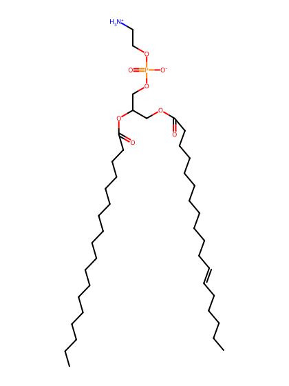
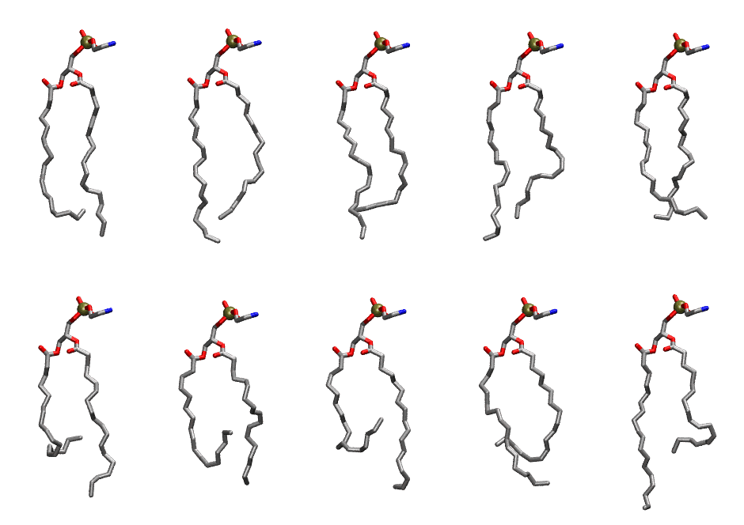

.. _lipid_gallery llpe:

LLPE
====

**1-Linoleoyl-2-Linolenoyl-sn-glycero-3-Phosphatidylethanolamine**

==============  ========================================
CHARMM resname  ``LLPE``
Net charge      0.00
Atoms           123
Topology file   ``toppar_all36_lipid_miscellaneous.str``
Conformers      10 fluid
==============  ========================================

Structure
---------

Conformers
----------

The grid packer draws a conformer per lipid from this ensemble, so what the ensemble contains is what a built bilayer is made of. A leaflet declared ``phase: Lo`` generates an ordered ensemble when a build first needs it. All conformers are rendered at one shared scale.

===========  =============  ================  ================
Conformer    Head-tail (Å)  Max internal (Å)  Min chain extent
===========  =============  ================  ================
``LLPE-00``  15.11          25.11             0.68
``LLPE-01``  16.02          25.89             0.76
``LLPE-02``  14.84          25.73             0.70
``LLPE-03``  15.54          26.23             0.73
``LLPE-04``  15.38          23.38             0.70
``LLPE-05``  10.33          24.32             0.46
``LLPE-06``  9.23           22.90             0.41
``LLPE-07``  8.02           23.83             0.35
``LLPE-08``  11.02          23.15             0.52
``LLPE-09``  12.18          26.60             0.58
===========  =============  ================  ================

*Min chain extent* is how far the least-extended acyl chain descends below its own attachment carbon, as a fraction of that chain's all-trans contour; an all-trans chain scores 1.0, and a conformer under 0.25 is rejected at generation as folded.

Provenance
----------

How the ensemble was generated, read from the entry's own ``info.yaml``:

===================  ============
Setting              ``LLPE``
===================  ============
Sampler              ``mc``
Phase                none (fluid)
Trans bias           0.0
Chain order          0.212
MC seed              0
Chains               2
Cylinder APL         60.0 Ų
Cylinder inflation   1.9
Equilibration steps  20000
Decorrelation steps  3000
Max MC angle         30°
Radius scale         0.8
Axial bias           1.0
===================  ============
