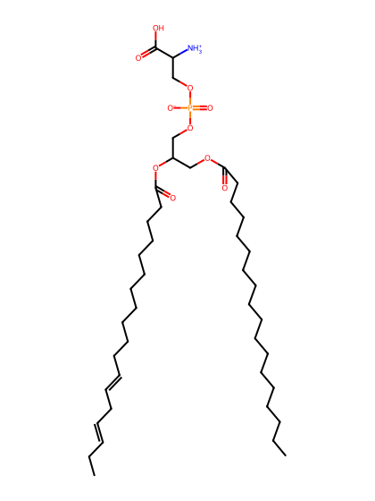
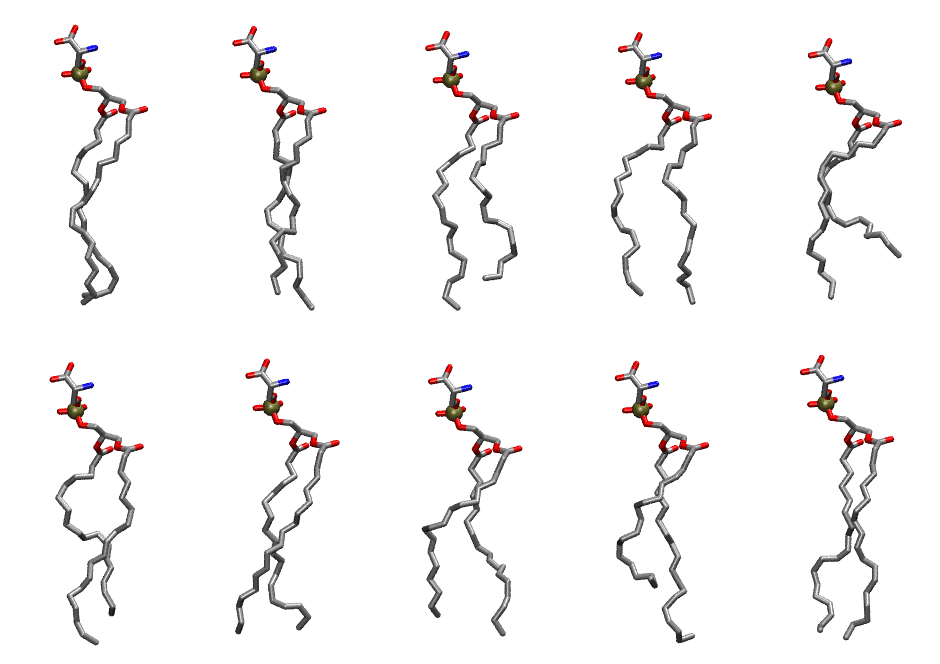

.. _lipid_gallery llps:

LLPS
====

**1-Linoleoyl-2-Linolenoyl-sn-glycero-3-Phosphatidylserine**

==============  ========================================
CHARMM resname  ``LLPS``
Net charge      -1.00
Atoms           125
Topology file   ``toppar_all36_lipid_miscellaneous.str``
Conformers      10 fluid
==============  ========================================

Structure
---------

Conformers
----------

The grid packer draws a conformer per lipid from this ensemble, so what the ensemble contains is what a built bilayer is made of. A leaflet declared ``phase: Lo`` generates an ordered ensemble when a build first needs it. All conformers are rendered at one shared scale.

===========  =============  ================  ================
Conformer    Head-tail (Å)  Max internal (Å)  Min chain extent
===========  =============  ================  ================
``LLPS-00``  17.18          26.46             0.78
``LLPS-01``  16.78          27.83             0.77
``LLPS-02``  14.99          27.01             0.69
``LLPS-03``  16.30          26.04             0.74
``LLPS-04``  12.16          24.59             0.54
``LLPS-05``  15.38          27.08             0.69
``LLPS-06``  17.03          26.65             0.77
``LLPS-07``  15.33          26.20             0.71
``LLPS-08``  12.25          27.53             0.56
``LLPS-09``  17.60          27.31             0.80
===========  =============  ================  ================

*Min chain extent* is how far the least-extended acyl chain descends below its own attachment carbon, as a fraction of that chain's all-trans contour; an all-trans chain scores 1.0, and a conformer under 0.25 is rejected at generation as folded.

Provenance
----------

How the ensemble was generated, read from the entry's own ``info.yaml``:

===================  ============
Setting              ``LLPS``
===================  ============
Sampler              ``mc``
Phase                none (fluid)
Trans bias           0.0
Chain order          0.183
MC seed              0
Chains               2
Cylinder APL         60.0 Ų
Cylinder inflation   1.9
Equilibration steps  20000
Decorrelation steps  3000
Max MC angle         30°
Radius scale         0.8
Axial bias           1.0
===================  ============
