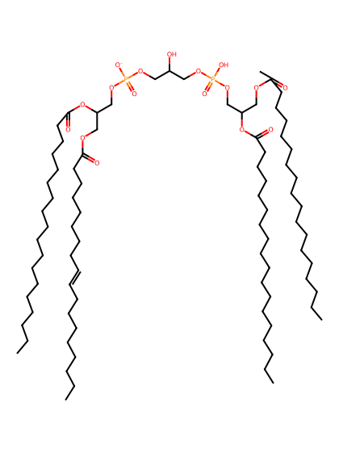
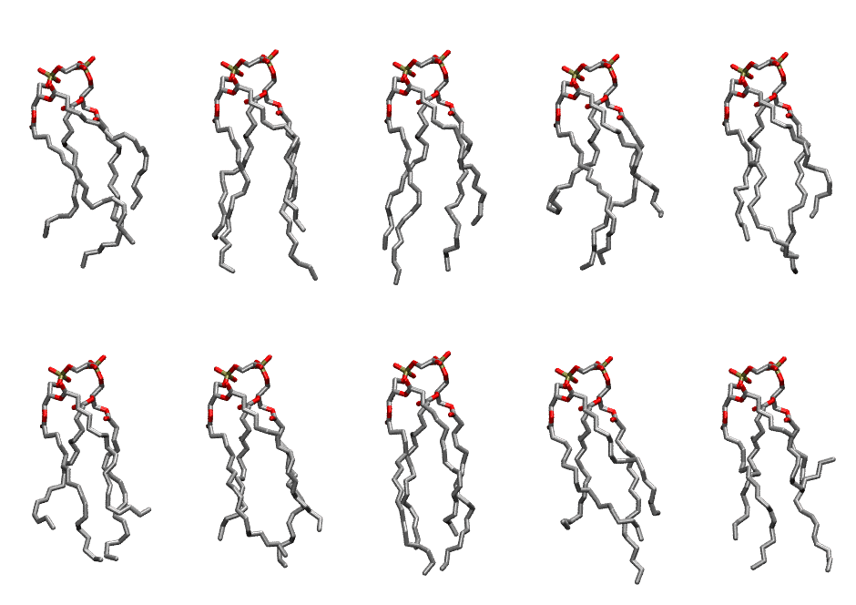

.. _lipid_gallery lnacl1:

LNACL1
======

**3 linoleic acid + 1 linolenic acid cardiolipin with head group charge = -1**

==============  ======================================
CHARMM resname  ``LNACL1``
Net charge      -1.00
Atoms           239
Topology file   ``toppar_all36_lipid_cardiolipin.str``
Conformers      10 fluid
==============  ======================================

Structure
---------

Conformers
----------

The grid packer draws a conformer per lipid from this ensemble, so what the ensemble contains is what a built bilayer is made of. A leaflet declared ``phase: Lo`` generates an ordered ensemble when a build first needs it. All conformers are rendered at one shared scale.

=============  =============  ================  ================
Conformer      Head-tail (Å)  Max internal (Å)  Min chain extent
=============  =============  ================  ================
``LNACL1-00``  9.19           25.54             0.61
``LNACL1-01``  12.47          28.50             0.73
``LNACL1-02``  11.71          29.17             0.72
``LNACL1-03``  7.56           26.45             0.46
``LNACL1-04``  10.61          27.04             0.67
``LNACL1-05``  9.55           26.17             0.62
``LNACL1-06``  11.82          26.18             0.69
``LNACL1-07``  12.77          27.81             0.77
``LNACL1-08``  9.76           27.36             0.60
``LNACL1-09``  3.61           26.52             0.35
=============  =============  ================  ================

*Min chain extent* is how far the least-extended acyl chain descends below its own attachment carbon, as a fraction of that chain's all-trans contour; an all-trans chain scores 1.0, and a conformer under 0.25 is rejected at generation as folded.

Provenance
----------

How the ensemble was generated, read from the entry's own ``info.yaml``:

===================  ============
Setting              ``LNACL1``
===================  ============
Sampler              ``mc``
Phase                none (fluid)
Trans bias           0.0
Chain order          0.183
MC seed              0
Chains               4
Cylinder APL         120.0 Ų
Cylinder inflation   1.9
Equilibration steps  20000
Decorrelation steps  3000
Max MC angle         30°
Radius scale         0.8
Axial bias           1.0
===================  ============
