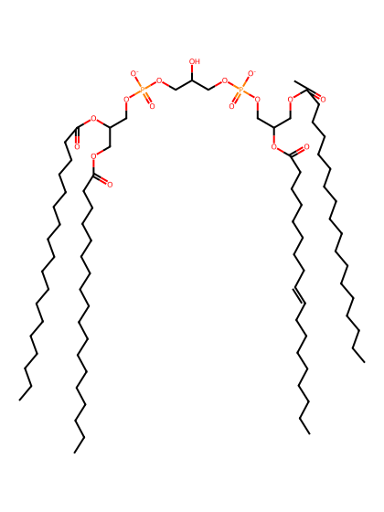
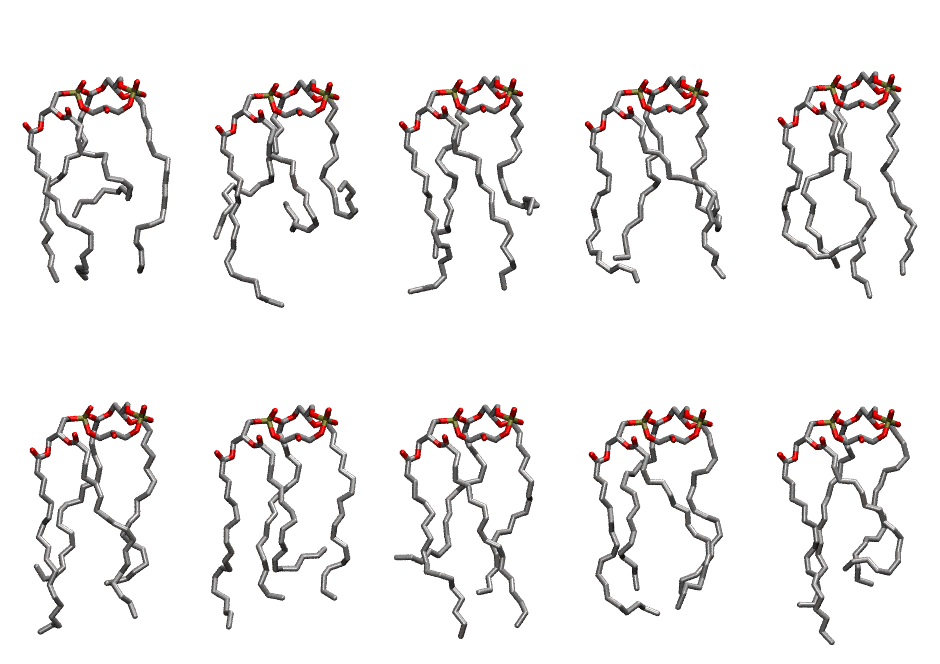

.. _lipid_gallery lnacl2:

LNACL2
======

**3 linoleic acid + 1 linolenic acid cardiolipin**

==============  ======================================
CHARMM resname  ``LNACL2``
Net charge      -2.00
Atoms           238
Topology file   ``toppar_all36_lipid_cardiolipin.str``
Conformers      10 fluid
==============  ======================================

Structure
---------

Conformers
----------

The grid packer draws a conformer per lipid from this ensemble, so what the ensemble contains is what a built bilayer is made of. A leaflet declared ``phase: Lo`` generates an ordered ensemble when a build first needs it. All conformers are rendered at one shared scale.

=============  =============  ================  ================
Conformer      Head-tail (Å)  Max internal (Å)  Min chain extent
=============  =============  ================  ================
``LNACL2-00``  9.15           23.63             0.46
``LNACL2-01``  6.28           25.39             0.40
``LNACL2-02``  8.99           25.03             0.56
``LNACL2-03``  6.97           24.81             0.47
``LNACL2-04``  12.08          25.38             0.52
``LNACL2-05``  11.77          26.31             0.69
``LNACL2-06``  9.75           25.41             0.49
``LNACL2-07``  10.63          25.88             0.64
``LNACL2-08``  13.56          23.89             0.71
``LNACL2-09``  11.55          26.08             0.57
=============  =============  ================  ================

*Min chain extent* is how far the least-extended acyl chain descends below its own attachment carbon, as a fraction of that chain's all-trans contour; an all-trans chain scores 1.0, and a conformer under 0.25 is rejected at generation as folded.

Provenance
----------

How the ensemble was generated, read from the entry's own ``info.yaml``:

===================  ============
Setting              ``LNACL2``
===================  ============
Sampler              ``mc``
Phase                none (fluid)
Trans bias           0.0
Chain order          0.208
MC seed              0
Chains               4
Cylinder APL         120.0 Ų
Cylinder inflation   1.9
Equilibration steps  20000
Decorrelation steps  3000
Max MC angle         30°
Radius scale         0.8
Axial bias           1.0
===================  ============
