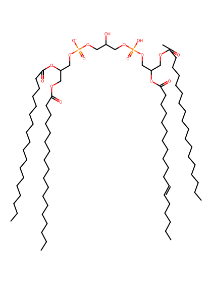
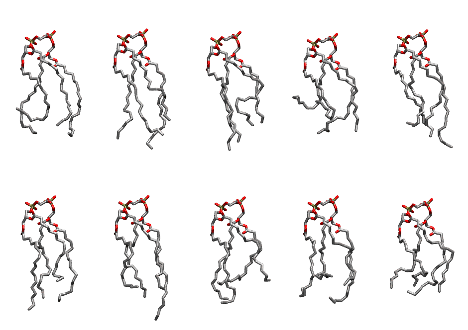

.. _lipid_gallery lnbcl1:

LNBCL1
======

**3 Linoleic acid + 1 linolenic acid cardiolipin with head group charge = -1**

==============  ======================================
CHARMM resname  ``LNBCL1``
Net charge      -1.00
Atoms           239
Topology file   ``toppar_all36_lipid_cardiolipin.str``
Conformers      10 fluid
==============  ======================================

Structure
---------

Conformers
----------

The grid packer draws a conformer per lipid from this ensemble, so what the ensemble contains is what a built bilayer is made of. A leaflet declared ``phase: Lo`` generates an ordered ensemble when a build first needs it. All conformers are rendered at one shared scale.

=============  =============  ================  ================
Conformer      Head-tail (Å)  Max internal (Å)  Min chain extent
=============  =============  ================  ================
``LNBCL1-00``  8.52           24.08             0.40
``LNBCL1-01``  11.22          26.56             0.67
``LNBCL1-02``  11.21          27.07             0.59
``LNBCL1-03``  5.67           23.38             0.30
``LNBCL1-04``  11.73          26.95             0.55
``LNBCL1-05``  9.96           26.40             0.64
``LNBCL1-06``  11.30          27.93             0.62
``LNBCL1-07``  9.64           26.00             0.51
``LNBCL1-08``  8.99           24.60             0.53
``LNBCL1-09``  10.35          22.30             0.48
=============  =============  ================  ================

*Min chain extent* is how far the least-extended acyl chain descends below its own attachment carbon, as a fraction of that chain's all-trans contour; an all-trans chain scores 1.0, and a conformer under 0.25 is rejected at generation as folded.

Provenance
----------

How the ensemble was generated, read from the entry's own ``info.yaml``:

===================  ============
Setting              ``LNBCL1``
===================  ============
Sampler              ``mc``
Phase                none (fluid)
Trans bias           0.0
Chain order          0.149
MC seed              0
Chains               4
Cylinder APL         120.0 Ų
Cylinder inflation   1.9
Equilibration steps  20000
Decorrelation steps  3000
Max MC angle         30°
Radius scale         0.8
Axial bias           1.0
===================  ============
