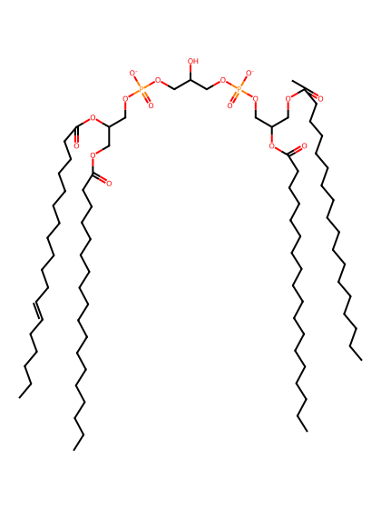
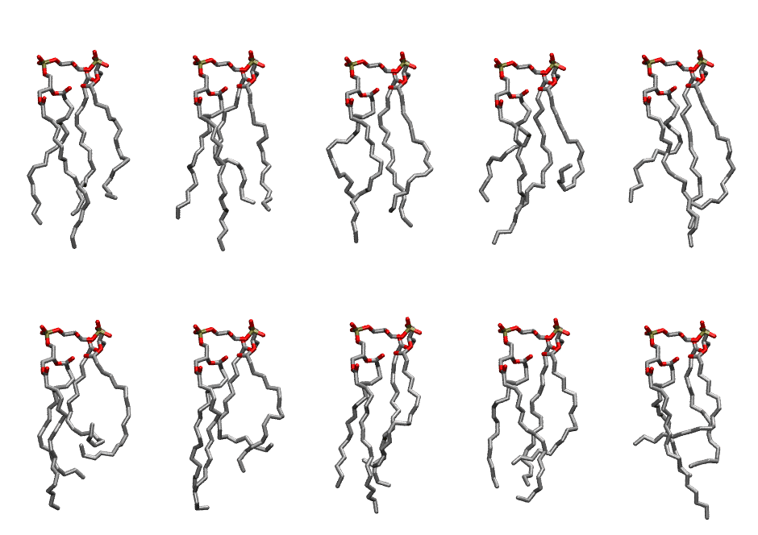

.. _lipid_gallery lnbcl2:

LNBCL2
======

**3 linoleic acid + 1 linolenic acid chains Cardiolipin with head group charge = -2**

==============  ======================================
CHARMM resname  ``LNBCL2``
Net charge      -2.00
Atoms           238
Topology file   ``toppar_all36_lipid_cardiolipin.str``
Conformers      10 fluid
==============  ======================================

Structure
---------

Conformers
----------

The grid packer draws a conformer per lipid from this ensemble, so what the ensemble contains is what a built bilayer is made of. A leaflet declared ``phase: Lo`` generates an ordered ensemble when a build first needs it. All conformers are rendered at one shared scale.

=============  =============  ================  ================
Conformer      Head-tail (Å)  Max internal (Å)  Min chain extent
=============  =============  ================  ================
``LNBCL2-00``  13.14          27.31             0.68
``LNBCL2-01``  13.71          27.57             0.75
``LNBCL2-02``  12.78          27.37             0.63
``LNBCL2-03``  8.45           27.36             0.47
``LNBCL2-04``  13.58          27.37             0.66
``LNBCL2-05``  7.43           26.30             0.47
``LNBCL2-06``  10.18          27.28             0.60
``LNBCL2-07``  12.53          26.91             0.66
``LNBCL2-08``  12.76          26.45             0.67
``LNBCL2-09``  9.90           27.39             0.53
=============  =============  ================  ================

*Min chain extent* is how far the least-extended acyl chain descends below its own attachment carbon, as a fraction of that chain's all-trans contour; an all-trans chain scores 1.0, and a conformer under 0.25 is rejected at generation as folded.

Provenance
----------

How the ensemble was generated, read from the entry's own ``info.yaml``:

===================  ============
Setting              ``LNBCL2``
===================  ============
Sampler              ``mc``
Phase                none (fluid)
Trans bias           0.0
Chain order          0.202
MC seed              0
Chains               4
Cylinder APL         120.0 Ų
Cylinder inflation   1.9
Equilibration steps  20000
Decorrelation steps  3000
Max MC angle         30°
Radius scale         0.8
Axial bias           1.0
===================  ============
