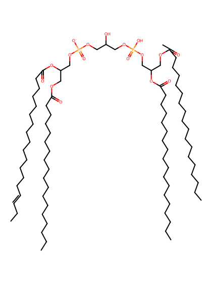
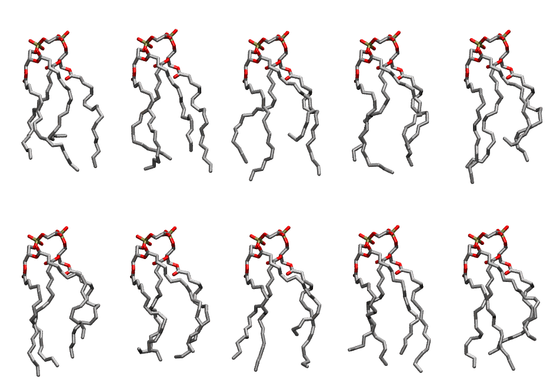

.. _lipid_gallery lnccl1:

LNCCL1
======

**3 Linoleic acid + 1 linolenic acid cardiolipin with head group charge = -1**

==============  ======================================
CHARMM resname  ``LNCCL1``
Net charge      -1.00
Atoms           239
Topology file   ``toppar_all36_lipid_cardiolipin.str``
Conformers      10 fluid
==============  ======================================

Structure
---------

Conformers
----------

The grid packer draws a conformer per lipid from this ensemble, so what the ensemble contains is what a built bilayer is made of. A leaflet declared ``phase: Lo`` generates an ordered ensemble when a build first needs it. All conformers are rendered at one shared scale.

=============  =============  ================  ================
Conformer      Head-tail (Å)  Max internal (Å)  Min chain extent
=============  =============  ================  ================
``LNCCL1-00``  8.84           25.13             0.59
``LNCCL1-01``  11.49          25.52             0.68
``LNCCL1-02``  8.64           26.64             0.58
``LNCCL1-03``  10.87          24.79             0.67
``LNCCL1-04``  9.47           27.59             0.62
``LNCCL1-05``  9.86           26.55             0.64
``LNCCL1-06``  11.69          22.85             0.63
``LNCCL1-07``  9.44           26.62             0.62
``LNCCL1-08``  12.07          25.17             0.56
``LNCCL1-09``  10.29          26.10             0.62
=============  =============  ================  ================

*Min chain extent* is how far the least-extended acyl chain descends below its own attachment carbon, as a fraction of that chain's all-trans contour; an all-trans chain scores 1.0, and a conformer under 0.25 is rejected at generation as folded.

Provenance
----------

How the ensemble was generated, read from the entry's own ``info.yaml``:

===================  ============
Setting              ``LNCCL1``
===================  ============
Sampler              ``mc``
Phase                none (fluid)
Trans bias           0.0
Chain order          0.142
MC seed              0
Chains               4
Cylinder APL         120.0 Ų
Cylinder inflation   1.9
Equilibration steps  20000
Decorrelation steps  3000
Max MC angle         30°
Radius scale         0.8
Axial bias           1.0
===================  ============
